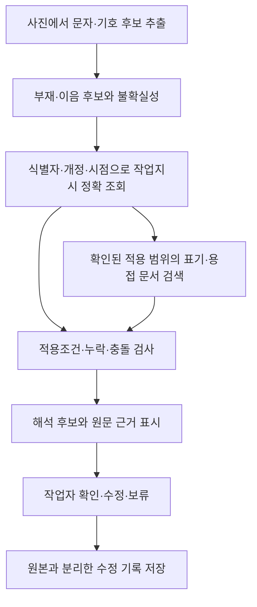

# ContextWeld 개발 기획 — 공개 자료와 작업 맥락 RAG

> **2026-10-10 현재 기준: [데모 스펙](DEMO_SPEC.md).** 아이디어 피칭을 위해 반사·재촬영 한 장면의 실제 모델·문서 근거·모의 전달 연결을 우선한다. 필요한 작은 원문 코퍼스 구축과 소량 입력의 기능 확인·오류 기록을 포함하며, 엄밀한 OCR 비교·독립 평가·정량 정확도 합격선은 후속 선택이다. Runpod에서 실행·기록하고 로컬 관리자 화면은 읽기 전용으로 조회·재생한다. 사용자 수정은 별도 저장하고 명시적 요청에 한해 새 실행으로 재검토한다. 다른 작업의 수정 이력 자동 참조·학습·재전송은 제외한다. 인식은 [OCR 구성](OCR_PIPELINE_SPEC.md), 자료 구축은 [문서 적용 계획](DOCUMENT_APPLICATION_PLAN.md), 출력은 [제조사 입력 명세](WELDING_ROBOT_INPUT_SPEC.md)를 따른다. 문서 정합은 제품 구현 완료를 의미하지 않는다.

최초 작성일: 2026-10-08. 현재 범위 정합일: 2026-10-10. 2절의 외부 자료 조사·접근 확인일: 2026-10-06. 외부 출처의 최신 확보 상태는 [참고 자료](SOURCES.md)에 별도로 기록한다.

이 문서는 기업의 상세 데이터가 제공되지 않는 상황에서 자료를 확보하고 인식·해석을 검증할 방법을 설명한다. 자료 조사 당시의 사실과 현재 구현 요구사항을 구분한다. 이번 정합에서 외부 자료를 다시 열람·다운로드한 것은 아니다.

`dev`는 초기 문서 상태인 `main`에서 시작했다. 이전 `spike-demo`의 코드·가상 규칙·평가 결과는 새 구현의 기준으로 승계하지 않는다. 이 문서의 기능과 데이터 규모는 계획이며, 새 구현이나 성능 측정이 완료됐다는 뜻이 아니다.

현재 구현: [첫 장면](FIRST_SCENE.md)의 후보→유효 작업지시 연결 CLI와 가상 예제·동작 테스트를 추가했다. 제품의 사진 OCR 연결·문서 RAG는 아직 없다. 2026-10-09 별도 [실험실](../experiments/README.md)에 계획과 E1-001~004 인식 비교, E2-001/002 문서 제공 비교, E4-001 연결 및 E5-001 출력 검사 파일럿을 정리했다. [통합 레포트](../experiments/REPORT-2026-10-09.md)를 참고한다. 아래 전체 목표와 부분 구현을 구분한다.

## 1. 목표와 완성 범위

**실제 모델로 사진의 표기를 읽고, 해당 작업과 문서 근거를 연결해, 재촬영·확인·모의 전달의 판단 과정이 기록되는 프로토타입을 만든다.**

[추론] 공개 이미지로 인식을 시험하고 공개 문서로 근거 검색을 구현하며, 운영 데이터는 일관된 가상 작업 묶음으로 구성하면 제한된 범위의 전체 흐름을 검증할 수 있다. 기업 자료를 받으면 표기사전·작업지시·적용 기준을 교체하는 구조를 목표로 한다.

| 영역 | 개발 목표 | 공개 자료만으로 확인할 수 없는 부분 |
|---|---|---|
| 이미지 인식 | 문자·영역·복수 후보와 실제 출력을 보존하고 시나리오·소량 입력에서 기능 확인 | 대상 조선소 촬영 조건과 수기 전반의 성능 |
| 표기 해석 | 지원하는 표기 종류를 명시하고 구조화 | 기업 고유 약어와 비공식 표기 관행 |
| 문서 RAG | 원문을 수집·추출·검수한 뒤 적용 범위 안의 조항·표·페이지를 검색하고 해석에 연결 | 특정 현장에 대한 문서의 승인·적용 여부 |
| 작업 맥락 | 프로젝트·부재·이음·개정·시점에 맞는 작업지시를 정확 조회 | 실제 작업 진행 상태와 생산시스템 연동 |
| 조건 후보 | 적용조건을 대조하고 관련 문서 후보·누락 항목 표시 | 현장 실행조건의 승인·최적화 |
| 확인·추적성 | 수정·보류·근거·버전을 함께 기록 | 실제 작업자의 운영 절차와 실무 효과 |

실제 용접·실기 로봇 제어, 임의의 현장 표기 전체 지원, 모델 학습, 전사 생산시스템 연동은 제외한다. 시뮬레이터의 촬영용 팔 이동과 모의 명령 수신은 데모 범위다. 기존 데모의 라벨 문법이나 가상 프로그램 번호를 실제 현장 규칙으로 사용하지 않는다.

## 2. 공개 자료 조사 결과

아래 규모는 별도 명시가 없으면 배포자의 설명 기준이다. 다운로드 경로 확인, 원본 다운로드, 개별 샘플 검수는 서로 다른 단계다.

| 자료 | 내용·규모 | 10월 6일 확인 수준 | 활용 및 한계 |
|---|---|---|---|
| [Steel OCR Dataset](https://huggingface.co/datasets/iput-tk230215/steel-ocr-dataset) | 철골 손글씨 제품코드, 문자·영역 정답. 학습·검증 319장, 테스트 14장. MIT 표기 | 데이터 카드와 파일 목록 확인. 전체 이미지 다운로드·품질 검수는 미실시 | 우선적인 실제 이미지 인식 평가 후보. 조선 용접기호나 작업 의미 정답은 없음 |
| [Steel OCR 960px](https://huggingface.co/datasets/iput-tk230215/steel-ocr-dataset-960) | 긴 변 960px의 경량판, 약 182MB | 데이터 카드 확인 | 초기 실험 후보. 원본판과 구성 차이가 있어 버전·분할을 고정해야 함 |
| [MPSC / SynthMPSC](https://github.com/TongkunGuan/RFN/blob/main/IndustrialTextDataset.md) | 금속 표면 문자. 실제 이미지 학습 2,555장·테스트 639장, 합성 98,962장 | 저자 배포 안내와 Google Drive·Baidu 경로 확인. 전체 다운로드 미실시 | 반사·부식·오염·저대비에 대한 보조 평가. CC BY-NC 4.0 및 학술 연구 이용 안내. 시연·재배포 가능 범위는 [확인 필요] |
| [한국선급 2026 규칙](https://www.krs.co.kr/KRRules/KRRules2026/KRRulesK.html) 제2편 재료 및 용접 | 규칙과 적용지침, 용접시공·절차 관련 내용 | 공식 PDF 361쪽 다운로드 및 한국어 본문 추출 확인. 전체 내용 검수는 미실시 | 국문 RAG 중심 후보. 필요한 절을 선별하고 정오표·유효 회보·적용 시점을 확인해야 함 |
| [TWI 용접기호 해설](https://www.twi-global.com/technical-knowledge/job-knowledge/weld-symbols) | 도면 기호, 치수, 표준별 표현 차이 | 웹 본문 확인 | 제한된 기호 사전의 근거. 기업 현장 약어를 보장하지 않음 |
| [KOBELCO 조선용 용접재료 안내](https://www.kobelco-welding.jp/products/recommended-materials/index.html) | 선박 부위·이음·자세·용접법·소모재의 대응표 | 웹 본문 확인 | 작업 맥락에 따라 참고 문서가 달라지는 사례. 특정 현장의 승인조건은 아님 |
| [LANL WPS 3501-xxxx-1](https://engstandards.lanl.gov/esm/welding/welding_specs/3501-xxxx-1.pdf) | 재질·적용범위·자세·가스·용접 변수 표가 기입된 WPS | 2쪽 다운로드·본문 추출·페이지 시각 확인 | 문서 추출과 적용조건 대조 시연. 조선소 적용 여부는 별도이며 관련 절차 문서도 참조해야 함 |
| [LANL 용접 문서·양식](https://engstandards.lanl.gov/ESM_Ch13.shtml) | WPS, 작업별 용접기법서(WTS), 검사·절차 자료 | 공개 목록·설명 확인. 일부 WPS 링크는 내부 도메인 | 운영 문서 항목 설계의 참고. 모든 링크를 공개 원문으로 간주하지 않음 |
| [조선소 공정 비교 데이터](https://zenodo.org/records/14591358) | 조선소 공정 비교 자료 | 설명은 공개, 실제 파일은 접근 제한 확인 | 즉시 사용할 데이터에서 제외 |

이번 조사에서는 조선소 사진·표기 의미·작업계획·적용 WPS·최종 판단이 연결된 공개 평가셋을 확보하지 못했다. 그런 데이터가 존재하지 않는다고 단정하지는 않는다.

### 수집 순서와 이용 범위

1. Steel OCR의 개발용 이미지 일부와 정답을 확보해 대상 장면과의 유사성, 인식 난도, 라벨 품질을 확인한다. 최종 평가 분할은 개발 중 오류 수정에 사용하지 않는다.
2. TWI의 필요한 기호 설명, 한국선급의 관련 절, 공개 WPS 예제를 선별한다. 원문을 대량 수집하기 전에 이용·가공·시연·재배포 조건을 기록한다.
3. 한국선급 자료는 규칙과 적용지침을 구분하고 적용 판본·회보·정오표를 확인한다. 제조사 권장표와 다른 국가·기관의 WPS는 별도 적용 범위를 부여한다.
4. MPSC는 이용 범위와 실제 다운로드 가능성을 확인한 후 보조 평가에 추가한다. 확보 지연 시 필수 개발을 막는 의존성으로 두지 않는다.

자료별로 출처 URL, 발행·개정일, 수집일, 버전 또는 해시, 이용 조건, 실제·합성 구분, 검수 상태를 기록한다. 공개 열람 가능 여부와 원문 재배포 가능 여부는 구분한다. 원문 파일은 [데이터 관리 원칙](../data/README.md)에 따라 관리한다.

## 3. 현재 작업·문서 근거·수정 기록의 역할

| 맥락 종류 | 답해야 하는 질문 | 확보 방법 | 처리 방식 |
|---|---|---|---|
| 일반 지식 | 기호·치수·용어의 의미가 무엇인가? | 공개 해설·선급·제조사 기술자료 | 문서 RAG |
| 적용 기준 | 이 재질·두께·자세에 어떤 절차를 검토해야 하는가? | 공개 WPS로 개발, 기업 승인 WPS로 교체 | 구조화 조건 필터 + 문서 검색 |
| 현재 작업 | 해당 부재의 유효 도면과 작업 상태는 무엇인가? | 가상 부재대장·작업지시·변경기록, 이후 기업 CSV·문서 | 식별자·버전·시간 기준의 정확한 조회 |
| 사용자 수정 기록 | 어느 실행의 어떤 필드를 왜 수정했는가? | 명시적 수정 입력으로 별도 기록 생성 | 감사·조회 및 명시적 새 실행의 입력. 일반 RAG·다른 작업 자동 참조에서 제외 |

**RAG는 확보한 맥락을 찾아주는 수단이다. 현재 작업 상태나 기업 고유 규칙의 부재를 검색만으로 해결할 수는 없다.**

`B-108`과 `B-103`은 문자가 비슷하더라도 다른 부재다. 문서 유사도만으로 연결하지 않는다. 이미지에서 부재 식별이 모호하면 복수 후보를 유지하며, 관련 없는 작업지시로 인식 결과를 덮어쓰지 않는다.

## 4. 제안 시스템 구조

아래는 인식·맥락 처리의 역할 구분이다. 전체 촬영·재생 흐름은 데모 스펙을 따른다. 실제 문서 구축, 정확한 작업 조회, 적용 범위를 제한한 RAG, 소량 입력의 인식·관계 기능 확인은 현재 범위다. 구체 모델·검색 구성은 소량 기능 확인으로 정하고, 청킹·재순위화 고도화와 모델 비교는 필요할 때만 추가한다. 성능 우세는 아직 검증되지 않았다.

### 인식과 의미 구조화

- 이미지 영역, 인식 원문, 복수 후보, 인식기 정보와 점수를 보존한다. 점수를 검증된 정답 확률로 표현하지 않는다.
- 초기 지원 범위는 부재번호·이음번호와 제한된 용접기호·치수로 정한다. 임의의 사진에 시연용 라벨 문법이 있다고 가정하지 않는다.
- 지원하지 않는 표기와 판독 불가는 별도 상태로 남긴다. 일반 용어의 의미와 현장 약어의 의미를 혼합하지 않는다.
- 초기 OCR·VLM 구성과 계약은 [OCR 명세](OCR_PIPELINE_SPEC.md)를 따른다. 시나리오와 소량 입력으로 실행성·인식 출력·관계·오류를 확인해 데모 구성을 정한다. 대규모 정확도 최적화나 독립 평가를 선행 조건으로 두지 않는다. 모델 공개·규모나 단일 성공으로 일반 신뢰성을 주장하지 않는다.

### 문서 수집과 검색

- 규칙 문서는 조항·제목 단위로 분할하며 표의 제목·열 이름·단위·주석과 그림 참조를 유지한다. 그림이 의미를 결정하는 기호는 원본 영역도 연결한다.
- WPS는 원문과 별도로 공정, 모재, 두께 범위, 자세, 소모재, 가스, 버전, 적용 범위를 구조화한다. 숫자는 값·단위·표의 행·열·원문 위치를 함께 보존한다.
- 설명 검색은 문서 범위 필터와 키워드 검색을 기준선으로 두고 다국어 의미 검색 결합을 비교한다. 검색 엔진·임베딩·재순위화 모델은 미정이다. 부재번호·문서번호·개정의 정확한 일치는 별도로 처리한다.
- 검색 후에도 관련성 점수와 적용 가능성은 구분한다. 검색 결과가 있다는 이유로 조건을 확정하지 않는다.
- 서로 다른 기관·표준 체계의 문서를 하나의 승인조건으로 합치지 않는다. 충돌 시 출처와 적용 범위를 나란히 보여준다.
- 초기 코퍼스는 지원 기호 해설 원문, 값이 기입된 공개 WPS, 같은 부재·이음에 연결된 모사 도면·작업지시, 모의 제조사 프로파일을 포함한다. 수량은 지원 질문과 검증 사례를 정한 뒤 고정한다. 과거의 30~50개 조항·WPS 2~3개 제안은 현재의 필수 수량이나 확보량이 아니다.
- 텍스트 PDF의 본문·표 추출과 스캔 페이지의 문서 OCR을 구분한다. 철판 사진 OCR과 같은 정확도·설정으로 취급하지 않는다. 원문·추출물·검수 결과·색인·출력 필드가 이어져야 적재 완료로 본다.

### 작업 데이터와 수정 기록

| 자료 | 최소 기록 항목 |
|---|---|
| 문서 | 문서 ID, 출처, 개정, 유효 시점, 적용 범위, 페이지·조항, 실제·가상 구분 |
| 부재·이음 | 프로젝트·블록·부재·이음 ID, 재질·두께, 도면 ID·버전 |
| 작업지시 | 작업 ID, 대상, 참조 도면·WPS, 예정·진행·완료·보류·취소 상태, 유효 시점 |
| 변경지시 | 대상 문서·작업, 이전·이후 버전, 변경 내용, 적용 시점, 승인 상태 |
| 확인 이력 | 대상·버전, 관측과 판단, 수정 전후, 이유, 확인 역할, 기록 시점·적용 범위 |

예정 상태를 완료로 간주하지 않는다. 해당 작업의 분석 시점 이후 지시나 취소된 지시를 현재 확정 근거로 사용하지 않는다. 사용자 수정 기록은 같은 범위라도 자동 검색·자동 반영하지 않는다. 명시적 재검토에서 선택된 수정만 출처가 드러나는 새 입력으로 사용하고, 원본 결과·기존 명령을 보존한다. 수정으로 조건 검사를 건너뛰거나 명령을 자동 재전송하지 않는다.

### 출력과 확인

로컬 관리자 화면은 내려받은 실행 묶음의 원본 영역, 사진에서 읽은 값, 작업지시 값, 문서 기준, 불일치·누락, 최종 후보를 구분해 조회·재생한다. 근거를 누르면 번들에 포함한 원문 위치·허용된 발췌를 확인할 수 있도록 한다. 외부 링크는 보조이며 오프라인 필수 근거의 유일한 공급원이 되어서는 안 된다. 수정·재검토 입력은 로컬 읽기 전용 재생과 분리하며 입력 위치는 데모 스펙의 미정 항목에서 관리한다.

용접 수치는 적용 가능한 문서의 명시된 행에서 가져온 경우에만 단위·출처와 함께 표시한다. 공개 문서의 예제값과 실제 현장 실행조건은 구분하며, 근거가 없거나 적용성이 확인되지 않으면 후보·참고 또는 확인 필요 상태로 남긴다. 작업자 확인도 실제 용접 실행 승인을 대신하지 않는다.

## 5. 자체 제작 작업 묶음

개별 예시에 임의 맥락을 붙이는 방식에서 벗어나, 같은 부재가 도면·작업지시·개정에 일관되게 등장하는 작은 작업 묶음을 만든다. 시뮬레이션 통합 장면 하나를 우선하고, 필요하면 소량 기능 확인 자료를 추가한다. 아래 수량은 10월 8일의 탐색 제안 이력이며 현재 필수 수량·확보량이 아니다.

| 자료 | 과거 제안 규모 | 현재 활용 범위 |
|---|---:|---|
| 부재·이음 대장 | 부재 10개, 이음 20개 | 식별자, 재질, 두께, 위치, 연결 도면 |
| 모사 도면·표기사전 | 표기 유형 5종 안팎 | 부재·이음번호, 제한된 기호·치수, 의미와 근거 |
| 작업지시서 | 10건 | 작업 대상, 참조 도면·기준, 예정 상태 |
| 변경·보류 지시 | 5건 | 변경 내용, 버전, 유효 시점 |
| 확인·수정 이력 | 10건 | 원본 보존·명시적 재검토·자동 참조 금지의 기능 검증용 |
| 전체 흐름 평가 | 30건 안팎 | 정상·모호·충돌·누락·오래된 지시·잘못된 이력 |

현재 수량은 별도로 고정한다. 먼저 부재·작업·상태 전이를 정의한 뒤 그 정보에서 모사 문서를 작성한다. 문서마다 독립적으로 내용을 생성하지 않는다. 생성한 초안의 항목 간 일관성을 검사하고, 도메인 판단의 근거와 검토 상태를 기록한다.

| 데이터 구성 | 표기·평가 원칙 |
|---|---|
| 공개 철골 사진과 원래 문자 정답 | 실제 공개 이미지의 인식 평가에 사용 |
| 공개 사진에 가상 작업계획 연결 | 사진은 공개 자료, 연결 관계와 계획은 가상이라고 표시 |
| 자체 작성 표기를 직접 촬영 | 자체 제작 모사 장면으로 표시. 인식부터 판단까지 연결 검증 |
| 그림·문자 합성 이미지 | 합성임을 표시하고 실제 이미지 결과와 분리 |
| 앱에서 생성한 확인 이력 | 실제 앱 동작 기록이지만 모사 작업의 이력임을 표시 |

## 6. 핵심 시나리오

| 상황 | 기대 동작 |
|---|---|
| 선명한 표기, 유효 계획·기준 일치 | 대상과 관련 근거를 연결하고 후보 제시 |
| 문자·치수 복수 후보 | 맥락으로 좁힌 근거와 남은 불확실성을 표시 |
| 사진과 계획 불일치 | 사진 값을 계획에 맞춰 덮어쓰지 않고 충돌 표시 |
| 재질·두께·적용 기준 누락 | 부족한 항목을 알리고 조건 확정 보류 |
| 이전 버전·취소된 지시 검색 | 현재 유효한 지시와 구분하고 확정 근거에서 제외 |
| 사용자 수정 또는 다른 작업의 수정 이력 | 저장만으로 추론 입력이 바뀌지 않음. 명시적 요청에 선택된 수정만 새 실행으로 재검토 |
| 올바른 문서가 검색 결과에 없음 | 그럴듯한 설명을 생성해 확정하지 않고 근거 부족 표시 |

## 7. 기술 선택을 위한 탐색 실험 계획

### 7.1 목적과 진행 방식

**작은 샘플로 실행 가능성과 실패 원인을 확인하고, 피칭 시나리오의 실제 연결을 먼저 완성한다.** 아래 비교 실험은 필요한 경우 선택하는 후속 작업이며 전부 완료할 필요가 없다. 한 시연의 A/B 성공은 그 시연의 동작 증거로 사용하고 일반 정확도의 증거로 확대하지 않는다.

이 절은 비교 실험의 계획이다. 2026-10-09 E1-001에서 공개 이미지 10장의 채점 대상 28개 표기에 같은 OCR의 전체 이미지/정답 영역 조건을 비교했다. 완전 일치는 양쪽 모두 0/28이었다. 후속으로 Vision/RapidOCR·방향 처리를 비교했고 E2 문서 제공·E4 가상 연결·E5 구조 검사 파일럿도 수행했다. E3·E6·E7과 독립 현장 평가는 미실행이다. 상세 실행 계획과 결과는 [실험실](../experiments/README.md)에서 관리한다. 4절의 세부 기술 선택은 변경 가능하지만 현재 요구사항과 제외 범위는 유지한다. 초기에 생각한 구조를 나중에 실험에서 처음 발견한 것처럼 서술하지 않는다.

- 먼저 가장 궁금한 질문 하나를 고르고, 가진 자료 몇 건으로 두 가지 방식을 비교한다.
- 탐색 중에는 프롬프트·자료·구현을 자유롭게 고친다. 바꾼 내용과 관찰을 짧게 남긴다.
- 아래 실험을 전부 수행할 필요는 없다. 필요한 비교만 선택하고, 단순한 방식으로 충분하면 거기서 멈춘다.
- 데모 구성은 시나리오·소량 입력의 결과로 선택할 수 있다. 일반 성능이나 모델 우세를 주장하려는 경우에 별도 원본 사례 평가를 추가한다.
- 원본·근거 보존과 작업자 확인은 제품 요구사항이다. 특정 모델·검색기·저장 방식의 성능 우세와는 구분한다.

### 7.2 바로 시작할 수 있는 작은 실험

아래 규모는 가벼운 출발 예시이며 필수 수량이 아니다. 자료가 확보되는 순서에 맞춰 바꿔도 된다.

| 궁금한 점 | 먼저 준비할 것 | 간단한 비교 | 먼저 볼 결과 |
|---|---|---|---|
| 공개 철골 사진을 얼마나 읽나? | 이미지 5~10장과 문자 정답 | OCR, 필요하면 같은 이미지의 VLM 결과 | 어떤 문자·기호를 틀리는지, 없는 내용을 만드는지 |
| 문서를 주면 해석이 나아지나? | 짧은 문서 몇 개와 질문 5개 안팎 | 문서 없음 / 전문 제공 / 검색해서 제공 | 답과 근거가 맞는지, 검색이 꼭 필요한지 |
| 작업 맥락이 도움이 되나? | 같은 사진에 정상·오래된·다른 부재의 작업지시 | 문서 검색만 / 대상·버전 조건을 적용한 조회 | 후보를 잘 좁히는지, 잘못된 지시를 따르는지 |

앱 화면 없이도 이미지 입력, 간단한 스크립트, 결과 메모로 시작할 수 있다. 검색 효과를 볼 때는 손으로 확인한 문자 입력을 사용해 인식 오류를 잠시 제외해도 된다. 이후 실제 이미지 입력으로 연결했을 때 결과가 유지되는지 확인한다.

### 7.3 기술 선택별 실험 후보

각 가설은 검증할 질문이며 결론이 아니다. 우선순위는 자료·관찰 결과에 따라 바꾼다.

| ID·선택 | 확인할 가설 | 비교 후보 | 비교할 때 맞출 조건 | 관찰 후 가능한 결정 |
|---|---|---|---|---|
| E1 인식 방식 | 문자에는 OCR이 충분하고 일부 기호·관계에는 VLM이 도움이 될 수 있다 | OCR + 구조화 / VLM 직접 구조화. 필요하면 어려운 입력에만 VLM 사용 | 같은 이미지·출력 항목. 최초 시각 관측에는 작업 정답·문서 근거를 주입하지 않음 | OCR 유지, VLM 선택, 특정 표기만 추가 처리 |
| E2 문서 제공 방식 | 실제 원문 묶음에서 제한된 검색이 필요한 근거를 제공하는지 확인한다 | 문서 없음 / 전문 제공 / 검색 후 제공 | 같은 질문·문자 입력·생성 모델. 전문과 검색은 같은 자료집 사용 | 전문 제공은 비교 기준선으로 유지하고 현재 RAG 구성의 누락·생성 오류를 보완 |
| E3 분할·검색 방식 | 조항·표를 보존하거나 검색 방식을 바꾸면 필요한 근거를 더 잘 찾을 수 있다 | 먼저 같은 검색기에서 고정 길이 / 조항·표 단위 분할. 이후 같은 분할에서 키워드 / 의미 / 결합 검색 | 한 번에 분할과 검색 중 하나만 변경. 상위 결과 수·입력량 기록 | 단순 검색 유지, 표 처리 보완, 필요한 경우 검색 결합 |
| E4 작업 맥락 조회 | 부재·버전·시점 조건이 관련 없는 지시의 적용을 줄일 수 있다 | 전체 작업 문서 검색 / 같은 자료에서 대상·버전·시점 필터 적용 | 같은 자료·질문·검색기·메타데이터, 필터 여부만 변경 | 정확한 조회키·자료 누락을 보완하고 모호한 ID는 복수 후보 유지 |
| E5 조건 검사 | 명시적인 충돌·누락 검사가 잘못된 확정을 줄일 수 있다 | 동일 모델 결과 / 그 결과에 조건 검사 추가 | 같은 인식·근거·모델 출력을 재사용 | 검사 추가·수정. 불필요한 보류가 많으면 규칙 재검토 |
| E6 과거 이력 참조 가설 | 10월 8일 제안이며 현재 범위 제외 | 자동 참조 비교를 이번 구현의 필수 실험으로 수행하지 않음 | 기존 계획·보고서는 역사적 자료로 보존 | 현재는 별도 기능 검사로 수정 저장·명시적 재검토·자동 학습/재전송 금지를 검증 |
| E7 통합 확인 | 개별 실험에서 좋았던 선택이 연결 후에도 도움이 될 수 있다 | 단순 기준선 / 현재 후보 구조. 필요하면 구성요소를 하나씩 제거 | 같은 실제 이미지와 작업 사례 | 구조 유지·단순화, 앞 단계 오류가 전파되는 부분 수정 |

E1에서 모델까지 달라지면 시험한 구성의 차이로 해석한다. E2에서 전문이 입력 한도를 넘으면 그 사실을 기록하고, 몰래 잘라낸 문서와 비교하지 않는다. E3는 근거를 잘 찾는 것과 최종 판단을 잘하는 것을 따로 본다. 작은 자료집에서 단순 방식이 잘 되면 복잡한 구조를 미리 넣을 이유가 없다.

### 7.4 데이터와 결과를 해석할 때

처음에는 개발용 공개 이미지와 자체 제작 사례로 시작한다. 문자 정답은 배포 라벨 또는 직접 확인한 원본을 사용하고, 문서 답변은 원문과 대조한다. 도메인 정답이 모호하면 억지로 맞음·틀림을 정하지 않고 [확인 필요]로 남긴다.

공개 실제 이미지, 자체 촬영, 합성 장면, 가상 작업 맥락의 결과를 구분한다. 같은 사진의 변형이나 같은 작업에서 파생한 사례가 여러 개면 독립적인 현장 사례 여러 건으로 세지 않는다.

정답표·사례별 최종 판정·미래 수정 이력을 검색 대상에 넣지 않는다. 다만 판단에 필요한 정상적인 작업지시와 규칙 문서는 제공할 수 있다. 탐색 결과를 보고 수정한 사례는 개발 사례로 취급한다. 향후 독립 성능을 주장할 때는 같은 원본·작업 묶음의 파생 사례가 아닌 별도 자료를 사용한다.

### 7.5 가볍게 남길 관찰과 선택 이유

처음부터 모든 지표를 자동화할 필요는 없다. 실험 질문에 맞는 항목을 골라 표나 메모로 기록한다.

| 볼 항목 | 기록 방법 |
|---|---|
| 문자·필드 정답 | 맞힌 수 / 전체 수와 대표 오류 |
| 근거 검색 | 필요한 조항·표 행을 찾았는지. 여러 근거가 필요하면 모두 찾았는지도 구분 |
| 잘못된 확정 | 잘못된 대상·값·문서를 확정한 사례와 이유 |
| 보류 | 필요한 보류와 불필요한 보류를 나눠 기록 |
| 처리 가능 범위 | 처리한 수·보류한 수·전체 수를 같이 기록 |
| 시간·복잡도 | 실제 소요시간, 실행 환경, 추가 설정·실패 요인 |

항상 보류해서 잘못된 확정만 줄인 결과는 개선으로 보지 않는다. 정상 사례가 악화되는지도 함께 본다. 출력이 흔들리는 경우 같은 입력을 몇 번 반복해 확인하되 반복 실행을 새 독립 사례로 세지 않는다. 자동 채점을 만들게 되면 이미 정답을 아는 사례로 계산부터 확인한다.

이번 데모에는 통계적 우세나 정량 정확도 통과선을 요구하지 않는다. 지원 필드·시나리오 기대 흐름·오류/보류 처리만 명시하고 실제 결과를 기록한다. 모델 선택은 실행성·설명 가능성·개발 부담을 포함해 정하고, 일반 성능 결론은 보류할 수 있다. 관측 오류가 없었다고 실제 현장 오류가 없다고 주장하지 않는다.

실험 메모는 아래 정도로 시작한다. 별도의 실험 관리 시스템은 필요해질 때 만든다.

| 항목 | 남길 내용 |
|---|---|
| 질문·비교 | 무엇이 궁금했고 무엇을 바꿨는지 |
| 입력·조건 | 사례 ID·출처, 사용 문서, 모델·프롬프트·설정의 식별 가능한 버전 |
| 관찰 | 출력·근거, 맞고 틀린 부분, 시간·실패 |
| 결정 | 유지·교체·보류와 이유, 다음에 확인할 것 |

### 7.6 결과를 아키텍처와 발표에 연결하기

발표를 위해 실험을 과도하게 늘리지 않는다. 실제로 수행한 비교 중 선택에 영향을 준 것만 ‘초기 가설 → 관찰한 문제 → 비교 결과 → 최종 선택’으로 정리한다. 처음 세운 가설과 실제 선택을 구분하면 된다.

| 아키텍처 선택 | 연결할 실험 | 현재 상태 |
|---|---|---|
| OCR / VLM / 선택적 추가 인식 | E1 | E1-001~004 진단 완료. 초기 OCR·VLM 구성은 OCR 명세에 기록, 실제 채택 검증은 미완료 |
| 문서 전문 / RAG | E2 | 140단어 요약집 비교만 완료. 실제 원문·표·개정 코퍼스 검증은 미완료. 전문 제공은 비교 기준선이며 제한된 RAG는 현재 구현 범위 |
| 문서 분할·검색 방식 | E3 | 미측정·제안 단계 |
| 부재·버전·시점별 작업 조회 | E4 | 실제 OCR→가상 지시 연결 파일럿 완료. 검색 대안 비교 미실행 |
| 조건·충돌·누락 검사 | E5 | 구조·출처 검사 파일럿 완료. 도메인 조건 효과 미측정 |
| 과거 이력 참조 가설 | E6 | 미실행·현재 범위 제외. 수정 저장과 명시적 재검토는 별도 기능 검사 |
| 최종 통합 구조 | E7 | 미측정 |

피칭에서는 실제 실행한 입력·설정·출력·실패를 그대로 설명한다. 후속으로 일반 성능이나 모델 우세를 주장하려면 설정을 고정하고 별도 사례·표본 수·절대 건수·실패 사례를 함께 정리한다. 아직 실험하지 않은 선택은 요구사항이나 운영상 판단으로 설명하고, 탐색용 모사 사례의 결과를 현장 성능으로 확대하지 않는다.

후보 연결 코드와 가상 예제, E1·E2·E4·E5의 실행·채점 도구와 개발 표본 관찰은 준비됐다. 독립 평가 데이터와 현장·아키텍처 우세를 주장할 수 있는 결과는 아직 없다. 필요한 실험부터 추가한다.

## 8. 현재 작업 범위와 마일스톤의 관계

기존 10월 6~8일 날짜와 P0-1~P2의 확대 순서는 현재 마감이나 완료 상태가 아니다. 실행 단계 번호·의존성은 [마일스톤](MILESTONES.md) 한 곳에서 관리하며, 이번 문서에서 새 날짜나 단계 번호를 확정하지 않는다.

| 작업 축 | 현재 필요한 결과 |
|---|---|
| 지원 범위·자료 계약 | 시나리오 마킹·정답·작업지시·WPS·전달 필드, 지원 표기·단위·보류 기준 |
| 문서·현재 맥락 | 원문 확보 → 추출 → 검수 → 구조화/적재 → 정확 조회·제한된 RAG → 필드별 원문 근거 |
| 인식·관계 기능 확인 | 초기 모델의 시나리오·소량 입력 실행, 실제 출력·관계·실패·보류 기록. 엄밀한 모델 비교는 후속 선택 |
| 시뮬레이션 | 같은 장면 A/B의 실제 RGB 확보, 실제 재촬영 연동 수준의 구분 |
| 해석·전달·재생 | 근거 기반 해석·검증·모의 수신, 서버 실행 묶음, 로컬 오프라인 조회·재생 |

문서 규모·지원 기호·검색 구성은 한 시나리오의 설명 가능한 연결에 필요한 범위로 제한한다. 실제 문서 근거와 실제 모델 출력은 유지하고, 정답을 인식 결과로 바꿔 넣지 않는다. 독립 평가·정량 정확도 기준을 데모의 선행 조건으로 추가하지 않는다. 상세 모델·검색 구성은 소량 기능 확인을 거쳐 정한다.

## 9. 기업·멘토에게 요청할 최소 자료

대용량 자료보다 **익명화된 연결 사례 하나**를 우선 요청한다. 사진, 표기의 정확한 의미, 관련 작업지시나 도면 일부, 연결되는 기준, 작업자의 최종 판단이 같은 대상을 가리켜야 한다.

| 확보 가능 수준 | 활용 |
|---|---|
| 사진 + 문자·의미 정답 | 인식·구조화의 실제 현장 적합성 확인 |
| 위 자료 + 작업지시·도면 일부 | 맥락 연결과 버전 처리 확인 |
| 위 자료 + 적용 WPS·최종 판단 | 후보 선택과 근거 적합성 확인 |
| 문서 제공 불가, 시나리오 검토 가능 | 자체 가정 중 실제와 다른 부분·반례 확인 |
| 자료·검토 모두 불가 | 공개 인식 평가와 모사 흐름 검증으로 결과 범위 한정 |

외부 모델 처리, 시연, 결과 공개 가능 범위도 자료와 함께 확인한다. 기업·멘토에게 실제 연락하거나 자료 제공을 요청하는 행위는 이 문서 작성에 포함되지 않는다.

## 10. 완료 판정과 남은 확인

전체 데모의 완료는 [데모 스펙](DEMO_SPEC.md)의 완료 조건으로 판정한다. 자료 구축·인식·해석은 시나리오의 실제 입력·실제 검색·원문 근거·필요한 보류 처리·수정 기록·명시적 재검토가 제한된 범위에서 재현되면 된다. 엄밀한 인식 정확도 비교나 독립 평가 완료는 피칭 데모의 필수 조건이 아니다. 현장 정확도, 생산성 개선, 용접 실행 적합성을 주장하려면 별도 자료와 검증이 필요하다.

- [확인 필요] 지원 표기와 대표 장면이 실제 미션의 작업 방식에 맞는지.
- [확인 필요] 공개 데이터 개별 샘플 품질 및 자료별 이용·시연·재배포 조건.
- [확인 필요] 기업 표기사전, 승인 WPS, 작업계획·변경이력의 제공 가능성.
- [확인 필요] 선급 규칙과 WPS의 실제 적용 범위·유효 판본.
- [확인 필요] 행사 최신 일정·사전 제작물 활용 규정·제출 요구사항.

현재는 자료 후보·일부 원문 접근 확인과 후보 연결의 첫 구현이 있다. 다음 목표는 피칭용 전체 흐름이며, 독립 성능 평가·현장 검증은 후속 선택이다.
