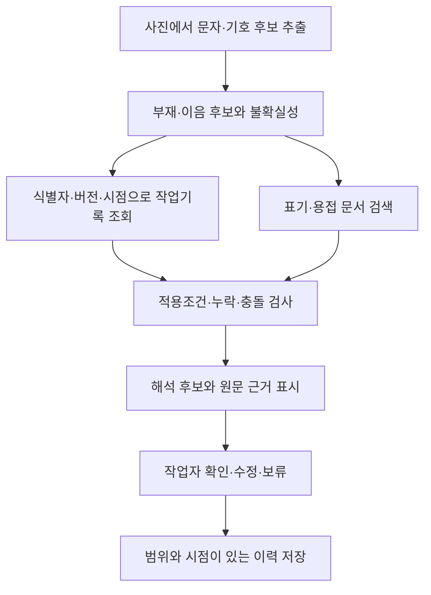

# ContextWeld 개발 기획 — 공개 자료와 작업 맥락 RAG

작성일: 2026-10-08. 외부 자료 조사·접근 확인일: 2026-10-06.

이 문서는 기업의 상세 데이터가 제공되지 않는 상황에서 개발할 범위, 자료 확보 방법, 맥락 RAG 구조, 검증 기준을 정한다. 자료 조사 결과와 구현 계획을 구분한다. 외부 자료를 10월 8일에 다시 검증한 것은 아니다.

현재 `dev`는 초기 문서 상태인 `main`에서 시작한다. 이전 `spike-demo`의 코드·가상 규칙·평가 결과는 새 구현의 기준으로 승계하지 않는다. 이 문서의 기능과 데이터 규모는 계획이며, 새 구현이나 성능 측정이 완료됐다는 뜻이 아니다.

## 1. 목표와 완성 범위

**실제 사진에서 표기를 읽고, 관련 문서와 작업기록을 찾아, 판단 근거와 작업자가 확인할 사항을 보여주는 프로토타입을 만든다.**

[추론] 공개 이미지로 인식을 시험하고 공개 문서로 근거 검색을 구현하며, 운영 데이터는 일관된 가상 작업 묶음으로 구성하면 제한된 범위의 전체 흐름을 검증할 수 있다. 기업 자료를 받으면 표기사전·작업기록·적용 기준을 교체하는 구조를 목표로 한다.

| 영역 | 개발 목표 | 공개 자료만으로 확인할 수 없는 부분 |
|---|---|---|
| 이미지 인식 | 문자·영역·복수 후보를 보존하고 실제 공개 이미지에서 평가 | 대상 조선소 촬영 조건과 수기 전반의 성능 |
| 표기 해석 | 지원하는 표기 종류를 명시하고 구조화 | 기업 고유 약어와 비공식 표기 관행 |
| 문서 RAG | 관련 조항·표·페이지를 검색하고 해석에 연결 | 특정 현장에 대한 문서의 승인·적용 여부 |
| 작업 맥락 | 부재·이음·버전·시점에 맞는 작업지시와 이력 연결 | 실제 작업 진행 상태와 생산시스템 연동 |
| 조건 후보 | 적용조건을 대조하고 관련 문서 후보·누락 항목 표시 | 현장 실행조건의 승인·최적화 |
| 확인·추적성 | 수정·보류·근거·버전을 함께 기록 | 실제 작업자의 운영 절차와 실무 효과 |

실제 로봇 제어, 임의의 현장 표기 전체 지원, 별도 인식모델 대규모 학습, 전사 생산시스템 연동은 초기 범위에서 제외한다. 기존 데모의 라벨 문법이나 가상 프로그램 번호를 실제 현장 규칙으로 사용하지 않는다.

## 2. 공개 자료 조사 결과

아래 규모는 별도 명시가 없으면 배포자의 설명 기준이다. 다운로드 경로 확인, 원본 다운로드, 개별 샘플 검수는 서로 다른 단계다.

| 자료 | 내용·규모 | 10월 6일 확인 수준 | 활용 및 한계 |
|---|---|---|---|
| [Steel OCR Dataset](https://huggingface.co/datasets/iput-tk230215/steel-ocr-dataset) | 철골 손글씨 제품코드, 문자·영역 정답. 학습·검증 319장, 테스트 14장. MIT 표기 | 데이터 카드와 파일 목록 확인. 전체 이미지 다운로드·품질 검수는 미실시 | 우선적인 실제 이미지 인식 평가 후보. 조선 용접기호나 작업 의미 정답은 없음 |
| [Steel OCR 960px](https://huggingface.co/datasets/iput-tk230215/steel-ocr-dataset-960) | 긴 변 960px의 경량판, 약 182MB | 데이터 카드 확인 | 초기 실험 후보. 원본판과 구성 차이가 있어 버전·분할을 고정해야 함 |
| [MPSC / SynthMPSC](https://github.com/TongkunGuan/RFN/blob/main/IndustrialTextDataset.md) | 금속 표면 문자. 실제 이미지 학습 2,555장·테스트 639장, 합성 98,962장 | 저자 배포 안내와 Google Drive·Baidu 경로 확인. 전체 다운로드 미실시 | 반사·부식·오염·저대비에 대한 보조 평가. CC BY-NC 4.0 및 학술 연구 이용 안내. 시연·재배포 가능 범위는 [확인 필요] |
| [한국선급 2026 규칙](https://www.krs.co.kr/KRRules/KRRules2026/KRRulesK.html) 제2편 재료 및 용접 | 규칙과 적용지침, 용접시공·절차 관련 내용 | 공식 PDF 361쪽 다운로드 및 한국어 본문 추출 확인. 전체 내용 검수는 미실시 | 국문 RAG 중심 후보. 필요한 절을 선별하고 정오표·유효 회보·적용 시점을 확인해야 함 |
| [TWI 용접기호 해설](https://www.twi-global.com/technical-knowledge/job-knowledge/weld-symbols) | 도면 기호, 치수, 표준별 표현 차이 | 웹 본문 확인 | 제한된 기호 사전의 근거. 기업 현장 약어를 보장하지 않음 |
| [KOBELCO 조선용 용접재료 안내](https://www.kobelco-welding.jp/products/recommended-materials/index.html) | 선박 부위·이음·자세·용접법·소모재의 대응표 | 웹 본문 확인 | 작업 맥락에 따라 참고 문서가 달라지는 사례. 특정 현장의 승인조건은 아님 |
| [LANL WPS 3501-xxxx-1](https://engstandards.lanl.gov/esm/welding/welding_specs/3501-xxxx-1.pdf) | 재질·적용범위·자세·가스·용접 변수 표가 기입된 WPS | 2쪽 다운로드·본문 추출·페이지 시각 확인 | 문서 추출과 적용조건 대조 시연. 조선소 적용 여부는 별도이며 관련 절차 문서도 참조해야 함 |
| [LANL 용접 문서·양식](https://engstandards.lanl.gov/ESM_Ch13.shtml) | WPS, 작업별 용접기법서(WTS), 검사·절차 자료 | 공개 목록·설명 확인. 일부 WPS 링크는 내부 도메인 | 운영 문서 항목 설계의 참고. 모든 링크를 공개 원문으로 간주하지 않음 |
| [조선소 공정 비교 데이터](https://zenodo.org/records/14591358) | 조선소 공정 비교 자료 | 설명은 공개, 실제 파일은 접근 제한 확인 | 즉시 사용할 데이터에서 제외 |

이번 조사에서는 조선소 사진·표기 의미·작업계획·적용 WPS·최종 판단이 연결된 공개 평가셋을 확보하지 못했다. 그런 데이터가 존재하지 않는다고 단정하지는 않는다.

### 수집 순서와 이용 범위

1. Steel OCR의 개발용 이미지 일부와 정답을 확보해 대상 장면과의 유사성, 인식 난도, 라벨 품질을 확인한다. 최종 평가 분할은 개발 중 오류 수정에 사용하지 않는다.
2. TWI의 필요한 기호 설명, 한국선급의 관련 절, 공개 WPS 예제를 선별한다. 원문을 대량 수집하기 전에 이용·가공·시연·재배포 조건을 기록한다.
3. 한국선급 자료는 규칙과 적용지침을 구분하고 적용 판본·회보·정오표를 확인한다. 제조사 권장표와 다른 국가·기관의 WPS는 별도 적용 범위를 부여한다.
4. MPSC는 이용 범위와 실제 다운로드 가능성을 확인한 후 보조 평가에 추가한다. 확보 지연 시 필수 개발을 막는 의존성으로 두지 않는다.

자료별로 출처 URL, 발행·개정일, 수집일, 버전 또는 해시, 이용 조건, 실제·합성 구분, 검수 상태를 기록한다. 공개 열람 가능 여부와 원문 재배포 가능 여부는 구분한다. 원문 파일은 [데이터 관리 원칙](../data/README.md)에 따라 관리한다.

## 3. 맥락을 네 종류로 나누기

| 맥락 종류 | 답해야 하는 질문 | 확보 방법 | 처리 방식 |
|---|---|---|---|
| 일반 지식 | 기호·치수·용어의 의미가 무엇인가? | 공개 해설·선급·제조사 기술자료 | 문서 RAG |
| 적용 기준 | 이 재질·두께·자세에 어떤 절차를 검토해야 하는가? | 공개 WPS로 개발, 기업 승인 WPS로 교체 | 구조화 조건 필터 + 문서 검색 |
| 현재 작업 | 해당 부재의 유효 도면과 작업 상태는 무엇인가? | 가상 부재대장·작업지시·변경기록, 이후 기업 CSV·문서 | 식별자·버전·시간 기준의 정확한 조회 |
| 확인 이력 | 관련 작업에서 무엇을 수정했고 왜 수정했는가? | 앱의 실제 승인·수정·보류 동작으로 기록 생성 | 범위를 제한한 기록 조회 + 설명 검색 |

**RAG는 확보한 맥락을 찾아주는 수단이다. 현재 작업 상태나 기업 고유 규칙의 부재를 검색만으로 해결할 수는 없다.**

`B-108`과 `B-103`은 문자가 비슷하더라도 다른 부재다. 문서 유사도만으로 연결하지 않는다. 이미지에서 부재 식별이 모호하면 복수 후보를 유지하며, 관련 없는 작업지시로 인식 결과를 덮어쓰지 않는다.

## 4. 제안 시스템 구조

### 인식과 의미 구조화

- 이미지 영역, 인식 원문, 복수 후보, 인식기 정보와 점수를 보존한다. 점수를 검증된 정답 확률로 표현하지 않는다.
- 초기 지원 범위는 부재번호·이음번호와 제한된 용접기호·치수로 정한다. 임의의 사진에 시연용 라벨 문법이 있다고 가정하지 않는다.
- 지원하지 않는 표기와 판독 불가는 별도 상태로 남긴다. 일반 용어의 의미와 현장 약어의 의미를 혼합하지 않는다.
- OCR·시각모델은 교체 가능한 구성으로 두되, 모델·라이브러리 선택은 소량 이미지의 실제 결과를 보고 결정한다.

### 문서 수집과 검색

- 규칙 문서는 조항·제목 단위로 분할하며 표의 제목·열 이름·단위·주석과 그림 참조를 유지한다. 그림이 의미를 결정하는 기호는 원본 영역도 연결한다.
- WPS는 원문과 별도로 공정, 모재, 두께 범위, 자세, 소모재, 가스, 버전, 적용 범위를 구조화한다. 숫자는 값·단위·표의 행·열·원문 위치를 함께 보존한다.
- 설명 검색은 키워드 검색을 기준선으로 두고 의미 검색을 결합하는 방식을 검토한다. 부재번호·문서번호의 정확한 일치는 별도로 처리한다.
- 검색 후에도 관련성 점수와 적용 가능성은 구분한다. 검색 결과가 있다는 이유로 조건을 확정하지 않는다.
- 서로 다른 기관·표준 체계의 문서를 하나의 승인조건으로 합치지 않는다. 충돌 시 출처와 적용 범위를 나란히 보여준다.
- 초기 자료 규모는 검토한 근거 조항 30~50개, 공개 WPS 예제 2~3개를 목표로 한다. 확보·검수 완료 수량이 아니다.

### 작업 데이터와 이력

| 자료 | 최소 기록 항목 |
|---|---|
| 문서 | 문서 ID, 출처, 개정, 유효 시점, 적용 범위, 페이지·조항, 실제·가상 구분 |
| 부재·이음 | 프로젝트·블록·부재·이음 ID, 재질·두께, 도면 ID·버전 |
| 작업지시 | 작업 ID, 대상, 참조 도면·WPS, 예정·진행·완료·보류·취소 상태, 유효 시점 |
| 변경지시 | 대상 문서·작업, 이전·이후 버전, 변경 내용, 적용 시점, 승인 상태 |
| 확인 이력 | 대상·버전, 관측과 판단, 수정 전후, 이유, 확인 역할, 기록 시점·적용 범위 |

예정 상태를 완료로 간주하지 않는다. 해당 작업의 분석 시점 이후에 생긴 기록, 취소된 지시, 다른 부재나 도면 버전의 수정 기록을 확정 근거로 사용하지 않는다. 후속 확인 기록은 문서 일반 규칙이나 모델 학습 결과로 자동 승격하지 않는다.

### 출력과 확인

화면은 원본 영역, 사진에서 읽은 값, 작업계획상의 값, 문서상의 기준, 불일치·누락, 최종 후보를 구분한다. 근거를 누르면 해당 원문 위치를 확인할 수 있도록 한다.

용접 수치는 적용 가능한 문서의 명시된 행에서 가져온 경우에만 단위·출처와 함께 표시한다. 공개 문서의 예제값과 실제 현장 실행조건은 구분하며, 근거가 없거나 적용성이 확인되지 않으면 후보·참고 또는 확인 필요 상태로 남긴다. 작업자 확인도 실제 용접 실행 승인을 대신하지 않는다.

## 5. 자체 제작 작업 묶음

개별 예시에 임의 맥락을 붙이는 방식에서 벗어나, 같은 부재가 도면·작업지시·변경·이력에 일관되게 등장하는 작은 작업 묶음을 만든다.

| 자료 | 전체 목표 규모 | 내용 |
|---|---:|---|
| 부재·이음 대장 | 부재 10개, 이음 20개 | 식별자, 재질, 두께, 위치, 연결 도면 |
| 모사 도면·표기사전 | 표기 유형 5종 안팎 | 부재·이음번호, 제한된 기호·치수, 의미와 근거 |
| 작업지시서 | 10건 | 작업 대상, 참조 도면·기준, 예정 상태 |
| 변경·보류 지시 | 5건 | 변경 내용, 버전, 유효 시점 |
| 확인·수정 이력 | 10건 | 수정 전후, 이유, 적용 범위 |
| 전체 흐름 평가 | 30건 안팎 | 정상·모호·충돌·누락·오래된 지시·잘못된 이력 |

수량은 개발 목표다. 먼저 부재·작업·상태 전이를 정의한 뒤 그 정보에서 문서를 작성한다. 문서마다 독립적으로 내용을 생성하지 않는다. 생성한 초안의 항목 간 일관성을 검사하고, 도메인 판단의 근거와 검토 상태를 기록한다.

| 데이터 구성 | 표기·평가 원칙 |
|---|---|
| 공개 철골 사진과 원래 문자 정답 | 실제 공개 이미지의 인식 평가에 사용 |
| 공개 사진에 가상 작업계획 연결 | 사진은 공개 자료, 연결 관계와 계획은 가상이라고 표시 |
| 자체 작성 표기를 직접 촬영 | 자체 제작 모사 장면으로 표시. 인식부터 판단까지 연결 검증 |
| 그림·문자 합성 이미지 | 합성임을 표시하고 실제 이미지 결과와 분리 |
| 앱에서 생성한 확인 이력 | 실제 앱 동작 기록이지만 모사 작업의 이력임을 표시 |

## 6. 핵심 시나리오

| 상황 | 기대 동작 |
|---|---|
| 선명한 표기, 유효 계획·기준 일치 | 대상과 관련 근거를 연결하고 후보 제시 |
| 문자·치수 복수 후보 | 맥락으로 좁힌 근거와 남은 불확실성을 표시 |
| 사진과 계획 불일치 | 사진 값을 계획에 맞춰 덮어쓰지 않고 충돌 표시 |
| 재질·두께·적용 기준 누락 | 부족한 항목을 알리고 조건 확정 보류 |
| 이전 버전·취소된 지시 검색 | 현재 유효한 지시와 구분하고 확정 근거에서 제외 |
| 다른 부재·버전의 확인 이력 | 적용 범위 불일치로 확정 근거에서 제외 |
| 올바른 문서가 검색 결과에 없음 | 그럴듯한 설명을 생성해 확정하지 않고 근거 부족 표시 |

## 7. 평가 계획

동일한 고정 사례에서 아래 구성을 비교한다. 비교 중에는 인식기·입력·평가 기준을 유지한다.

| 구성 | 확인할 효과 |
|---|---|
| A: 이미지 인식·해석만 | 인식·의미 구조화의 기준선 |
| B: A + 일반 문서 RAG | 기호·용어 설명과 근거 연결의 변화 |
| C: B + 작업 맥락·이력 | 후보 선택·충돌 발견의 변화 |
| C에 잘못된 맥락 주입 | 오래된 지시·잘못된 부재가 오판을 유발하는지 확인 |

| 측정 항목 | 보고 방식 |
|---|---|
| 문자·필드 정답 | 정확히 맞힌 수 / 전체 수, 오류 유형 |
| 근거 검색 | 정답 근거가 상위 k개에 포함된 수 / 대상 수. k를 사전 고정 |
| 인용 타당성 | 표시한 근거가 해당 판단을 뒷받침하는지 별도 검토 |
| 잘못된 확정 | 잘못 확정한 수 / 전체 사례와 확정 사례 수를 함께 보고 |
| 보류·처리 가능 비율 | 보류 수, 확정·후보 제시 수, 전체 수를 함께 보고 |
| 처리시간 | 측정 환경·표본 수·구간 정의를 함께 기록 |

정답표는 RAG 색인에서 제외한다. 입력 작업지시에 정상적으로 포함된 사실은 사용할 수 있지만, 최종 정답·미래 수정 이력을 미리 넣어 정답을 찾게 해서는 안 된다. 같은 원본 이미지의 변형본과 같은 작업 묶음의 파생 사례는 개발·평가 사이에 섞지 않는다.

평가용 질문·정답·근거는 실행 전에 고정하고, 평가 결과를 본 뒤 규칙을 수정하면 새 버전으로 별도 기록한다. AI가 만든 문서와 정답이 일치한다는 사실만으로 도메인 정확성을 입증하지 않는다. 전문가 검토가 없는 부분은 [확인 필요]로 남긴다.

## 8. 10월 8일 기준 실행 우선순위

10월 6~8일로 제안했던 일정은 경과한 계획이다. 현재는 `dev`에서 구현을 새로 시작하는 시점이므로 그 일정을 완료 사실이나 남은 가용기간으로 사용하지 않는다. 아래는 순서와 완료 기준이며 소요시간 보장은 아니다. 기존 [마일스톤](MILESTONES.md)의 날짜보다 이 문서의 새 개발 범위를 우선한다.

| 우선순위 | 작업 | 완료 기준 |
|---|---|---|
| P0-1 | 지원 입력과 자료 확정 | 개발용 공개 이미지 소량 검수, 지원 표기 고정, 문서·출처·버전 등록 |
| P0-2 | 실제 입력에서 근거까지 한 장면 연결 | 실제 인식 결과 → 대상 후보 → 관련 작업지시·문서 근거 표시 |
| P0-3 | 확인과 실패 처리 | 정상·충돌·근거 누락 사례가 확인·보류·저장까지 동작 |
| P0-4 | 최소 재현 검증 | 고정 사례의 실행 결과, 오류, 미구현 범위 기록 및 백업 시연 준비 |
| P1 | 가상 작업 묶음·검색 확장 | 버전·시점·이력 연결, 문서 검색 비교, 전체 평가 사례 확장 |
| P2 | 현장 검증 | 기업 사례 연결, 약어·기준 교체, 도메인 검토 및 별도 성능 평가 |

시간이 부족하면 P0의 한 장면과 실패 처리를 우선한다. 데이터 수량 확대, 기호 종류 추가, 의미 검색 고도화는 이후로 미룬다. 현재 기술 스택·모델은 미확정이며, 데이터 적합성과 실제 결과를 기준으로 선택한다.

## 9. 기업·멘토에게 요청할 최소 자료

대용량 자료보다 **익명화된 연결 사례 하나**를 우선 요청한다. 사진, 표기의 정확한 의미, 관련 작업지시나 도면 일부, 연결되는 기준, 작업자의 최종 판단이 같은 대상을 가리켜야 한다.

| 확보 가능 수준 | 활용 |
|---|---|
| 사진 + 문자·의미 정답 | 인식·구조화의 실제 현장 적합성 확인 |
| 위 자료 + 작업지시·도면 일부 | 맥락 연결과 버전 처리 확인 |
| 위 자료 + 적용 WPS·최종 판단 | 후보 선택과 근거 적합성 확인 |
| 문서 제공 불가, 시나리오 검토 가능 | 자체 가정 중 실제와 다른 부분·반례 확인 |
| 자료·검토 모두 불가 | 공개 인식 평가와 모사 흐름 검증으로 결과 범위 한정 |

외부 모델 처리, 시연, 결과 공개 가능 범위도 자료와 함께 확인한다. 기업·멘토에게 실제 연락하거나 자료 제공을 요청하는 행위는 이 문서 작성에 포함되지 않는다.

## 10. 완료 판정과 남은 확인

첫 구현의 완료는 실제 입력·실제 검색·원문 근거·충돌 및 누락 처리·작업자 확인·추적 기록이 제한된 범위에서 재현되는 것으로 판단한다. 현장 정확도, 생산성 개선, 용접 실행 적합성을 주장하려면 별도 자료와 검증이 필요하다.

- [확인 필요] 지원 표기와 대표 장면이 실제 미션의 작업 방식에 맞는지.
- [확인 필요] 공개 데이터 개별 샘플 품질 및 자료별 이용·시연·재배포 조건.
- [확인 필요] 기업 표기사전, 승인 WPS, 작업계획·변경이력의 제공 가능성.
- [확인 필요] 선급 규칙과 WPS의 실제 적용 범위·유효 판본.
- [확인 필요] 행사 최신 일정·사전 제작물 활용 규정·제출 요구사항.

현재 확보한 것은 자료 후보와 일부 원문 접근·추출 확인 결과다. 제품 구현·독립 평가·현장 검증은 이 계획에 따라 별도로 수행한다.
