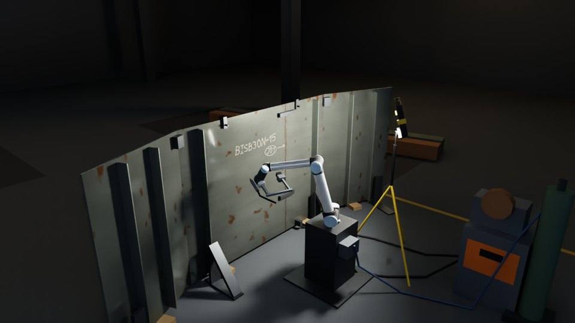
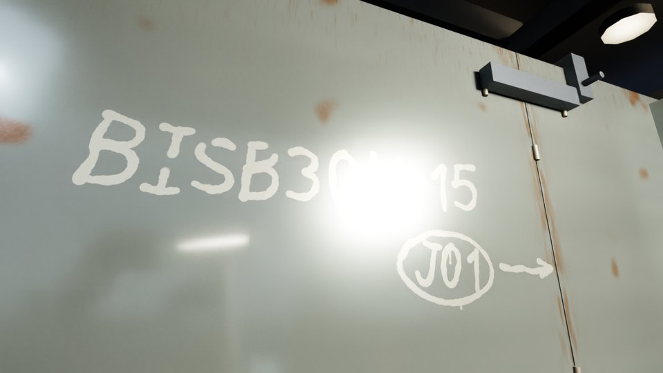
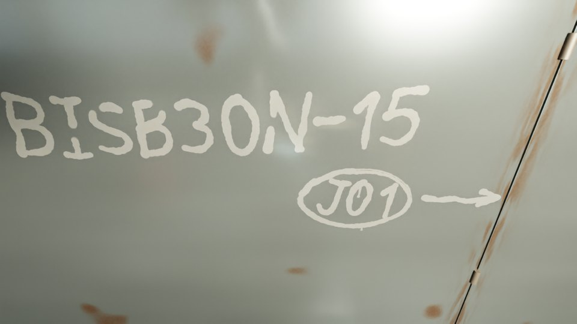

# Isaac 조선소 수직 강판·수기 메모 A/B 영상

기준일: **2026-10-10**. 기존 [야간 작업장 기준 장면](ISAAC_SCENE.md)의 작은 수평 작업대를 **조선소 블록 조립장을 연상시키는 수직 3면 강판 지그**로 바꾸고, 가운데 강판의 작업자 눈높이에 **페인트 마커풍 수기 메모**를 배치한 장면이다. Isaac Sim 6.1에서 UR10 손목 카메라가 두 자세 A/B로 이동하고, 고정 작업등의 금속 정반사가 A에서 메모 일부를 가리고 B에서 같은 메모가 읽히는 과정을 실제 RGB로 렌더링한다. ROS Jazzy 송출기가 저장된 RGB를 기존 Foxglove 연결로 내보낸다. [데모 명세](DEMO_SPEC.md)의 장면·촬영 부분 실행이며, 렌더링 결과는 **모사 장면**이다. A/B는 사전 정의된 자세 순서(`capture_mode=pre_captured`, `recognition_feedback_enabled=false`)이고 인식 판단에 따른 재촬영 폐루프, 이 장면의 인식→문서 검토 연결, 실제 용접·실기 제어는 포함하지 않는다. `execution_authorized=false`를 유지한다.

**기존 기준 장면은 비교·복구용으로 그대로 둔다.** `output/isaac-scene-20261010/live-01/`의 설정·소스 사본·`scene.usda`·`assets/marking.png`·`frames/`·`*-capture.json`, 튜닝 결과 `tune-01`~`tune-07`, [night_welding.json](../configs/isaac_scene/night_welding.json)과 기존 runner·helper·송출기 코드는 수정하지 않았다. 새 장면은 별도 설정 [shipyard_handwriting.json](../configs/isaac_scene/shipyard_handwriting.json), 별도 runner [run_isaac_shipyard_scene.py](../scripts/run_isaac_shipyard_scene.py), 마킹 생성기 [isaac_shipyard_marking.py](../scripts/isaac_shipyard_marking.py), 새 출력 루트 `output/isaac-shipyard-20261010/`를 사용한다.

## 확인 상태

최종 기준 실행은 **`output/isaac-shipyard-20261010/live-03/`**이다(`--live`, 2026-10-09 22:37:50 UTC 시작). 이에 앞서 `draft-01`(초안 전체 장면 1장), `pair-01`·`pair-02`(A/B 튜닝), `live-01`(1차 Foxglove 전환 실행, 독립 리뷰 반영 전), `live-02`(리뷰 반영 중 GPU 경합으로 중단)를 각각 새 디렉토리로 실행했고 모두 보존한다. 저장소의 설정·코드 파일은 `live-03`의 `config.json`·`source/` 사본과 SHA-256이 같다. 아래 세 이미지가 최종 실행의 최초 정착 A/B와 전체 장면이며, 저장소에는 축소 JPEG 미리보기만 포함한다. 원본 1280×720 PNG는 `output/`(Git 제외)에 있고 SHA-256은 `manifest.json`과 [docs/images/isaac_shipyard/README.json](images/isaac_shipyard/README.json)에 기록했다.

| 이미지 | 미리보기 | 원본 |
|---|---|---|
| 전체 장면(A 자세) |  | `live-03/frames/A-overview.png` |
| 손목 A — 반사가 메모 일부를 가림 |  | `live-03/frames/A-wrist.png` |
| 손목 B — 같은 메모가 읽힘 |  | `live-03/frames/B-wrist.png` |

육안 검수 결과: A 손목 영상에서는 고정 작업등의 정반사 덩어리가 `BISB30N-15`의 `0N-` 부근에 겹쳐 식별자를 끝까지 읽을 수 없고(`BISB3`과 `15`는 보임), 동그라미 친 `J01`과 이음부로 향한 화살표는 보인다. B 손목 영상에서는 `BISB30N-15`, `J01`, 화살표, 이음부(가접·strongback)가 모두 보이고 반사는 메모 위쪽 프레임 상단으로 옮겨 가 있다. 전체 장면에서는 수직 3면 강판, 보강재, 이음부, 받침·클램프, 로봇 받침대, 삼각대 작업등, 바닥 케이블, 용접 전원·가스통, 어두운 대형 작업장이 보인다. **글자 확인은 육안 검수이며 OCR/VLM 측정 결과가 아니다.** 새 프레임에 대한 인식 실행은 하지 않았다.

| live-03 최초 정착 촬영 | 요청 카메라 위치 (m) | 실제 카메라 위치 (m) | 위치 오차 | 회전 오차 | 고정 장착·USD/PhysX 대조 |
|---|---|---|---:|---:|---|
| A (sequence 17, 22:38:23.365 UTC) | `[0.70, 0.29, 1.28]` | `[0.7016, 0.2909, 1.2744]` | 5.91 mm | 0.0099 rad | 통과 |
| B (sequence 35, 22:38:32.067 UTC) | `[0.75, 0.00, 1.62]` | `[0.7544, 0.0006, 1.6152]` | 6.53 mm | 0.0083 rad | 통과 |

허용오차는 위치 15 mm, 회전 0.018 rad다. A/B 관절값은 `frames/A-capture.json`, `frames/B-capture.json`의 `joint_positions`(A `[0.540, -1.288, 1.475, -0.651, -0.725, 0.367]`, B `[0.152, -1.355, 0.865, 0.957, -1.434, -0.067]` rad)이며, 카메라는 PhysX Jacobian IK로 관절 목표를 보내 이동했고 순간 이동은 쓰지 않았다. `config.json` SHA-256 `afef8c34…6905f`(저장소 설정 파일과 동일), 코드 사본 3개(`run_isaac_shipyard_scene.py` `6af6eee4…`, `isaac_shipyard_marking.py` `c03e3cc9…`, `isaac_scene_robot.py` `76033689…`)와 마킹 텍스처의 SHA-256은 `manifest.json`의 `source_hashes`·`asset_provenance`에 있다. 독립 리뷰(시각 심사 3관점·코드 리뷰 3관점)에서 지적된 램프 마스트 광택, 강판 거울 반사, 수기 끊김 부재, 종료 신호 처리 등은 `live-03` 전에 반영했다.

| 구분 | 확인된 상태 | 아직 확인되지 않은 것 |
|---|---|---|
| 장면 형상 | 초안·A/B 전체 장면 RGB에서 수직 3면 강판 지그 확인, 책상·천 병풍 아님 | 실제 선박 블록 설계와의 유사성(의도하지 않음) |
| 수기 마킹 | seed 고정 절차적 획 텍스처가 강판 표면에 렌더링됨, 두 시점에서 동일 | OCR/VLM 판독, 실제 작업자 필적과의 비교 |
| 조명·반사 | 고정 작업등 하나의 실제 정반사가 A에서 메모 일부를 가리고 B에서 벗어남(육안) | 다른 노출·재질 조합에서의 재현 |
| 손목 카메라·UR10 | A/B 도달, 고정 장착 변환 검증, 팔·브래킷·토치가 손목 영상을 가리지 않음, 종료 신호 중 이동이 가짜 IK 실패로 끝나지 않음(`live-02`에서 이전 코드의 실패 재현 후 수정) | 충돌 없는 경로, 실기 적합성 |
| ROS·Foxglove 스트림 | 아래 수신 표 참조 | Mac Foxglove 화면 자체의 육안 확인(서버 WebSocket 수신으로 대체) |
| 인식·문서 연결 | 없음 | 이 장면의 인식→문서 검토→모의 전달, 자동 재촬영 폐루프 |

서버 Foxglove WebSocket(`ws://127.0.0.1:8765`, subprotocol `foxglove.sdk.v1`)에 Foxglove 클라이언트와 같은 방식으로 접속해 수신을 검증했다. 검사 도구는 [check_isaac_scene_stream.py](../scripts/check_isaac_scene_stream.py)이며 CDR 페이로드를 직접 복호해 PNG를 디코딩한다.

| 확인 항목 | live-03 결과 |
|---|---|
| 영상 전송 | 60초 수신 창(22:41:43–22:42:48 UTC)에서 손목·전체 장면·`/camera` 각 120개, 총 360개 PNG가 1280×720 RGB로 디코딩됨. 촬영 시각이 창 이전인 샘플(손목 3·전체 3·alias 1, 구독 직후 latched 전달 또는 전송 중)은 상세 기록에 남기고 판정에서 제외 |
| 상태·촬영 대조 | 상태 120개, sequence 413–532가 도착 순서대로 단조 증가, 촬영 시각 120개 모두 서로 다르고 증가. 영상/상태의 SHA-256 360쌍 일치, 불일치 0개. `scene.scenario_id`는 모두 `shipyard-handwriting-glare-01` |
| alias | `/camera` 120개 모두 수신된 손목 영상과 같은 바이트(해시 동일) |
| 실제 갱신 | `A`·`B`·`moving_to_A`·`moving_to_B` 모두 수신, 상태는 모두 `new_capture`·`recent_capture`, `capture_age_seconds` 0.296–0.508초, `capture_mode=pre_captured`, `execution_authorized=false` |
| TF | 동적 TF `world→contextweld_wrist_optical` 120개, `map→world` 정적 TF 1개 수신, CDR 복호 오류 0 |
| 기존 자료·프로세스 | 기준 보존 목록 70개 파일(`live-01`·`tune-01~07`의 `stream/` 제외 전체 + 기존 코드·설정 4개) SHA-256 작업 전후 동일, 기존 Isaac 앱·bridge·SSH 세션 유지 |

근거 파일은 `output/isaac-shipyard-20261010/live-03-reception-02.json`(위 표의 수신 요약·상세)이며, 같은 폴더의 `live-03-reception-01.json`(전환 직후 첫 60초 창: 영상 117·118·118개, sequence 167–284; depth 1 QoS로 손목 메시지 1개가 전송 중 유실돼 alias 비교만 불일치로 집계됨), `live-01-reception-01/02.json`(1차 전환 실행의 수신 기록), `baseline-sha256-before.txt`·`baseline-sha256-after.txt`(보존 대조)를 함께 보존한다. bridge가 토픽을 advertise한다는 사실만으로 수신을 주장하지 않았고, 수신 구간의 영상 수·sequence·촬영 시각 증가를 실제 메시지로 확인했다. 이 검증은 해당 실행과 수신 구간에 대한 확인이다.

## 장면과 경계

실행 설정은 [shipyard_handwriting.json](../configs/isaac_scene/shipyard_handwriting.json), 장면 생성·촬영은 [run_isaac_shipyard_scene.py](../scripts/run_isaac_shipyard_scene.py), 수기 마킹·그라임 텍스처는 [isaac_shipyard_marking.py](../scripts/isaac_shipyard_marking.py), 로봇 이동은 기존 [isaac_scene_robot.py](../scripts/isaac_scene_robot.py)를 읽기 재사용한다. 좌표계는 USD z-up, 단위 m, 회전은 quaternion `wxyz`이며 로봇은 +x를 바라본다. 가운데 강판을 읽는 방향 기준으로 **+y가 왼쪽, -y가 오른쪽**이다.

| 항목 | 현재 설정 | 기존 기준 장면과의 관계 |
|---|---|---|
| 가운데 강판 | 2.4 × 1.8 × 0.02 m, 앞면 x = 1.20, 바닥 z = 0.06, 수직 | 변경(수평 0.58 × 0.42 판 → 수직 패널) |
| 이음부 J01 | y = -0.40의 수직 맞대기 이음(간격 4 mm, 가접 4곳, strongback 2개) | 신규 |
| 양옆 패널 | 1.2 × 1.8 × 0.02 m, 가운데 판 양끝에서 로봇 쪽으로 22° 꺾임 | 신규 |
| 보강재·고정 | 앞면 수직 플랫바 y = ±0.95, 뒷면 수평 플랫바 z = 0.5/1.0/1.5, 윗변 클램프 y = ±0.6, 받침·목재 받침목 | 신규 |
| 수기 메모 | `BISB30N-15` 중심 (y 0.10, z 1.45) 높이 0.09 m(획 포함 폭 0.68 m), 동그라미 친 `J01` 중심 (-0.12, 1.32) 높이 0.07 m, 화살표 (-0.25, 1.32)→(-0.385, 1.32), 획 폭 11 mm, 색 (238, 231, 196) | 변경(모노스페이스 폰트 → 절차적 수기 획) |
| 강판 재질 | metallic 0.65, roughness 0.19, clearcoat 1.0, clearcoat roughness 0.10, 샵프라이머 그라임 텍스처 4096 × 3072 (0.586 mm/texel) | roughness 0.13 → 0.19, clearcoat roughness 0.06 → 0.10 |
| 로봇 | UR10 USD, 베이스 `[0.15, 0, 0.75]` m(받침대 0.42 × 0.42 × 0.75 m) | 변경(`[0, 0, 0.3]`) |
| 손목 장착 | `wrist_3_link` 기준 카메라 고정 이동 `[0.25, 0, -0.15]` m, 시각적 하우징·토치 | 동일 |
| A 목표 | 카메라 `[0.70, 0.29, 1.28]`, 주시점 `[1.20, 0.10, 1.45]` | 변경 |
| B 목표 | 카메라 `[0.75, 0.00, 1.62]`, 주시점 `[1.20, 0.00, 1.40]` | 변경 |
| 고정 작업등 | 사각광 0.36 × 0.30 m, 위치 `[-0.15, -0.75, 1.85]`, 주시 `[1.20, 0.05, 1.40]`, intensity 120000, 색 (1.0, 0.95, 0.86), 후드·무광 마스트의 삼각대 | 변경(0.22 × 0.16, 30000) |
| 기타 조명 | 돔 260 (0.40, 0.50, 0.65), 소프트 필 900, 원경 구형 조명 6개(바닥 광 pool·기둥·크레인 거더가 어둡게 보이도록) | 변경 |
| 노출·영상 | 자동 노출 끔, ISO 200, shutter 50, f/4, 1280 × 720, 손목 18 mm·전체 장면 26 mm(aperture 36 mm) | 동일 |
| 렌더링 | `RealTimePathTracing`, samples 16, 초기·정착 각 80 step, 물리·렌더 dt 1/60 s, Kit HTTP 포트 8031 | 포트만 변경(기존 8021) |
| 시연 반복 | A/B 순서 이동, 이동 120 step·유지 480 step, 12 step마다 최신 RGB 저장 | 동일 |

A/B 사이에 형상·마킹·조명 위치와 세기·재질·노출을 바꾸지 않았고 저장 RGB에 반사나 글자를 사후 합성하지 않았다. 수직 패널로 바뀌었으므로 기존 조명·카메라 좌표를 그대로 쓰지 않고 새 패널 법선과 로봇 도달 범위에 맞춰 다시 구했다. `--predict`는 고정 작업등을 패널 평면에 거울 반사시켜 각 시점의 정반사 중심을 계산하는데, A는 (y 0.009, z 1.434)로 `N` 위(추정 반경 0.10 m), B는 (y -0.188, z 1.678)로 글자 상단 위쪽(추정 반경 0.09 m)이다. 실제 렌더에서도 A는 `0N-` 부근, B는 프레임 상단에서 반사가 보였다. 예측은 설계 보조값이며 저장 RGB를 대체하지 않는다.

카메라는 손목의 고정 자식이다. PhysX의 실제 링크 pose와 Jacobian으로 관절 목표를 계산해 관절 위치 목표로 움직이며 카메라·관절 상태를 순간 이동시키지 않는다. 목표 미수렴 시 실행이 실패할 수 있고 충돌 없는 경로·실기 적합성은 검증하지 않았다. 팔·브래킷·토치가 손목 영상을 가리지 않는 것은 A/B 손목 RGB로 확인했다.

### 합성 마킹과 자산 출처

표기 `BISB30N-15`, `J01`, 동그라미, 화살표는 이 장면을 위해 그린 **합성 텍스처**다. TrueType 폰트를 쓰지 않고 [isaac_shipyard_marking.py](../scripts/isaac_shipyard_marking.py)에 직접 정의한 단일 획 글리프(`shipyard-stroke-glyphs.v2`)를 seed `20261010`으로 흔들어 그렸다. 획마다 폭·압력 변화, 시작부 고임, 획 폭보다 긴 실제 끊김(글자당 최대 1회), 마른 획의 결 무늬, 흔들림을 넣고 행 기울기(-1.56°, +2.80°)·자간·기울임을 어긋나게 했으며, 미세 입자, 방향성 번짐, 흘림, 고인 부분의 어두워짐을 더했다. 생성은 seed로 결정적이며 같은 입력에서 같은 파일 해시가 나온다(numpy 2.1/2.3, Pillow 11/12에서 확인). 바탕은 샵프라이머 색 (122, 128, 122)의 얼룩·롤러 자국·녹·긁힘을 절차적으로 생성했다. 식별자는 기존 시연 문서와의 후속 연결을 위한 합성 입력이며 실제 사진 정답이 아니다. 문서에 없는 용접 전류·재질·두께는 쓰지 않았다. 생성 방식·seed·문구·파일 해시는 실행마다 `assets/marking.json`과 `manifest.json`의 `asset_provenance`에 저장된다.

| 자산 | 출처·생성 방식 |
|---|---|
| `assets/panel_center_albedo.png` | 생성기가 만든 가운데 강판 텍스처(그라임 + 수기 메모), live-03 SHA-256 `9b94cc0d…c0c65d` |
| `assets/panel_side_albedo.png`, `marking_layer.png`, `marking_preview.png` | 같은 생성기 출력(옆 패널 그라임, 메모 단독 RGBA, 메모 영역 크롭) |
| UR10 | `https://omniverse-content-production.s3-us-west-2.amazonaws.com/Assets/Isaac/6.1/Isaac/Robots/UniversalRobots/ur10/ur10.usd` (NVIDIA Isaac Sim 6.1 자산, 출력에 복사하지 않음) |
| 그 외 형상 | runner가 작성한 USD 기본 도형(Cube·Cylinder·Mesh), 외부 mesh 없음 |

`scene.usda`는 UR10을 외부 URL로 참조하므로 USD 하나만으로 독립 실행 패키지가 되지 않는다. 재실행은 아래 명령과 같은 설정·코드·Isaac 자산 접근을 전제한다.

| 실행 방식 | `capture_mode` | 증명하는 것 | 증명하지 않는 것 |
|---|---|---|---|
| 이번 장면(`--live` 포함) | `pre_captured`, `presentation_mode=scheduled_pose_loop` | 같은 장면·센서의 A/B 원본 RGB, 실제 관절 이동, 고정 반사의 시점 의존성 | 인식 판단이 팔 이동을 일으켰다는 사실 |

J01과 기존 문서 검토 자료의 `JOINT-DEMO-01` 연결은 `[확인 필요]`이며 이 문서는 연결을 주장하지 않는다. 미완료 항목: 자동 OCR 판단→재촬영 폐루프, 이 장면 프레임의 인식·문서 검토 실행, 실제 용접·실기 제어, 관리자 UI, `--native-ros`, 충돌 없는 경로 검증, OCR/VLM 판독성 측정.

## Runpod에서 시작

기존 [Pod 환경](POD_VER1.md)의 `/workspace/PAC2026`, Isaac 6.1 전용 환경, ROS Jazzy·domain 26·FastDDS, Foxglove bridge를 재사용한다. 새 설치·새 Pod·패키지 변경·bridge 재기동은 없었다. 아래는 서버 Bash용이며 실제 live-01에 사용한 명령이다. ROS 설정은 `set -u` 상태에서 실패할 수 있으므로 먼저 해제한다. Isaac runner와 송출기는 서로 다른 Python을 쓴다.

매번 **비어 있는 새 출력 디렉토리**를 만든다. runner는 `manifest.json` 유무와 관계없이 비어 있지 않은 디렉토리를 거절하므로, 로그·PID 파일은 출력 디렉토리 **밖**(아래처럼 `$scene_out.log`, `$scene_out.pid`)에 둔다. 기준 장면 문서처럼 `>"$scene_out/scene.log"`로 리다이렉트하면 셸이 먼저 파일을 만들어 실행이 거절된다. 실패한 실행도 보존하고 새 디렉토리로 재시도한다.

```bash
set +u
source /workspace/pac-env.sh
cd /workspace/PAC2026
scene_root="output/isaac-shipyard-$(date -u +%Y%m%d)"
mkdir -p "$scene_root"
scene_out=$(mktemp -d "$scene_root/run-XXXXXXXX")
rmdir "$scene_out"   # runner가 직접 만들도록 비워 둔다
printf '%s\n' "$scene_out"

# 반사 위치·도달 예측만(Isaac 불필요)
/usr/bin/python3 scripts/run_isaac_shipyard_scene.py --config configs/isaac_scene/shipyard_handwriting.json --predict

# 초안 1장(팔 이동 없이 두 카메라의 워밍업 RGB 저장 후 종료)
OMNI_KIT_ACCEPT_EULA=YES OMNI_KIT_ALLOW_ROOT=1 \
  /workspace/venvs/isaacsim-6.1/bin/python -u scripts/run_isaac_shipyard_scene.py \
  --config configs/isaac_scene/shipyard_handwriting.json --output "$scene_out" --draft

# A/B 반복 시연(새 디렉토리로 다시 지정)
OMNI_KIT_ACCEPT_EULA=YES OMNI_KIT_ALLOW_ROOT=1 \
  /workspace/venvs/isaacsim-6.1/bin/python -u scripts/run_isaac_shipyard_scene.py \
  --config configs/isaac_scene/shipyard_handwriting.json \
  --output "$scene_out" --live >"$scene_out.log" 2>&1 &
printf '%s\n' "$!" >"$scene_out.pid"
```

`OMNI_KIT_ACCEPT_EULA=YES`는 기존 환경의 NVIDIA 약관 동의를 전제한다. Kit 내부 HTTP 포트는 설정의 `kit_http_port`(8031)이며 기존 데모 Isaac(8021)·사용자 Isaac 앱(8011)과 겹치지 않게 했고 공개 포트는 추가하지 않았다. 로그에서 `MARKING_GENERATED`, `SCENE_READY`, 두 `SENSOR_WARMUP [720, 1280, 3]`, `CAPTURED A`, `CAPTURED B`, `PAIR_COMPLETE`(초안은 `DRAFT_COMPLETE`)를 확인한다. 미도달 시 `ROBOT_IK_FAILED_STATE`와 함께 실패한다. 수기 텍스처만 다시 그려 보려면 Isaac 없이 `/usr/bin/python3 scripts/isaac_shipyard_marking.py --out <새 디렉토리>`를 실행한다.

송출기는 기존 송출기를 종료한 뒤 하나만 실행한다. 같은 토픽·TF에 두 송출기가 동시에 발행하지 않게 한다.

```bash
/usr/bin/python3 -u scripts/serve_isaac_scene_ros.py \
  --output-root "$scene_out" --camera-alias /camera \
  --publish-map-tf --publish-link-markers --repeat-interval 1 \
  >"$scene_out-publisher.log" 2>&1 &
printf '%s\n' "$!" >"$scene_out-publisher.pid"
```

## 연결과 결과 확인

Foxglove 토픽·타입·프레임은 기준 장면과 같다. 기존 레이아웃 `ContextWeld · 기준 장면 AB`([foxglove-baseline-layout.json](../configs/isaac_scene/foxglove-baseline-layout.json))를 그대로 쓰면 왼쪽 전체 장면·오른쪽 손목 Image 패널에 새 장면이 보인다. 서버 bridge는 `127.0.0.1:8765`, Mac의 기존 터널은 `ws://localhost:8765`다. 새 bridge·공개 포트는 만들지 않았다.

| Foxglove 항목 | 토픽·프레임 |
|---|---|
| 손목·전체 장면 Image 패널 | `/contextweld/wrist/image`, `/contextweld/overview/image` (`sensor_msgs/msg/CompressedImage`, PNG) |
| 기존 카메라 패널 | `/camera` — 손목 영상의 동일 사본 |
| 상태 확인 | `/contextweld/status` — `std_msgs/msg/String` 안의 JSON. `scene.scenario_id`가 `shipyard-handwriting-glare-01`이면 새 장면 |
| 3D 기준 | `map→world` 정적 TF, `world→contextweld_wrist_optical` 실제 카메라 pose |
| 링크 위치 점 | `/contextweld/robot_link_samples` — 실제 링크 위치 샘플, 로봇 mesh 아님 |

`stream/current.json`은 기존 필드명·타입을 그대로 유지하고 `scenario_id`, `scene_schema_version`, `execution_authorized`를 추가했다. 송출기 입력 계약은 `--check-input`으로 확인한다.

```bash
/usr/bin/python3 scripts/serve_isaac_scene_ros.py --output-root "$scene_out" --check-input
ros2 topic list -t
ros2 topic echo --once /contextweld/status
/workspace/venvs/isaacsim-6.1/bin/python scripts/check_isaac_scene_stream.py \
  --seconds 60 --expect-scenario shipyard-handwriting-glare-01 \
  --report "$scene_out-reception-01.json"
```

상태의 `sequence`, `view=A/B/moving_to_A/moving_to_B`, `captured_at_utc`, `published_at_utc`, `capture_age_seconds`를 본다. `publication_kind=new_capture`는 새 스냅샷, `held_capture_republish`는 같은 촬영의 재송출이다. 촬영 시각은 렌더 step 이후 최신 RGB를 읽은 호스트 UTC이며 `simulation_time`을 함께 남기고 `native_sensor_frame_id=null`이다. 송출 header는 원 촬영 시각을 유지하며 재송출 시각으로 바꾸지 않는다. 파일 교체는 이미지 먼저, JSON 마지막이고 송출기가 교체 중 읽기를 건너뛰는 `장면 스냅샷 대기` 경고는 일시적 재시도이며 오류 누락이 아니다.

## 기록과 중단

| 출력 | 의미 |
|---|---|
| `config.json`, `source/`, `prediction.json`, `manifest.json` | 실행 당시 설정·코드 사본 3개·반사 예측, 해시, Git 상태, 카메라·로봇·고정 노출·자산 출처 메타데이터 |
| `frames/initial-*.png` | 워밍업 직후 두 카메라 RGB(팔은 초기 자세) |
| `frames/A-*.png`, `frames/B-*.png`, `*-capture.json` | 최초 정착 A/B의 실제 RGB, 관절·카메라 pose, 오차·장착 대조와 이미지 해시 |
| `scene.usda`, `assets/` | 장면·합성 텍스처·`marking.json`. UR10 등 외부 Isaac 자산은 별도 필요 |
| `stream/current.json`, `stream/*.png` | 반복 시연의 최신 스냅샷. 이미지 먼저, JSON 마지막으로 교체 |
| `stream/session.json` | 종료 기록(`state`가 `stopped`/`failed`, 실패 시 `error`). 강제 종료에서는 없을 수 있음 |
| `<run>.log`, `<run>-publisher.log`, `*.pid`, `<run>-reception-NN.json` | 로그·소유 PID·수신 검증(출력 디렉토리 밖, 같은 상위 폴더) |

`stream/`은 최신 프레임만 보관하므로 고정 증거에는 `frames/`를 쓴다. 출력·원문·모델은 Git에 넣지 않으며 Pod 종료 전에 필요한 결과를 내려받는다.

**자신이 시작한 PID만 중단한다.** PID 파일의 숫자와 전체 명령·출력 경로가 일치하는지 먼저 확인하고, 다르면 중단하지 않는다. 기존 사용자 Isaac 앱·bridge·SSH 터널에 대한 일괄 종료(`pkill isaac`, `killall python`)는 하지 않는다.

```bash
scene_pid=$(cat "$scene_out.pid"); publisher_pid=$(cat "$scene_out-publisher.pid")
ps -p "$scene_pid" -o pid=,args=
ps -p "$publisher_pid" -o pid=,args=
kill -TERM "$scene_pid" "$publisher_pid"   # 소유 확인 후
```

현재 서버 상태(2026-10-09 22:20 UTC 1차 전환, 22:39 UTC `live-03`로 재전환): 새 장면 runner는 `output/isaac-shipyard-20261010/live-03.pid`, 새 송출기는 `live-03-publisher.pid`로 실행 중이다. 이 세션이 시작한 이전 runner(`live-01.pid`, `live-02.pid`)와 송출기(`live-01-publisher.pid`)는 소유 확인 후 종료했다. 기존 기준 장면 송출기(`output/isaac-scene-20261010/ros-publisher-01.pid`)는 소유 확인 후 22:20 UTC에 종료했고, 기존 기준 장면 runner(`output/isaac-scene-20261010/live-01.pid`)는 그대로 실행 중이어서 `output/isaac-scene-20261010/live-01/stream/`은 계속 갱신되지만 Foxglove에는 발행되지 않는다. 기준 장면으로 복구하려면 새 송출기를 종료하고 기존 송출기 명령을 다시 실행한다.

```bash
kill -TERM "$(cat output/isaac-shipyard-20261010/live-03-publisher.pid)"
/usr/bin/python3 -u scripts/serve_isaac_scene_ros.py \
  --output-root output/isaac-scene-20261010/live-01 --camera-alias /camera \
  --publish-map-tf --publish-link-markers --repeat-interval 1 \
  >output/isaac-scene-20261010/ros-publisher-02.log 2>&1 &
printf '%s\n' "$!" >output/isaac-scene-20261010/ros-publisher-02.pid
```

기존 runner까지 종료된 상태라면 [기준 장면 문서](ISAAC_SCENE.md)의 시작 명령으로 새 디렉토리에 다시 실행한다. 기존 `live-01` 디렉토리는 재사용하지 않는다.

## API 근거

- [Isaac 카메라 API](https://docs.isaacsim.omniverse.nvidia.com/6.1.0/py/source/extensions/isaacsim.sensors.experimental.rtx/docs/index.html): `CameraSensor`·`RtxCamera`, 해상도 인자 `(height, width)`, `get_data('rgb')`. 기준 장면과 같은 호출을 사용했다.
- [Isaac Multi-Tick Rendering](https://docs.isaacsim.omniverse.nvidia.com/latest/sensors/isaacsim_sensors_multitick_rendering.html): `tick_rate=0`은 매 렌더 프레임 촬영이다.
- [UsdPreviewSurface 명세](https://openusd.org/release/spec_usdpreviewsurface.html): 강판의 `diffuseColor`를 `UsdUVTexture`로 연결하고 `metallic`·`roughness`·`clearcoat`를 썼다. 공식 문서는 기능의 존재를 뒷받침하며 이 장면에서의 결과는 위 RGB로 확인했다.
- [UsdLux RectLight·SphereLight·DomeLight](https://openusd.org/release/api/usd_lux_page_front.html): 작업등·필·원경·돔 조명.
- [Foxglove WebSocket 프로토콜(SDK)](https://docs.foxglove.dev/docs/sdk/websocket-protocol): 설치된 `foxglove-bridge/3.6.0 foxglove-sdk-cpp/0.28.0`은 subprotocol `foxglove.sdk.v1`을 협상했고 `serverInfo`·`advertise`·`subscribe`와 binary opcode 1 메시지로 수신했다.
- [ROS Jazzy CompressedImage 정의](https://github.com/ros2/common_interfaces/blob/jazzy/sensor_msgs/msg/CompressedImage.msg): PNG 바이트를 재인코딩 없이 발행하는 계약.

## 변경 기록

| 버전 | 날짜 | 내용 |
|---|---|---|
| 1.0 | 2026-10-10 | 조선소 수직 3면 강판·수기 메모 장면, A/B 반사 실행 live-03(튜닝 draft-01·pair-01·pair-02·live-01·live-02 보존), 독립 리뷰 반영, Foxglove 송출 전환 기록. 인식·문서 연결, 자동 재촬영 폐루프, 제품 구현 완료를 의미하지 않음 |
