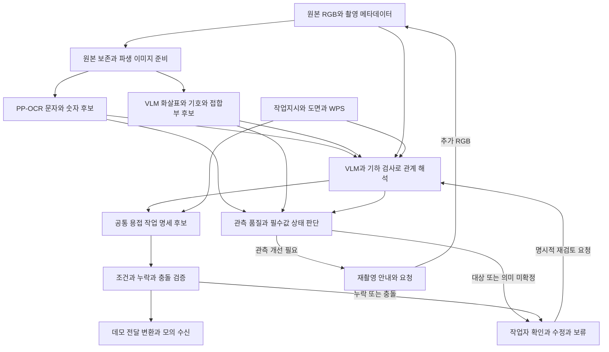

# ContextWeld OCR와 시각 관계 인식 구성

버전 **1.0** · 기준일 **2026-10-10** · 상태 **구현 설계, 새 모델 성능 미측정**

**문자 OCR와 이미지 해석을 함께 사용해 문자·숫자·화살표·기호·접합부의 관계를 추출한다. 출력은 원본 위치와 근거가 붙은 작업 명세 후보이며, 판독이 어려우면 재촬영하고 의미가 애매하면 작업자 확인으로 보낸다.**

이 문서는 확정 흐름도의 인식 부분을 구현할 기준이다. [데모 구현 기준](DEMO_SPEC.md)의 Runpod 실행, A/B 촬영, 모의 수신, 로컬 오프라인 재생 계약을 따른다. 전체 자료 목록은 [오픈 자료 조사](PIPELINE_OPEN_RESOURCES_AND_SCENARIO.md), 장비 입력은 [제조사 파라미터 조사](WELDING_ROBOT_PARAMETERS.md)를 참고한다.

## 1 확정 범위와 구현 선택

기준 그림은 `mermaid-diagram (1).png`다. 원본 SHA-256은 `0def9e91f29399571ed18ab5ad7f55a78f96998fe42351c0a7132be8cbce2208`이며, 아래 도식과 요구사항으로 필요한 구조를 옮겼다. 그림 파일이 없어도 이 문서로 구현 범위를 읽을 수 있다.

| 구분 | 내용 |
|---|---|
| 그림에서 확정 | 문자·숫자 인식과 화살표·기호·접합부 검출, 표기와 대상 관계 해석, 작업지시·도면·WPS 대조, 공통 명세와 조건·누락·충돌 검증 |
| 그림에서 확정 | 흐림·가림 등 관측 문제는 재촬영 안내, 대상·의미의 모호함과 조건 충돌은 작업자 확인·수정·보류, 확인·수정된 정보로 재검토 |
| 이 문서의 초기 구현 선택 `[추론]` | PP-OCRv6 문자 인식 + Qwen3-VL-8B 이미지 관측·관계 해석 + 좌표·참조·조건 검증. VLM은 이미지와 언어를 함께 처리하는 모델을 뜻함 |
| 구현 전 결정할 것 `[확인 필요]` | 실제 마킹·지원 기호, 모델 revision·런타임, 입력 해상도, 품질 임계값, 작업문서·WPS, 모의 수신 필수 필드 |

모델 선택은 확정 흐름도를 구현하기 위한 출발점이며 성능이 입증된 최종 선택이 아니다. 초기 구성은 A/B 실제 RGB로 검증한 뒤 유지하거나 교체한다. 과거 Vision·RapidOCR 결과를 새 PP-OCRv6·VLM 성능으로 사용하지 않는다. 기존 개발 표본에서 부재번호 완전 일치가 낮았다는 사실은 [실험 레포트](../experiments/REPORT-2026-10-09.md)에 기록되어 있다.

첨부 흐름도의 CAD·3D 센서·좌표 보정과 제조사 변환은 인식 결과의 후속 소비자다. 이번 데모는 모의 수신까지이며, 인식부가 사진의 픽셀 좌표를 실제 로봇 XYZ나 용접 경로로 변환하지 않는다.

## 2 논리 구조



문자와 비문자 경로는 논리적으로 분리한다. 동일 GPU에서 순차 실행해도 된다. VLM은 먼저 문서를 보지 않고 이미지의 관측을 생성하고, 다음 호출에서 그 관측과 관련 문서를 함께 보고 관계를 해석한다. 문서에 맞춰 사진의 글자를 고쳐 읽는 현상을 확인하기 위해 두 호출의 입력·원문 출력을 분리한다.

## 3 모델과 실행 구성

아래 선택과 추가 조건은 `[추론]`이다. 모델의 공개 기능·배포 조건은 12절의 공식 출처로 확인하고, 장면에서의 성능은 10절로 검증한다.

| 구성요소 | 초기 선택 | 입력과 역할 | 추가 또는 교체 조건 |
|---|---|---|---|
| 문자 영역 검출 | `PaddlePaddle/PP-OCRv6_medium_det` [S1] | 전체 RGB → 문자 polygon·검출 점수 | 작고 회전된 문자 누락이면 타일·회전 조건을 비교 |
| 영문·숫자 인식 | `PaddlePaddle/PP-OCRv6_medium_rec` [S2] | 검출 crop → 원문 문자열·인식 점수 | 부재번호·소수점·단위의 오류가 남으면 원본 crop의 VLM 판독과 비교 |
| 한국어 인식 | 필요할 때 `PaddlePaddle/korean_PP-OCRv5_mobile_rec` [S3] | 같은 검출 crop의 한국어 문자 후보 | 시나리오에 한국어가 있을 때 추가. 기본 인식기의 한국어 지원을 가정하지 않음 |
| 비문자 관측과 관계 | `Qwen/Qwen3-VL-8B-Instruct` [S4] | 전체 RGB와 필요한 crop → 시각 객체 후보. 이후 OCR·문서와 관계 후보 생성 | 메모리·시간이 부족하면 입력 예산 또는 모델 크기를 변경하고 다시 측정 |
| 좌표와 관계 검사 | 일반 이미지·기하 처리와 명시적 규칙 | 좌표 역변환, 선·화살촉 연결 검사, ID 참조 검사 | 가림·교차로 근거가 부족하면 보류. 규칙으로 선을 임의 복원하지 않음 |
| 문서 연결과 최종 검사 | 정확 ID 조회와 작은 고정 문서 묶음 | 문서·개정·페이지·표 셀을 명세 값에 연결 | 자료가 커져 전문 제공이 어려울 때 검색을 추가 |

S1~S4의 모델 카드는 Apache-2.0을 표시한다. 실행에 포함하는 도구·추가 가중치의 조건은 각각 기록한다. 버전은 실행 전에 정확한 revision과 파일 해시로 고정하며 `latest`만 기록하지 않는다.

**Grounding DINO·SAM은 초기 필수 구성에 넣지 않는다.** VLM의 위치·부재 영역이 병목인 경우에 검출·분할 보조로 추가한다. DINO의 박스와 SAM의 마스크만으로 화살표 방향이나 용접 의미가 해결되지는 않는다. 용접기호 전용 검출기 학습도 실제 지원 기호와 라벨을 확보한 다음 단계다. [S5][S6]

Runpod에서는 우선 단일 작업 프로세스에서 문자 OCR → 비문자 관측 → 관계 해석 → 규칙 검사 순으로 실행한다. Paddle와 VLM의 환경은 분리할 수 있고 파일 또는 작은 호출 인터페이스로 연결한다. GPU 동시 상주 여부, 정밀도, 최대 이미지 수·픽셀 예산·출력 토큰 수·타임아웃은 실제 메모리와 지연을 측정해 고정한다. 렌더러와 동시 실행이 어려우면 데모 스펙의 `pre_captured` 방식을 사용하고 그 사실을 표시한다.

## 4 원본과 전처리

1. 원본 RGB를 변경하지 않고 `frame_id`, 해시, 폭·높이, 촬영 요청 ID, 센서·시각·실제 카메라 자세와 함께 저장한다. 센서 시각과 실행 입력 시각을 구분한다.
2. 원본에서 OCR용 리사이즈·crop을 생성한다. 원근 보정이 필요하면 기준 사각형을 얻은 방법과 변환 행렬을 저장한다. 정답 영역을 자동 검출 결과처럼 사용하지 않는다.
3. VLM에는 전체 장면을 포함한다. 문자 crop만 보내 화살표와 대상이 잘리는 것을 피하고, 확대 영역에는 참조 ID를 붙인다. 영역 ID·오버레이는 원본과 별도 이미지로 보존한다.
4. 회전·확대·타일 입력을 추가하면 변환마다 원본으로 돌아가는 행렬을 남긴다. 초기에는 같은 원본의 제한된 파생본만 비교하고 후보가 늘었다는 이유로 정확도가 향상됐다고 보지 않는다.
5. 명암 조정·노이즈 제거를 적용한 결과와 원본 결과를 구분한다. 생성형 복원으로 만든 글자를 실제 관측 근거로 쓰지 않는다. 반사로 정보가 사라졌다면 추가 사진이 필요하다.

**공통 좌표는 원본 이미지의 좌상단 원점, x는 오른쪽, y는 아래쪽, 단위는 pixel**이다. 경계 좌표는 `0 ≤ x ≤ width`, `0 ≤ y ≤ height`인 실수로 저장하고, `bbox`는 `[x_min, y_min, x_max, y_max]`를 사용한다. 원본 polygon과 모델이 출력한 원시 좌표·그 좌표의 기준도 함께 남긴다. 모델별 정규화 좌표 범위를 추측하지 않고 선택한 어댑터의 규약으로 명시한다.

## 5 문자와 비문자 관측

| 관측 종류 | 보존할 값 | 확정하지 말아야 할 것 |
|---|---|---|
| 문자 | 원문, 대안 후보, polygon, 검출·인식 점수 각각, 모델·파생본·실행 ID | `O/0`, `I/1`, 소수점·하이픈을 작업지시에 맞춰 치환 |
| 화살표 | 몸체 polyline, 화살촉 위치 또는 영역, 시작·끝 후보, 가림·절단 상태 | 사각형만 보고 head/tail 또는 진행 방향 확정 |
| 기호 | 지원 목록 중 종류 후보, 기준선·치수·꼬리 문구와 각각의 위치 | 미지원 기호를 가장 비슷한 지원 기호로 강제 분류 |
| 부재·접합부 | 이미지 안의 관측 ID, 영역 또는 선, 보이는 형상 | 이미지 객체 ID를 기업 부재·이음 ID나 3D 좌표로 간주 |
| 품질 문제 | 영향을 받는 영역, 판독 불가·가림 등 관측, 측정값·방법 | 시뮬레이터의 반사 정답이나 미리 정한 A/B 역할을 인식 결과로 사용 |

OCR가 후보 하나만 반환하면 실제 후보 하나만 저장한다. VLM이 다른 판독을 제시하면 별도 출처의 후보로 추가한다. 두 엔진의 점수는 평균하지 않는다. VLM에 자신감 숫자를 생성시켜 정답 확률로 쓰지 않는다. 모델이 제공하지 않은 점수는 `null`이다.

동일 문자 영역의 중복은 위치와 원문을 기준으로 연결하되 각 관측을 남긴다. 다른 문자열은 대안으로 유지한다. 읽기 순서만으로 문자를 이어 부재번호를 만드는 대신 같은 물리적 표기라는 근거를 보존한다. 사람이 지정한 crop·화살촉·대상은 `producer=user`이며 자동 검출 성적으로 집계하지 않는다.

## 6 관계 해석과 문서 연결

관계 해석의 단위는 `문자 또는 기호 → 화살표 또는 기준선 → 접합부 → 부재`다. 직접 표기처럼 화살표가 없는 관계도 표현하고 화살표를 억지로 생성하지 않는다.

| 단계 | 처리 |
|---|---|
| 시각 연결 후보 | 화살촉 끝, 선의 연결성, 기호와 기준선 배치, 대상 경계를 근거로 후보 생성. 거리만으로 최근접 대상을 확정하지 않음 |
| VLM 해석 | 전체 RGB·crop·관측 객체 ID·OCR 후보·선별된 문서를 제공. 근거 ID와 대안·누락을 구조화하여 반환 |
| 참조 검사 | 존재하지 않는 객체·문서 ID를 거부. 새 객체를 제안했다면 별도 관측으로 등록·검사한 뒤 관계에 사용 |
| 도메인 의미 | 문서에 명시된 표준·사전으로 기호·치수의 의미를 해석. 수기 약어의 의미나 표준이 없으면 미확정 |
| 업무 ID 연결 | 관측 ID와 작업지시의 부재·이음 ID를 별도 필드로 유지. 프로젝트·블록·시점·개정으로 좁히고 근거를 기록 |
| 조건 연결 | 관련 작업지시·도면·WPS에서 필드별 값·단위·적용범위를 가져옴. 서로 다른 WPS의 조건을 혼합하지 않음 |

이미지의 숫자에 용도가 붙기 전에는 두께·각장·목두께·용접 길이 중 하나로 단정하지 않는다. 용접기호의 대상 지시 화살표는 토치 진행 방향과 구분한다. 기호 규약은 표준·체계에 따라 달라지므로 선택한 문서의 기준을 기록한다. [S7]

문서를 통해 하나의 후보가 남더라도 사진에서 다른 후보를 배제할 근거가 없다면 `needs_review`를 유지한다. 필드별 근거의 `source_kind`는 문서가 제공한 값이면 `document`, 이미지 판독이면 `model`, 작업자 수정이면 `user`, 시연용 가정이면 `fixture`로 구분한다. 이는 처리 주체를 나타내는 사건의 `producer`와 별개다. 문서의 ID·개정·페이지·표 셀 참조를 포함하고 최신 취소·보류·만료 후 과거 지시를 되살리지 않는다.

## 7 노드 사이의 입출력 계약

모든 단계 결과는 `schema_version`, `result_id`, `run_id`, `stage`, `input_frame_ids`, `input_result_ids`, `producer`, `status`, `raw_output_ref`를 공통으로 가진다. 모델 출력뿐 아니라 전처리·프롬프트·모델 revision·생성 설정을 추적할 `config_ref`도 둔다. 원문이 없는 규칙 결과의 `raw_output_ref`는 `null`이다. 파일 참조는 실행 묶음 안의 상대경로다.

| 결과 | 필수 내용 |
|---|---|
| `observation` | 프레임별 `text_observations`, `visual_objects`, 좌표 기준, 변환 참조, 품질 근거. 관측 ID는 전체 실행에서 유일 |
| `relation` | `relation_id`, 근거 관측 ID, 대상 후보, 선택된 대상 또는 `null`, 문서 참조, 모호함·충돌 이유 |
| `recognition_decision` | `action`, `reason_codes`, 영향받은 필수 필드·영역, 판정 규칙 버전, 재촬영 요청 또는 `null` |
| `work_spec_candidate` | 작업·부재·이음 ID 후보, 표기 해석, 필드별 `value`·`unit`·`source_refs`·상태, `execution_authorized: false` |

일반 결과의 `status`는 `candidate`, `resolved`, `unreadable`, `unsupported`, `needs_review`, `failed` 중 하나다. `resolved`는 해당 단계의 검사 범위를 통과했다는 뜻이며 용접 실행 승인이 아니다. 인식 판단의 `action`은 `continue`, `request_recapture`, `needs_review`, `failed` 중 하나다. `continue` 역시 후속 명세 검증을 생략하지 않는다.

다음은 **직접 작성한 형식 예시**다. `joint-observed-*`는 사진 안의 관측 ID이며 실제 이음번호가 아니다. 제시한 파일 경로와 결과는 구현할 계약을 설명하며 현재 실행 산출물이 아니다.

```json
{
  "schema_version": "recognition.v1",
  "result_id": "relation-example-01",
  "run_id": "example-run",
  "stage": "relation",
  "input_frame_ids": ["frame-example"],
  "input_result_ids": ["observation-example"],
  "producer": "model",
  "status": "needs_review",
  "raw_output_ref": "results/relation-example-01.raw.txt",
  "config_ref": "results/inference-config.json",
  "relations": [
    {
      "relation_id": "rel-example-01",
      "source_observation_ids": ["text-observed-01", "arrow-observed-01"],
      "target_observation_candidates": ["joint-observed-01", "joint-observed-02"],
      "selected_target_observation_id": null,
      "business_joint_id": null,
      "document_refs": [],
      "reason_codes": ["ambiguous_target"]
    }
  ]
}
```

스키마 검사는 형식·타입·참조·좌표 범위·누락을 확인한다. `null`을 0이나 기본 용접값으로 치환하지 않는다. JSON 구문이 틀린 경우 원문을 저장하고 동일 입력의 구조 재출력을 최대 1회 허용하는 초기 정책을 사용한다 `[추론]`. 재실패하면 `failed`로 끝낸다. 내용이 애매한 결과를 재출력으로 반복 강제 확정하지 않는다.

## 8 재촬영과 작업자 확인

### 8.1 분기 규칙

품질 점수 하나나 모델의 자기평가만으로 분기하지 않는다. **필수 정보가 무엇이고, 어떤 관측 문제로 얻지 못했는지**를 함께 본다. 전체 이미지 평균보다 해당 문자·화살표·대상 주변의 상태를 우선한다.

| 실제 관측과 처리 상태 | 판단 | 행동 |
|---|---|---|
| 필수 표기가 흐림·과노출 후보·가림·잘림 때문에 읽히지 않고 다른 시점에서 개선 가능 | 관측 부족 | 한도 안에서 `request_recapture` |
| 필수 표기의 위치조차 찾지 못했지만 프레임의 흐림·잘림 등 관측 근거가 있음 | 관측 부족 | 전체 프레임 근거와 함께 재촬영. 없는 ROI를 만들어 내지 않음 |
| 문자는 선명하지만 화살표 대상이 둘이거나 수기 약어·표준이 불명확 | 의미 부족 | `needs_review` |
| WPS·작업지시 누락, 개정·재질·두께 충돌 | 문서 또는 조건 문제 | `needs_review`; 같은 카메라 반복 촬영으로 해결하지 않음 |
| 관측과 관계가 필요한 범위에서 해결됨 | 인식 단계 통과 | `continue` → 공통 명세와 조건 검증 |
| 추론 오류·타임아웃·파싱 재실패 | 기술 실패 | `failed`; 판독 불가와 구분 |
| B에서도 필수 정보가 미확정 | 한도 소진 | `needs_review`; 정상 명령 전송 없음 |

명암 포화 비율·선명도 같은 수치는 원본 또는 명시된 파생본의 영역·계산법·정규화 방식과 함께 저장한다. 밝은 페인트를 반사로, 얇은 선을 흐림으로 단정하지 않는다. 임계값은 별도 개발 이미지에서 고정하고 설정 버전을 기록한다. 미확정 필드가 없는데 높은 밝기만으로 무조건 재촬영하지 않는다.

단일 데모의 기본 한도는 **재촬영 1회**다. `A이므로 실패`, `B이므로 성공` 같은 규칙을 두지 않는다. B가 선명할 것이라는 장면 기대값은 판정 입력이 아니다. 입력 해상도·임계값·타임아웃의 수치는 초기 측정 후 확정한다 `[확인 필요]`.

### 8.2 카메라와의 계약

재촬영 요청에는 `request_id`, `run_id`, 원인이 된 결과·프레임 ID, `reason_codes`, `affected_fields`, `roi_original_px` 또는 `null`, `suggested_adjustments`, `attempt`, `max_attempts`를 포함한다. 안내는 “표기를 화면에 모두 포함”, “반사를 피하도록 시점 이동”, “글자가 크게 보이도록 거리 조정”처럼 관측 문제에 맞춰 생성한다.

인식부는 관절각·이동 경로를 생성하지 않는다. 카메라 어댑터가 요청을 미리 검증한 자세 B로 매핑한다. 일반 안내는 각도·거리·조명 조정을 포함할 수 있지만 **확정 A/B 반사 데모에서는 조명·노출·마킹을 고정하고 카메라 시점만 바꾼다.** 조명을 바꾼 실험은 다른 조건으로 기록한다.

`live_closed_loop`에서는 같은 요청의 이동 완료 후 새로 촬영한 프레임만 채택한다. 요청 ID·실제 자세·센서 촬영 시각을 검사한다. `pre_captured`에서는 기존 B 이미지를 입력했다는 사실과 원 촬영 시각을 보존한다. 재촬영 A/B의 관측 ID와 좌표를 섞지 않고, 다른 시점의 동일 부재 연결은 별도 관계로 남긴다.

### 8.3 확인과 수정 후 재검토

최신 흐름도의 재검토는 **작업자의 명시적 요청으로 시작하는 새 검토 실행**으로 구현한다. 수정 저장만으로 추론이 자동 시작되지 않는다. 이는 [데모 스펙](DEMO_SPEC.md) 1.1에 반영된 동작이며, 자동 학습·메모리·다른 작업에 대한 자동 참조는 추가하지 않는다.

- 수정은 원문과 별도로 `correction_id`, 대상 결과·관계·필드, 수정 전후 값, 사유·시각·작성 주체와 함께 기록한다. 이미 오래된 결과를 수정했다면 현재 결과에 조용히 덮어쓰지 않는다.
- 재검토는 `parent_run_id`, `review_request_id`, 사용할 `correction_ids`를 명시한 새 `run_id`로 수행한다. 원본 관측·관련 문서와 명시적으로 선택한 수정을 입력한다. 수정 사건은 `producer=user`로 보존하고, 재검토의 모델·규칙 결과는 각 처리 주체를 별도로 기록한다.
- 기본 재검토 범위는 관계 해석·명세 생성·조건 검증이다. OCR 원문은 보존한다. 새 사진이 필요할 때만 별도 관측을 생성한다.
- 작업자가 값을 확인했어도 적용 WPS·개정·필수값·단위·충돌을 다시 검사한다. 수정이 모델의 자동 정답으로 집계되거나 전송 승인이 되지 않는다.
- 재검토 뒤 모의 전달도 별도 명시적 동작이다. 새 명세 ID와 새 명령 ID를 사용하며 기존 명령·ACK를 변경하지 않는다. 보류를 선택하면 재검토·전달을 시작하지 않는다.
- 내보내기가 끝난 묶음은 불변이다. 이후 수정은 묶음 밖 추가 기록, 재검토는 별도 묶음이다. 로컬 읽기 전용 재생 화면은 서버 추론·전송을 호출하지 않는다. 수정·재검토 입력 위치는 데모 스펙 O07에서 선택한다.
- 새 재검토 묶음에는 사용한 원본 프레임·관측·문서 근거·수정 스냅샷을 포함하고, 각 복사본의 원래 실행·결과 ID와 해시를 보존한다. 이를 새 촬영·새 OCR 결과로 표시하지 않는다. 이전 서버 경로 없이 새 묶음만으로도 재검토 근거를 조회할 수 있어야 한다.

## 9 저장과 화면에 보여줄 정보

[데모 스펙](DEMO_SPEC.md) 7절의 `frames/`, `results/`, `evidence/`, `commands/`, `corrections.jsonl`, `events.jsonl`을 그대로 사용한다. 별도 인식 전용 번들을 만들지 않는다. manifest의 `spec_version`은 `demo-1.1+ocr-1.0`, 인식 결과의 `schema_version`은 `recognition.v1`로 시작한다. 이는 구현할 초기 버전 이름이다.

| 남길 사건 또는 자료 | 목적 |
|---|---|
| 원본·파생 이미지와 변환 | 원본 위치에 OCR·화살표·대상 오버레이를 표시 |
| 모델 호출별 입력·원문·구조화 결과·설정·시간 | 관측과 문서에 의한 해석을 구분하고 오류 위치 추적 |
| 재촬영 판단·요청·이동완료·새 프레임 연결 | 왜 추가 사진을 요청했는지, 실제 이동이 있었는지 설명 |
| 관계 후보와 문서 근거·충돌 | 무엇을 읽었고 어느 대상에 연결했는지 확인 |
| `review_requested`와 부모 실행·수정 참조 | 사람이 확인한 내용과 새 재검토 결과를 원본과 구분 |
| 실제 전달 명세와 모의 응답 | 인식 성공·형식 통과·수신 성공을 각각 표시 |

사건의 `seq`, `parent_event_ids`, `input_frame_ids`, `input_result_ids`, `producer`는 데모 계약을 따른다. 사용자 수정은 `producer=user`, 모델 추론은 `model`, 품질·필드 규칙은 `rule`이다. 실패·모호함도 원문과 사건을 남긴다. 오프라인 화면은 저장된 좌표와 결과만 그리며 재생 과정에서 다시 OCR하지 않는다.

## 10 검증 자료와 완료 기준

초기 구현은 모델 학습 없이 A/B 한 장면의 실제 추론을 먼저 연결한다. 장면 제작용 정답·객체 마스크·부재 ID는 평가 입력으로 분리하고 모델에 몰래 제공하지 않는다. 개발 과정에서 조정한 장면의 성공은 해당 데모의 동작 증거이며 독립 현장 성능이 아니다.

| 자료 | 인식부에서의 역할 | 제한 |
|---|---|---|
| 확정 데모의 시뮬레이터 A/B RGB | 실제 통합·재촬영 분기 검증 | 동일 마킹·문서·조명 유지. 기대 결과로 모델 출력을 치환하지 않음 |
| [Steel OCR](https://huggingface.co/datasets/iput-tk230215/steel-ocr-dataset) | 금속 수기 문자 비교 | 화살표·용접조건 정답은 없음. 기존 고정 실험·테스트 분할 보존 |
| [FC Offline](https://cmp.felk.cvut.cz/~breslmar/flowcharts_offline/) | 화살표 머리·끝점·연결 관계의 보조 검증 | 종이 순서도이며 철판 현장 성능으로 일반화하지 않음. 재배포 조건 확인 |
| [AI2D-RST](https://github.com/thiippal/AI2D-RST) | 관계 그래프 라벨 설계 참고 | 과학 설명도이며 용접 전문 정답은 아님 |
| 작업지시·도면·WPS의 선택된 묶음 | 값·단위·적용조건·개정 연결 | 합성 자료와 공개 예시, 기업 승인 자료를 구분 |

| 검사 | 완료 기준 |
|---|---|
| 문자 | B의 사전 정의한 필수 식별자·치수·단위를 정답과 대조. 전체 문자열 일치와 문자 오류를 별도 기록 |
| 비문자와 관계 | 화살촉 방향·대상 이음·기호 의미를 사전 정의한 정답과 대조. 허용 픽셀 오차는 실행 전에 고정 |
| 재촬영 | 실제 관측 근거로 A에서 요청, B에서 재평가. A도 읽히거나 B도 실패하면 그대로 기록 |
| 좌표 | crop·회전·리사이즈 역변환 후 원본 오버레이 일치. 서로 다른 프레임의 좌표를 혼합하지 않음 |
| 미확정·충돌 | A/B 모두 실패, 복수 대상, 미지원 기호, 문서 충돌에서 보류. 정상 명령 없음 |
| 기술 오류 | 추론·프레임·파싱 실패를 `failed`로 기록. 원문 보존·무한 재시도 없음 |
| 수정과 재검토 | 저장만으로 실행되지 않음. 명시 요청은 새 실행, 선택 수정 참조, 원본 불변, 자동 재전송 없음 |
| 전달과 재생 | 필수 명세·근거·단위 검사 후 모의 전달. 인터넷·추론 서버 없이 같은 결과 재생 |

정답률에는 `맞힌 개수/전체 개수`를 병기한다. 보류·사람 수정 사례를 자동 성공에 포함하지 않는다. 인식·관계·판단의 지연과 최대 GPU 메모리를 함께 기록하되 서로 다른 실행 환경의 속도를 단순 비교하지 않는다.

## 11 구현 순서와 남은 결정

| 순서 | 작업 | 결과 |
|---|---|---|
| 1 | 지원 표기·기호·관계, 필수 출력 필드, 정답과 문서 묶음을 고정 | 작은 시나리오 설정과 평가 정답 분리 |
| 2 | A/B RGB 저장, 모델 revision·환경·입력 예산 고정 | 원본·촬영 메타데이터·재현 설정 |
| 3 | PP-OCR와 문서 비참조 VLM 관측, 원본 좌표 어댑터 구현 | 문자·시각 객체·오버레이 |
| 4 | 관계 해석·정확 문서 조회·명세 검증 연결 | 후보·근거·누락·충돌 |
| 5 | 재촬영 판단·한도·요청 ID 연결 | 사전 촬영 완주 후 실제 이동 연동 |
| 6 | 수정 저장과 명시 재검토, 모의 전달·번들·재생 검증 | 원본과 재검토가 구분되는 검토 가능한 데모 |

구현 전 남은 값은 `[확인 필요]`다. 데모 스펙 O01/O05/O06에서 실제 표기·문서·최종 필드, O03에서 모델·런타임·정밀도·입력 예산, O04에서 품질 규칙·좌표 오차·타임아웃, O07에서 수정·재검토 입력 위치를 정한다. 이 문서의 초기 모델 구성을 실제 실행 확인 없이 O03 완료로 표시하지 않는다.

## 12 공식 근거와 확인일

확인일 **2026-10-10**. 아래 링크는 기능·배포 확인 근거이며 우리 시나리오에서의 정확도·실행성 근거는 아니다.

| ID | 출처 | 사용한 사실 |
|---|---|---|
| S1 | [PP-OCRv6 medium det](https://huggingface.co/PaddlePaddle/PP-OCRv6_medium_det) | 문자 영역 검출 모델·사용법·Apache-2.0 |
| S2 | [PP-OCRv6 medium rec](https://huggingface.co/PaddlePaddle/PP-OCRv6_medium_rec) | 문자 인식 모델·사용법·Apache-2.0 |
| S3 | [한국어 PP-OCRv5](https://huggingface.co/PaddlePaddle/korean_PP-OCRv5_mobile_rec) | 한국어 문자 인식·Apache-2.0 |
| S4 | [Qwen3-VL-8B-Instruct](https://huggingface.co/Qwen/Qwen3-VL-8B-Instruct) | 이미지·텍스트 입력, OCR·공간 이해·위치 찾기, Apache-2.0 |
| S5 | [Grounding DINO](https://github.com/IDEA-Research/GroundingDINO) | 이미지·텍스트 설명으로 대상 영역 검출 |
| S6 | [SAM 2](https://github.com/facebookresearch/sam2) | 지시 기반 이미지·영상 영역 분할 |
| S7 | [TWI 용접기호 해설](https://www.twi-global.com/technical-knowledge/job-knowledge/weld-symbols) | 화살표·기준선·기호와 표준별 의미 구분 |

기존 결과·평가셋은 보존한다. 이 문서 작성으로 제품 코드·새 모델·시뮬레이터·로봇 연동이 구현된 것은 아니다.
