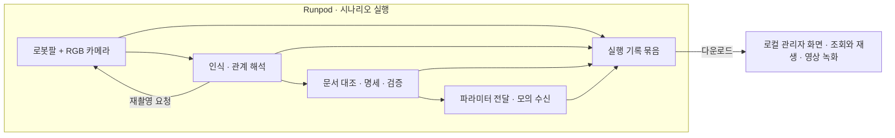
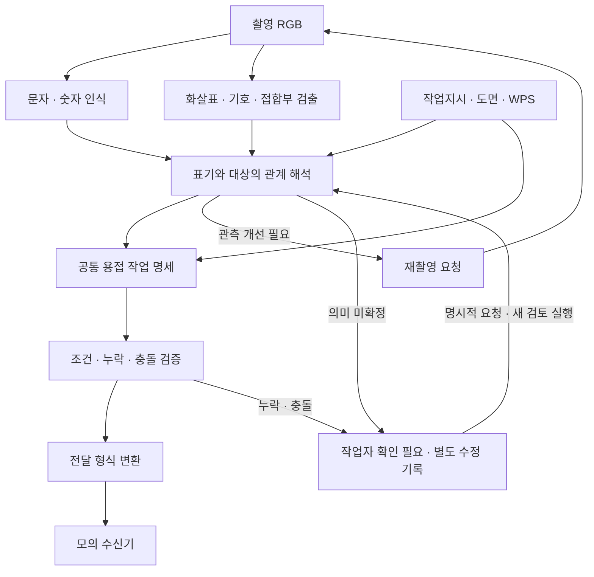

# ContextWeld 데모 구현 기준

문서 버전: **1.6** · 기준일: **2026-10-11** · 상태: **기능 범위 확정, 부분 구현·검증 완료, 전체 데모 미완료**

**Runpod에서 모사 작업장 촬영·인식·해석·재촬영·파라미터 전달을 수행하고 실행 기록을 저장한다. 기록을 내려받아 로컬 관리자 화면에서 조회·재생하며 하나의 시나리오를 영상으로 보여준다.**

이 문서는 GitHub에서 내려받아 사용하는 현재 데모의 공통 구현 기준이다. 기존 기획의 더 넓은 목표나 과거 시연 기능을 이번 범위에 자동으로 포함하지 않는다. 문서 확정은 기능 구현·모델 성능·Runpod 실행 검증 완료를 뜻하지 않는다. **이번 목표는 아이디어 피칭이다. 실제 모델과 문서 근거로 한 시나리오의 흐름을 설득력 있게 보여주는 것을 우선하고, 높은 정확도·엄밀한 모델 비교·독립 평가를 완료 조건으로 요구하지 않는다.**

인식 단계의 모델 구성·좌표·입출력·재촬영·재검토는 [OCR 구성 v1.2](../spec/OCR_PIPELINE_SPEC.md), 근거 원문 확보·정확 조회·RAG는 [문서 적용 계획 v1.3](DOCUMENT_APPLICATION_PLAN.md)을 따른다. 제조사 입력은 [용접 로봇 입력 상세 명세](../spec/WELDING_ROBOT_INPUT_SPEC.md), 확인된 서버 환경은 [Pod v1 기록](../setup/POD_VER1.md)이 기준이다. 수정 저장만으로 자동 실행하지 않고, 작업자가 명시적으로 요청한 별도 실행에서 관계·명세·조건을 다시 검토한다.

**현재 구현 상태:** [Isaac 기준 장면 live-01](../runs/ISAAC_SCENE.md)에서 UR10 손목 카메라의 실제 A/B RGB·고정 반사·관절 이동과 Foxglove 손목/전체 장면 두 영상을 검증했다. P1은 기존 정형 마킹·작업대 장면에서 달성했고, 이 장면을 보존한 채 [조선소 수직 3면 강판·중앙 수기 메모 장면 live-03](../runs/ISAAC_SHIPYARD_SCENE.md)을 추가로 구성했다. 예약 A/B 이동은 `pre_captured`이며 인식 판단에 따른 폐루프가 아니다. [문서 검토 한 건의 오프라인 HTML 조회](../runs/DOCUMENT_REVIEW_VIEWER.md)는 부분 구현을 마쳤으며 HTML 구조·표시 내용을 검증했다. [수정 저장 → 명시적 재검토 → 선택적 모의 전달](../runs/EXPLICIT_REVIEW.md)은 서버 CLI로 문서 범위 규칙 재검토까지 구현·실행했다(O07 결정, v1.5). 시각 관계의 모델 재해석과 인식 결과 입력 화면은 구현하지 않았다. 저장 A/B 프레임의 판독부터 제조사 전달까지는 [통합 파이프라인](../runs/WELD_PIPELINE.md)으로 연결했고, 여러 실행을 담는 [오프라인 관리자 패키지](../runs/ADMIN_DASHBOARD.md)로 P3를 달성했다. 패키지 전체의 브라우저 시각 검수, 전체 P2·P4, 모델 판단에 따른 재촬영과 A/B 재생은 미완료다.

## 1. 읽는 순서와 명세의 효력

1. 이 문서의 2~5절로 목표·시나리오·파이프라인을 파악한다.
2. 6~10절의 입출력·기록·관리자 화면·실행 규약을 따라 구성요소를 연결한다.
3. 11절의 미정 항목을 해당 구현 전에 결정하고, 12절의 단계별 완료 기준으로 검증한다.
4. 13절의 문제 목록과 14절의 근거를 참고한다.

| 구분 | 의미 |
|---|---|
| 확정 범위 | 이번 대화에서 합의했고 2026-10-10에 구현 기준으로 확정한 기능·제외 범위 |
| 최소 구현 계약 | 합의한 기능이 서로 연결되고 오프라인에서 재생되도록 이 문서에서 구체화한 규약. 필드명·파일 구조를 바꾸면 생산자와 소비자 및 문서를 함께 갱신 |
| `[확인 필요]` | 아직 선택·측정·확인되지 않은 항목. 후속 구현자가 이미 확정된 사실로 간주하지 않음 |
| `[추론]` | 확인한 사실에서 도출한 설계 판단. 성능 검증 결과가 아님 |

범위 충돌 시 이 문서가 [개발 기획](DEVELOPMENT_PLAN.md), [마일스톤](MILESTONES.md), [공개 자료·시나리오 조사](PIPELINE_OPEN_RESOURCES_AND_SCENARIO.md)보다 우선한다. 세부 계약은 위 연결 문서와 함께 갱신한다. 과거 실험 결과나 자료의 사실 자체를 변경하는 것은 아니다. 기존 문서의 이력 자동 참조·여러 시뮬레이션 장면·PCC 예제 시나리오는 이번 필수 기능으로 승계하지 않는다. 인식·관계·문서 해석은 데모 입력에서 실제 동작과 근거 연결을 확인한다. 추가 사진이나 독립 평가는 필요한 오류를 살펴보기 위한 선택 사항이다.

**세 가지 경계:** 사전 촬영 두 장의 추론은 실시간 재촬영 연동과 구분한다. 모의 수신은 실제 용접 실행과 구분한다. 기록 조회는 과거 추론·명령의 재실행과 구분한다.

## 2. 확정 범위

| ID | 요구사항 |
|---|---|
| F01 | 아이디어 피칭용 단일 시나리오에서 인식 → 관계 해석 → 문서 대조 → 명세·검증 → 파라미터 전달의 전체 흐름을 구현한다. |
| F02 | 시뮬레이션·모델 추론·파이프라인 실행과 기록은 Runpod의 L40S 환경을 대상으로 한다. 로컬 개발은 가능하지만 최종 로컬 녹화에 추론 서버를 요구하지 않는다. |
| F03 | 로컬 관리자 화면은 내려받은 실행 묶음을 조회·재생한다. 원본 이미지, 각 단계 결과, 재촬영 사유, 문서 근거와 전달 결과를 보여준다. |
| F04 | 문자·숫자와 화살표·기호·접합부를 논리적으로 구분해 인식하고, 표기가 어떤 대상에 연결되는지 해석한다. 모델 두 개나 별도 서비스 두 개를 반드시 요구하지 않는다. |
| F05 | 재촬영 필요 판단은 인식·해석의 역할이고, 카메라 이동과 새로운 RGB 생성은 시뮬레이터의 역할이다. |
| F06 | 같은 판재·마킹을 자세 A/B에서 촬영한다. A에서는 작업등 반사가 판독을 방해하고 B에서는 필요한 표기가 판독되는 장면을 구성한다. |
| F07 | 용접 로봇 역할의 로봇팔 한 대의 움직이는 손목에 카메라를 장착한다. 별도 카메라 로봇은 필수가 아니다. 현재 기준 장면은 NVIDIA UR10 자산과 고정 손목 카메라로 검증했다. |
| F08 | 촬영 자세 A/B와 이동 경로는 미리 정할 수 있다. 실제 이미지의 품질·인식 결과로 재촬영 분기를 결정한다. |
| F09 | 시뮬레이터에서 RGB 두 장을 먼저 얻어 별도로 추론하는 단계적 구현·대안도 허용한다. 실시간 연동 여부를 기록과 화면에 표시한다. |
| F10 | 실행 결과는 파일 묶음으로 내보내고 로컬에서 동일한 데이터로 재생한다. 녹화 때 다시 추론하지 않는다. |
| F11 | 사용자 확인·수정은 원래 결과와 분리하여 저장한다. 명시적 재검토 요청은 선택한 수정 기록을 참조하는 새 실행으로 처리한다. 자동 학습·파인튜닝·메모리·후속 추론의 자동 참조·자동 재전송에는 사용하지 않는다. |
| F12 | 최종 파라미터는 모의 수신기에 전달하고 수신 결과를 기록한다. 실제 용접기·로봇 제어기에는 전달하지 않는다. |
| F13 | 근거로 사용할 문서 원문을 실제 확보·등록하고, 현재 작업의 정확 조회와 범위를 제한한 RAG를 구성한다. WPS 조건표는 행·단위·적용조건을 검수해 구조화한다. 출처 링크 목록만으로 문서 적재 완료로 보지 않는다. |
| F14 | 데모 입력에서 실제 인식·관계·문서 처리와 재촬영 흐름을 확인한다. 정확도 목표·독립 평가·모델 순위 비교는 필수 완료 조건이 아니다. 단일 시연 결과를 일반 현장 정확도로 주장하지 않는다. |

### 이번 범위에 포함하지 않는 것

- 실제 용접, 아크·토치 작동, 용접 비드·열변형·품질 시뮬레이션.
- 실제 로봇용 용접 경로 생성, CAD 자동 정합, 실물 핸드아이 보정, 이미지 좌표의 실제 로봇 XYZ 변환.
- 임의의 장면에서 최적 촬영 위치를 찾는 계획기, 강화학습, 일반적인 장애물 회피.
- 마킹 자체가 잘못되어 사람도 판단할 수 없는 사례의 해결.
- 모든 표기·모든 제조사 지원, 대규모 운영 서비스, 실시간 다중 사용자 시스템.
- 사용자 수정의 자동 정답화, 다음 작업으로의 자동 전파, 모델 자동 개선.

사람 확인이 필요한 상태와 누락·충돌 처리는 유지한다. 제외된 어려운 사례를 임의 값으로 성공 처리한다는 뜻이 아니다.

## 3. 실행 배치와 두 가지 시연 수준



| 실행 방식 | `capture_mode` | 증명하는 것 | 증명하지 않는 것 |
|---|---|---|---|
| 사전 촬영 방식 | `pre_captured` | 시뮬레이터 RGB A/B의 실제 추론, 재촬영 판단, 관계·문서 해석, 전달·기록·재생 | 현재 실행의 요청이 실제 팔 이동을 일으켰다는 사실 |
| 재촬영 연동 방식 | `live_closed_loop` | 위 기능과 실제 요청 → 팔 이동 완료 → 새 RGB 수신의 연결 | 임의 장면의 최적 시점 탐색, 실물 로봇 적용 성능 |

실제 재촬영 연동을 목표로 하되 사전 촬영 방식을 먼저 구현한다. 사전 촬영 방식은 허용된 대안이지만 두 수준의 완료 표시는 합치지 않는다. 최종 제출에 어느 수준을 사용할지는 11절의 미정 항목으로 남긴다. 미리 지정된 B 자세를 사용해도 실제 인식 판단이 이동을 일으키면 `live_closed_loop`에 해당한다.

Runpod의 CPU 작업과 GPU 작업을 구분한다. 문서 조회·검증·기록·파라미터 형식화에 모두 GPU가 필요한 것은 아니다. 시뮬레이터와 추론은 같은 서버에서 별도 프로세스로 나눌 수 있지만 마이크로서비스·별도 서버 여러 대는 필수 요구가 아니다.

## 4. 단일 시나리오: 야간 작업등 반사와 재촬영

### 4.1 장면과 입력

- 모사 작업장에 판재와 이음, 판독 가능한 마킹을 배치한다. 필요한 문자·화살표·기호·대상의 관계를 보여줄 수 있는 최소 장면으로 구성한다.
- 실제 사진을 사용할 때는 선명한 마킹 영역을 표면 텍스처로 적용한다. 사용한 이미지·가공·출처·이용 조건을 기록한다. 렌더링된 결과는 **모사 장면**으로 표시한다.
- 반사는 원본 사진의 하얀 영역을 재사용하는 대신 재질·조명·시점으로 만든다. 원본에 이미 소실된 글자는 시점 변경으로 복원되지 않는다. [S1]
- 낮은 주변광과 고정 작업등으로 야간 작업 상황을 모사한다. 두 촬영 사이 마킹·대상·작업문서·조명·노출 설정은 유지한다. 카메라 위치·방향을 바꾼다.
- 카메라는 팔 손목 링크와 고정 변환으로 연결한다. 실제 동작 링크에 붙어 있어야 팔 이동에 따라 시점이 바뀐다. [S2]
- 자세 B는 같은 마킹을 볼 수 있는 다른 관측 위치다. 제자리 방향 회전만으로 충분하다고 가정하지 않는다. 이동 경로·시야·도달 가능성은 장면에서 확인한다.

### 4.2 장면을 만들기 전에 정할 성공 기준

다음 항목을 하나의 시나리오 설정으로 고정한다. 현재 정형 마킹·A/B 자세·조명·재질·노출은 [기준 장면 설정](../runs/ISAAC_SCENE.md)에 고정했다. 모델의 A/B 판독·재촬영 판정과 장면의 작업문서·적용조건 연결은 `[확인 필요]`이며 임의 WPS·용접 수치로 채우지 않는다. 조선소 수기 형상 개선은 기존 결과와 별도로 구현한다.

| 항목 | 고정할 내용 |
|---|---|
| 대상과 표기 | 정확한 부재·이음 ID, 문자·숫자, 지원할 화살표·기호와 의미 |
| A의 판독 문제 | 어떤 필수 필드가 확정되지 않아야 하는지, 어떤 관측 근거로 재촬영하는지 |
| B의 기대 결과 | 정확히 읽혀야 할 값, 해당 표기가 연결될 대상·이음 |
| 작업 맥락 | 같은 대상의 작업지시·도면·WPS 및 개정·유효 시점·적용조건 |
| 최종 전달 | 수신 계약에서 요구할 필드, 값·단위·근거, 예상 수신 상태 |
| 장면 설정 | 판재·마킹 자산, 조명·재질·노출·카메라 설정, A/B 자세 |

정답과 예상 성공 여부는 **검증용**으로 분리한다. 프레임 번호나 정답표를 추론·재촬영 분기에 넣어 성공을 강제하지 않는다. 정상적인 작업지시와 문서의 대상 정보는 입력할 수 있지만 사진의 실제 오독을 몰래 치환하지 않는다.

### 4.3 실행 순서

| 순서 | 동작 | 남길 증거 |
|---|---|---|
| 1 | A에서 RGB 획득 | 원본 이미지, 실제 촬영 시각·자세·설정 |
| 2 | 문자·비문자 인식과 관계 해석 시도 | 입력 이미지 ID, 원문 출력, 후보·영역·불확실성 |
| 3 | 판독 문제를 근거로 재촬영 결정 | 필수 미확정 필드, 품질 측정·판정 규칙, 요청 ID |
| 4 | 연동 방식은 B로 팔 이동 후 새 RGB 획득. 사전 촬영 방식은 B의 저장된 RGB를 입력 | 방식 구분, 요청·관측 연결, 이동 완료·촬영 증거 |
| 5 | B의 RGB로 실제 재추론 | 새로운 입력 ID와 출력, A/B 비교 |
| 6 | 표기와 대상 연결, 작업문서 대조, 공통 작업 명세 구성·검증 | 관계의 근거, 문서·개정·위치, 값·단위·충돌 여부 |
| 7 | 유효한 데모 파라미터를 모의 수신기에 전달 | 명령 ID, 실제 전송 내용, 수신·형식 검사 응답 |
| 8 | 실행 묶음 완료·다운로드·로컬 재생 | 완전성 검사, 동일 결과의 오프라인 화면 |

장면의 설정 원인인 `glare`와 시스템의 관측 판단을 구분한다. 시스템이 판독 불가만 판단했다면 대시보드에 “반사를 정확히 진단했다”고 표시하지 않는다. A도 잘 읽히거나 B도 실패하면 그대로 기록하고 장면·모델 후보를 다시 검토한다.

## 5. 인식·해석 파이프라인



촬영 품질 문제가 앞 단계에서 드러나면 관계 해석 완료를 기다리지 않고 재촬영할 수 있다. 도표는 설명용 논리 단계이며 모든 노드를 별도 모델·프로세스로 만들라는 요구가 아니다. H의 재검토 화살표는 명시적 요청만 처리하며, 수정 저장에 따른 자동 학습·재추론·재전송은 수행하지 않는다.

| 단계 | 최소 출력과 처리 규칙 |
|---|---|
| 문자·숫자 | 원문 문자열, 영역, 복수 후보, 인식기 정보·점수. 제공되지 않은 confidence는 `null`; 자체 점수를 정답 확률로 표현하지 않음 |
| 비문자 검출 | 화살표 몸체·끝 또는 대응 영역, 지원 기호 종류, 판재·이음 후보와 영역. 검출 불가는 별도 상태 |
| 관계 해석 | `표기 ID → 대상/이음 ID` 후보와 영상·문서 근거. 가까운 영역이라는 이유만으로 확정하지 않음 |
| 문서 조회 | 대상·프로젝트·블록·시점·개정에 맞는 작업지시와 근거. 최신 취소·만료·보류 후 과거 유효 지시를 되살리지 않음 |
| 공통 명세 | 대상·이음, 읽힌 지시, 관련 문서, 용접조건 후보와 각각의 출처·단위·미확정 상태 |
| 검증 | 필수값, 대상 일치, 개정·유효성, 문서 적용조건, 단위·범위·충돌. 검색 점수나 JSON 형식 통과만으로 적합성 확정 금지 |
| 전달 변환 | 검증된 데모 명세에서 모의 수신 계약으로 변환. 실제 제조사별 변환기는 별도 선택 항목 |

OCR와 비문자 검출은 하나의 VLM으로 구현해도 되고 분리해도 된다. 두 출력의 입력 프레임·좌표 기준은 같아야 한다. 회전·리사이즈·crop을 썼다면 원본 좌표로 돌아가는 변환을 기록한다.

현재 인식의 초기 구성은 **PP-OCRv6 medium 검출·인식 + Qwen3-VL-8B-Instruct**다. 이는 데모 연결을 시작할 구성이다. 시나리오에 필요한 출력을 얻을 수 있으면 진행하며, 여러 모델의 정확도 경쟁을 먼저 끝낼 필요는 없다. 일반 현장 성능이 확인된 구성이라는 뜻은 아니다. 기존 RapidOCR 실험도 PP-OCRv6 small을 사용했으므로 새 구성을 단순한 모델 세대 교체로 설명하지 않는다. revision·입력 예산·런타임과 검증 방법은 [인식 구성](../spec/OCR_PIPELINE_SPEC.md)을 따른다.

문서 처리의 현재 방향은 **원문 등록 → 작업·대상·개정·유효 시점의 정확 조회 → 해당 범위 안의 근거 검색 → 적용조건 검증**이다. 작업 ID나 유효 개정을 의미 검색의 유사도만으로 선택하지 않는다. RAG는 근거 문단·표를 공급하고, 검수한 WPS 구조화 조건과 규칙 검사가 최종 필드의 적용성을 확인한다. 작은 자료집의 전문 제공은 비교 기준선으로 유지하되, 출처 링크나 짧은 요약만 넣은 실험을 실제 문서 스택의 완료로 보지 않는다.

최소 공개 원문 검색은 BM25를 사용하고, HTML/MD 절·블록과 PDF 페이지를 위치와 함께 보존한다. 임베딩은 사용하지 않는다. 별도 벡터 DB나 대규모 문서 시스템이 필수인 것은 아니다. 원문·페이지·표 행·단위·해시를 보존하는 최소 문서 묶음부터 구현한다. 제조사 매뉴얼은 출력 계약과 검증 규칙의 근거로 쓰며, 모델이 직접 실행 코드를 생성하게 하지 않는다. 제조사 자료·공개 WPS·모사 작업지시는 출처와 적용범위를 구분한다. 이전 [자료 조사](PIPELINE_OPEN_RESOURCES_AND_SCENARIO.md)의 PCC 예제를 이번 야간 장면의 정답으로 자동 채택하지 않는다.

### 5.1 재촬영과 실패 상태의 최소 계약

- 재촬영 판단은 실제 RGB의 품질 측정 또는 인식·해석 결과를 입력으로 한다. 판정 규칙·임계값은 설정으로 분리해 버전을 남긴다. 특정 모델의 confidence에 근거 없는 공통 임계값을 적용하지 않는다.
- 두 자세 데모의 기본 재촬영 한도는 **1회**다. B에서도 필수값이 미확정이면 `needs_review`로 끝내고 정상 명령을 보내지 않는다.
- 문서 누락·충돌처럼 다른 시점으로 해결되지 않는 문제는 카메라 반복 이동으로 처리하지 않는다.
- 이동·프레임 수신·추론·모의 응답의 타임아웃을 설정한다. 정확한 시간값은 초기 측정 후 고정한다. 기술 실패는 `failed`, 의미 미확정은 `needs_review`로 구분한다.
- 연동 방식은 B 이동 완료 후 촬영한 새 프레임을 채택한다. 센서 버퍼의 오래된 A 프레임을 B로 사용하지 않는다. 촬영 요청 ID·자세·센서 시각을 함께 검사한다.
- 사전 촬영 방식은 실제 촬영 시각과 현재 파이프라인에 입력한 시각을 구분한다. 사전 촬영 사건을 현재 요청 뒤에 발생한 것처럼 기록하지 않는다.

## 6. 파라미터 전달과 사용자 수정

### 6.1 전달 계약

최소 목표는 **공통 명세 → 구조화된 데모 파라미터 → 모의 수신·검사 응답**이다. 원래 파이프라인의 “제조사별 변환”은 이 경계에 대응한다. 이번 문서만으로 특정 제조사 언어·제어기·용접기 지원을 약속하지 않는다. 제조사 입력의 기준은 [용접 로봇 입력 상세 명세](../spec/WELDING_ROBOT_INPUT_SPEC.md)다. 선택한 프로파일의 자료형·단위·조건부 필수값을 검사하되 실제 장비 지원 완료로 표시하지 않는다.

| 필드 묶음 | 최소 규약 |
|---|---|
| 식별 | `command_id`, `run_id`, 입력 명세 ID, 계약 버전, `target_profile` |
| 대상 | 작업·부재·이음 ID. 식별이 미확정이면 정상 전송 금지 |
| 문서 근거 | 작업지시·도면·WPS의 ID·개정과 사용 위치 |
| 조건 | 선택한 프로파일의 필수 필드 목록. 수치는 `value`, `unit`, 근거를 함께 보존 |
| 상태 | `execution_authorized: false`, 전달 목적은 `demo_mock` |
| 응답 | 같은 `command_id`에 대한 `received`/`rejected`, 수신 시각, 형식·필수값 검사 결과 |

수치가 없으면 `null` 또는 누락 상태로 표현한다. 필수값이 미확정이면 전송을 보류한다. WPS가 범위만 제공하는데 근거 없이 중앙값을 실제 설정값으로 고르지 않는다. 범위를 보낼지, 명시된 데모 레시피를 사용할지는 11절에서 정한다. 모사 레시피를 쓰면 모사임을 표시한다.

카메라 이동의 시뮬레이터 좌표와 용접 명령의 작업 좌표는 별개다. 이번 용접 전달에 필수도 아닌 실제 경로·좌표를 임의로 생성하지 않는다. 카메라 A/B 자세의 좌표계·길이 단위·각도 단위·회전 표현은 시뮬레이터 선택 때 명시한다.

ACK는 수신·형식 검사 결과이며 용접 실행·물리적 적합성의 확인이 아니다. 타임아웃은 성공이 아니다. 같은 명령 ID의 재전송은 같은 논리 명령으로 처리하고 중복 수신 여부를 남긴다.

### 6.2 확인과 수정 저장 및 명시적 재검토

확정된 요구는 **수정 내용을 원본과 분리해 저장하고, 작업자가 명시적으로 요청하면 그 정보를 사용해 재검토하는 것**이다. 원문 OCR·해석·기존 명령·ACK를 수정값으로 덮어쓰지 않는다. 수정 기록에는 `correction_id`, 대상 실행·결과 ID, 수정 전후 값, 기록 시각, 사유, 작성 주체를 담는다. 수정 저장만으로 자동 학습·검색 입력·재추론·재전송을 수행하지 않는다.

재검토는 새 `run_id`와 `parent_run_id`, `review_request_id`, 사용할 `correction_ids`를 기록한다. 원본 관측과 선택한 수정의 출처를 유지해 관계 해석·명세 생성·조건 검증을 다시 수행한다. 새 사진이 필요하지 않으면 OCR 원문은 재작성하지 않는다. 재검토 후 모의 전달도 별도 명시적 동작이며 새 명세·명령 ID를 사용한다. 이전 실행·명령·ACK를 변경하지 않는다. 세부 계약은 [인식 구성](../spec/OCR_PIPELINE_SPEC.md) 8.3절을 따른다.

재검토만 마친 실행은 전송 없이 종료할 수 있다. 이미 완료·내보낸 결과를 나중에 전달하도록 요청하면 새 재검토·전달 실행을 만들어 조건을 다시 검사하며, 완료된 묶음에 명령·ACK를 뒤늦게 추가하지 않는다. 요청 범위별 성공 상태는 7.2절을 따른다.

로컬 재생의 필수 범위는 읽기 전용이다. **O07 결정(v1.5): 수정 저장·재검토·전달 요청은 서버 저장소의 명시적 CLI와 JSON 요청 파일로 입력한다.** `scripts/run/record_correction.py`(저장만), `scripts/run/run_review.py`(새 재검토, `--deliver`일 때만 전달)를 서로 다른 명령으로 실행하며 세부 계약·실행 결과는 [명시적 재검토](../runs/EXPLICIT_REVIEW.md)에 있다. 별도 웹 화면·로그인·DB는 두지 않는다. 읽기 전용 재생 화면은 추론·수정 저장·전송을 호출하지 않는다. 내보내기 전에 수집한 수정은 원본 결과와 분리된 파일의 스냅샷으로 묶음에 포함한다. 내보내기 완료 후의 수정은 원본 묶음을 바꾸지 않고, 해당 `run_id`·결과 ID를 참조하는 묶음 밖의 추가 기록으로 저장한다. 재검토 결과는 별도 실행 묶음(`review-bundle.v1`)으로 내보낸다. 단일 반사 시나리오의 영상에 수정 장면까지 보여줄지는 미정이다. 현재 구현은 저장 규약·문서 범위 규칙 재검토·선택적 모의 전달·읽기 전용 조회이며, 수정 입력 UI와 이미지 의미·시각 관계의 모델 재해석은 구현하지 않았다.

## 7. 실행 기록과 이동 가능한 데이터 묶음

이 절은 최소 구현 계약이다. 전용 대규모 DB는 필수가 아니다. 내부에 SQLite 등을 사용해도 내보낸 묶음만으로 로컬 재생이 가능해야 한다.

### 7.1 기본 파일 구조

아래는 전체 실행의 공통 규약이다. 공개 사진 bootstrap, 문서 검토 부분 실행, 명시적 재검토는 이를 바탕으로 별도 묶음을 저장하며 전체 시나리오·화면의 구현 완료와 구분한다. 재검토 묶음은 즉시 부모 묶음 사본을 `inputs/parent/`에, 선택 수정의 원본 바이트 사본을 `inputs/corrections/`에 두고 `corrections.jsonl`에 적용 순서대로 스냅샷한다.

```text
run_<run_id>/
  manifest.json              # 버전, 실행 방식, 환경, 결과, 포함 파일 목록
  events.jsonl               # 추가 방식으로 기록한 단계별 사건
  frames/                    # 원본 RGB; 시각화 오버레이와 분리
  results/                   # 단계별 원문 출력과 구조화 출력
  evidence/                  # 화면에서 확인할 문서 근거와 메타데이터
  commands/                  # 전송한 파라미터와 수신 응답
  corrections.jsonl          # 내보내기 시점의 수정 기록 스냅샷; 없으면 빈 파일
  media/                     # 선택: 팔 이동·장면 영상 또는 센서 MCAP
  checksums.json             # manifest 및 데이터 파일의 해시; 자기 자신 제외
```

- 파일 참조는 묶음 내부 상대경로다. `/workspace/...`, 개인 Mac 경로, 만료되는 서버 URL을 화면의 유일한 데이터 위치로 사용하지 않는다.
- 필수 이미지·결과·근거는 다운로드에 포함한다. 원문 재배포가 제한되면 허용되는 요약·필드·페이지 참조를 포함하고, 원문 미포함을 표시한다. 온라인 링크만 있는 상태를 오프라인 원문 조회 완료라고 하지 않는다.
- 로컬 재생을 위해 모델 가중치나 전체 시뮬레이터 자산을 내려받을 필요는 없다. 재실행용 자산 확보 방법은 별도 환경 설정에 남긴다.
- 누락 파일·해시 불일치·지원하지 않는 스키마는 오류로 표시한다. 외부 경로로 벗어나는 상대경로는 읽지 않는다.

### 7.2 manifest 필수 정보

| 묶음 | 기록할 내용 |
|---|---|
| 식별·버전 | `run_id`, `scenario_id`, `spec_version`, `schema_version`, Git commit, 미커밋 변경 여부. 재검토는 `parent_run_id`, `review_request_id`, `correction_ids`도 기록 |
| 요청 범위 | `run_kind`: `scenario` / `review` / `bootstrap` / `document_demo`, `delivery_requested`: 명시적으로 파라미터 전달까지 요청됐는지. 재검토의 기본값은 `false`. 통합 실행은 `run_kind` 대신 `schema_version=weld-pipeline-bundle.v1`과 `delivery_status`로 구분한다 |
| 실행 방식 | `capture_mode`, 시뮬레이터·로봇·센서·렌더러 버전, 장면 설정과 자산 식별자 |
| 추론 | 모델 ID·revision, 전처리·프롬프트·생성 설정과 버전, 사용 정밀도, 단계별 처리시간 |
| 문서 | 실제 사용한 문서 스냅샷·개정·해시·출처·모사 여부, 코퍼스·검색 설정 버전 |
| 시각 | 실행 시작·종료 UTC, 센서 시각의 기준, 시뮬레이션 시각과 실제 시각의 구분 |
| 결과 | `run_outcome`: `succeeded` / `needs_review` / `failed` / `aborted` |
| 내보내기 | `export_status`: `in_progress` / `complete` / `incomplete`, 파일 목록·해시 목록 참조 |

`export_status=complete`는 파일 묶음이 완전하다는 뜻이다. 실패한 실행도 완전하게 내보낼 수 있으므로 `run_outcome`과 분리한다. `run_outcome=succeeded`는 **해당 요청 범위의 필수 단계와 검증**을 통과했다는 실행 상태다. 전체 시나리오 실행은 모의 수신까지 통과해야 한다. 재검토 실행은 전달을 요청하지 않았으면 관계·명세·조건 검증 완료로 성공 종료할 수 있고, 보내지 않은 명령·ACK를 만들지 않는다. 전달까지 별도 요청했다면 그 수신 결과도 성공 조건에 포함한다. 인식·해석 정답 여부는 12절에서 별도로 대조한다. 코드 커밋만으로 외부 모델·자산이 고정되지 않으므로 각 revision·해시도 보존한다.

현재 조합의 `spec_version`은 `demo-1.5+ocr-1.2+documents-1.3`이며 새 `review` 묶음이 기록한다. 계약이 바뀌지 않은 `document_demo` 생산자는 정의 당시의 `demo-1.4+ocr-1.2+documents-1.3`을 계속 기록하고, 이전 bootstrap의 `demo-1.3+ocr-1.2+documents-1.2` 기록은 변경하지 않는다. 이는 문서 조합 식별자이며 개별 결과의 스키마 버전과 다르다. 인식 결과는 [인식 구성](../spec/OCR_PIPELINE_SPEC.md)의 `recognition.v1`을 따른다. 문서 조합과 각 결과 형식의 버전을 독립적으로 기록한다.

공개 사진과 문서를 연결하는 부분 실행은 `run_kind=bootstrap`, `capture_mode=public_dataset`, `delivery_requested=false`로 기록한다. 촬영 시각·카메라 자세를 알 수 없으면 `null`이고 입력 시각과 구분한다. 실제 관측·근거 검색이 끝나도 작업·조건이 미확정이면 `needs_review`로 남긴다. 이 실행은 A/B 시뮬레이션이나 P2 전체 완료를 뜻하지 않는다. 같은 파일 구조와 `recognition.v1` 결과 형식을 사용한다. 실제 명령과 확인 범위는 [Runpod 인식·검색 안내](../runs/RUNPOD_INFERENCE.md)에 기록한다.

문서 검토 후속 실행은 `run_kind=document_demo`, `capture_mode=public_dataset`, `evaluation_scope=document_review`로 기록한다. 저장된 실제 모델 출력을 재사용하고 모사 작업지시·도면과 WPS 대표층의 범위값을 연결한다. `delivery_requested=true`일 때 검증 후 실제 loopback HTTP 모의 수신까지 확인한다. 현장 적용 미확인과 `application_authorized=false`는 유지하며, 문서 검토 범위 성공을 전체 데모 성공으로 표시하지 않는다. 별도 `document-demo-bundle.v1`과 검증기를 사용한다. 자세한 계약·실제 결과는 [문서 연결 실행](../runs/DOCUMENT_DEMO.md)에 있다.

명시적 재검토는 `run_kind=review`, `schema_version=review-bundle.v1`, `review_scope=document_rule_review`로 기록한다. 즉시 부모 `parent_run_id`와 별도로 원래 문서 실행 `origin_run_id`, 원래 인식 실행 `recognition_run_id`, 전체 계보 `results/lineage.json`을 남긴다. 기존 document_demo 검증기의 원래 인식 실행 대조는 그대로 두고, 부모 묶음 사본(`inputs/parent/`)을 스키마별 검증기로 재귀 검증한다. `review_request_id`, 사용자가 선택한 `correction_ids`, `delivery_requested`(기본 `false`)를 기록하며 `capture_mode`는 원래 실행을 따른다. 새 모델 호출은 0이며 `new_model_calls`, `relation_reinterpretation=not_performed`로 표시한다. 계약·실제 결과는 [명시적 재검토](../runs/EXPLICIT_REVIEW.md)에 있다.

마킹 판독부터 제조사 전달까지의 통합 실행은 `schema_version=weld-pipeline-bundle.v1`로 기록한다. `capture_mode`는 저장 장면 프레임을 쓰면 `pre_captured`, 공개 사진을 쓰면 `public_dataset`이다. `source_kind=actual_model`과 `input_reused=true`로 기존 실제 판독을 재사용했음을 남기고, `execution_authorized`·`application_authorized`·`physical_movement_triggered`는 모두 `false`다. 전달 결과는 `delivery_status`(`received` / `blocked`)로, 실행 상태는 `run_outcome`으로 따로 기록한다. 묶음은 `inputs`·`results`·`evidence`·`commands`·`events.jsonl`·`manifest.json`·`checksums.json`을 보존하고 `verify_pipeline()`이 파일 해시·인식 출처·송수신 패킷·ACK를 교차 확인한다. 계약과 실제 결과는 [통합 파이프라인](../runs/WELD_PIPELINE.md)에 있다.

등록 작업조건에서 만든 공통 작업명세와 제조사 변환 미리보기는 `common-weld-spec-preview.v1`로 기록한다. 화면 편집용 현재 값이며 전송 기록이 아니다. `execution_authorized=false`를 유지하고 과거 전송 묶음을 바꾸지 않는다. 계약과 변환 규칙은 [작업조건·제조사 변환](../runs/ROBOT_INPUT_PREVIEW.md)에 있다.

### 7.3 사건과 결과 연결

각 사건은 최소한 다음 값을 가진다.

| 필드 | 의미 |
|---|---|
| `run_id`, `event_id`, `seq` | 실행·사건 식별과 실행 안에서 증가하는 기록 순서 |
| `type`, `stage`, `producer` | 사건 종류·단계·생성 주체(`model`, `rule`, `user`, `simulator`, `fixture`, `system`) |
| `recorded_at_utc`, `elapsed_ms` | 기록 UTC와 실행 시작 기준 경과시간. 재생 정렬의 기준은 `seq` |
| `parent_event_ids` | 원인이 되는 이전 사건 ID 목록. 여러 입력의 합류도 표현 |
| `input_frame_ids`, `input_result_ids` | 사용한 관측·이전 결과와의 연결 |
| `request_id`, `command_id` | 해당되는 요청·명령의 식별자. 해당 없으면 `null` |
| `payload_ref` | 묶음 안의 원문·구조화 결과 파일 위치 |

설명용 사건 예시다. 아래 ID·경로는 실제 실행 결과가 아니다.

```json
{
  "run_id": "demo-run-example",
  "event_id": "event-004",
  "seq": 4,
  "type": "recapture_requested",
  "stage": "observation_decision",
  "producer": "rule",
  "recorded_at_utc": "2026-10-10T00:00:04Z",
  "elapsed_ms": 4000,
  "parent_event_ids": ["event-003"],
  "input_frame_ids": ["frame-A"],
  "input_result_ids": ["recognition-A"],
  "request_id": "capture-B",
  "command_id": null,
  "payload_ref": "results/recapture-decision.json"
}
```

프레임 메타데이터에는 실제 촬영 시각, 이미지 크기, 카메라 식별자·실제 자세, 촬영 요청 ID, 원본 해시를 포함한다. 시뮬레이션 시각은 UTC와 다른 필드로 저장한다. 이미지 영역은 좌상단 원점의 원본 픽셀 좌표로 표현하고 crop·회전 변환은 따로 남긴다.

시뮬레이터가 알고 있는 정답 대상 ID·픽셀 마스크·장면 실패 원인은 검증 메타데이터다. 이를 인식 결과로 표시하거나 명시되지 않은 입력으로 모델에 제공하지 않는다. 원본 모델 출력과 파싱·규칙 처리된 결과를 모두 보존한다.

### 7.4 기록 완료와 중단

사건과 결과는 순서대로 저장하고, 실패 시에도 이전 단계 기록을 남긴다. 임시 위치에 `export_status=complete`를 포함한 최종 manifest와 데이터 파일을 작성한 뒤 해시를 생성·검증한다. 검증된 묶음만 완료 경로로 원자적으로 이동해 공개하고 이후 내용을 변경하지 않는다. 해시 생성 후 manifest를 다시 바꾸지 않는다. 검증 실패·중단 묶음은 완료 경로에 공개하지 않고 `incomplete`로 보존한다. 기존 `run_id`에 다른 실행을 덮어쓰지 않는다. 내보낸 후 수정 기록을 추가할 때도 기존 묶음과 해시는 그대로 유지한다.

MCAP는 Foxglove에서 센서 흐름을 함께 보고 싶을 때 추가할 수 있다. 관리자 화면용 사건·근거 계약을 MCAP만으로 대체하려면 동일한 정보와 오프라인 조회가 보장되어야 한다. Foxglove SDK는 실시간 스트리밍과 MCAP 기록을 제공하며, Foxglove는 로컬 MCAP 열기를 지원한다. [S5][S6]

## 8. 로컬 관리자 화면

화면의 목적은 “무엇을 보고, 왜 재촬영했고, 다시 무엇을 읽어 어떤 파라미터를 보냈는가”를 설명하는 것이다. 현재 Foxglove는 기준 장면의 손목·전체 장면 실시간 영상을 보여 주는 용도로 검증했다. 별도 [문서 조회 exporter](../runs/DOCUMENT_REVIEW_VIEWER.md)는 문서 검토 묶음 한 건을 서버·인터넷 없이 조회할 단일 HTML로 만든다. 실제 정상 `received`와 누락/관측 충돌 `blocked` 묶음 3개를 내보내 원본 582개 파일 해시 보존·신규 테스트 6개·HTML 구조·표시 내용 검사를 통과했다. 브라우저 파일 URL 제한으로 시각 검수는 미완료다. 여러 실행을 한 패키지로 묶어 서버 없이 여는 [오프라인 관리자 패키지](../runs/ADMIN_DASHBOARD.md)는 이후 구현했고, A/B 재촬영 재생은 남아 있다. 같은 exporter는 `review-bundle.v1`도 스키마를 구분해 검증한 뒤 원래 관측(model)·수정 기록(user/demo_fixture)·재판단(rule)·요청·전달 기록을 나눠 표시한다. 특정 시각화 도구가 파이프라인의 필수 실행 의존성이 되어서는 안 된다.

| 화면 요소 | 필수 동작 |
|---|---|
| 실행 선택·요약 | 실행 ID, 시나리오, 실행 방식, 실제 결과, 내보내기 완전성 표시 |
| 촬영 전후 비교 | A/B 원본 이미지, 필요한 영역 오버레이, 관측별 인식 결과 비교 |
| 단계 타임라인 | 사건 순서, 현재 선택 단계, 입력·출력, 성공·미확정·오류 상태 |
| 재촬영 설명 | 판독 문제, 요청 사유, A/B 자세, 연동 여부. 제공되면 팔 이동 영상 |
| 해석·문서 근거 | 표기→대상 관계, 적용한 작업·개정 필터, 검색 근거 문단·표 행, 필드별 값·단위·출처와 미확정값 |
| 전달 내역 | 실제 보낸 값·단위·명령 ID, 모의 수신 응답. “용접 완료” 표시 금지 |
| 수정 이력 | 존재하는 경우 원래 값과 별도 수정 기록을 구분해 조회 |
| 재생 조작 | 시작·일시정지·단계 이동. 동일 기록을 반복 재생해도 결과가 바뀌지 않음 |

재생은 기록을 읽는 동작이다. 추론, 카메라 이동, 명령 송신 API를 호출하지 않는다. 표시 단계보다 미래인 결과를 현재 확정 결과로 보여주지 않는다. 전체 비교 화면에는 A/B를 함께 보여줄 수 있으나 시점과 출처를 명확히 표시한다.

서버와 인터넷 연결을 끈 상태에서도 필수 이미지·근거·결과가 열려야 한다. UI의 글꼴·스크립트·영상도 필수 동작에 외부 CDN을 요구하지 않도록 패키징한다. 저장된 장면 영상은 선택 사항이며, 3D 장면을 로컬에서 다시 렌더링하는 기능은 필수가 아니다.

## 9. GitHub에서 Runpod으로 이어가는 방법

### 9.1 현재 준비된 것과 아직 없는 것

공개 사진 bootstrap은 `577faa6` 기반에서 시작했고, 문서 연결 후속 구현은 `dev/9bcb89a` 기반에서 수행했다. 기존 후보→작업지시 CLI와 [OCR/VLM·최소 RAG](../runs/RUNPOD_INFERENCE.md)를 유지하고, 실제 저장 관측→모사 작업문서→WPS 원문 범위값→검증→HTTP 모의 수신을 [문서 검토 부분 실행](../runs/DOCUMENT_DEMO.md)으로 연결했다. 후속 [Isaac 기준 장면](../runs/ISAAC_SCENE.md)은 `a8ac4d8` 기반의 별도 실행으로 실제 A/B 촬영·예약 관절 이동·Foxglove 두 영상까지 확인했다. 그 뒤 사용자 수정 재검토(`ce0d47f`), 조선소 장면(`f9b2fa8`), A/B 인식·문서·전달 통합(`2ddb723`)을 구현했고 관리자 패키지는 `94c4856`에 있다. 모델 판단에 따른 재촬영은 미완료다. [첫 장면](../runs/FIRST_SCENE.md), [실험 결과](../../experiments/REPORT-2026-10-09.md)를 구분해 읽는다.

2026-10-10 Runpod의 `data/raw/demo-bootstrap-v1/`에 Steel OCR 사진 10장·메타데이터 2개와 TWI·LANL WTS/WPS·현대 `arccond` 원문 4개를 확보하고 해시를 확인했다. [자료 준비 안내](../setup/RUNPOD_DATA_SETUP.md)에 재실행·전송 방법과 실제 결과가 있다. 원문4개를 추출한 74청크 검색 색인은 `output/document-rag/`에 있다. `data/knowledge/lanl-wps-3501-reviewed.json`에 원문 개정 1의 대표층 필드를 전사하고 `configs/document_demo/`에 모사 작업지시·도면·범위 검토용 프로파일을 등록했다. 전사 검수는 사람의 공정 승인이 아니며 실제 사진·A/B 장면의 WPS 적용성은 미확인이다. 과거 짧은 문서 실험이 이를 대신하지 않는다. Runpod의 초기 환경 확인은 [Pod v1](../setup/POD_VER1.md)에, 후속 실제 RGB 저장·UR10 손목 카메라·ROS/Foxglove 수신과 로컬 두 영상 확인은 [Isaac 실행 기록](../runs/ISAAC_SCENE.md)에 구분해 남겼다.

기존 실험은 macOS Vision·CPU·MPS 환경을 포함한다. 해당 런타임을 Linux/CUDA에서 그대로 실행할 수 있다고 가정하지 않는다. 과거 `spike-demo` 브랜치의 기능도 현재 `dev`에 존재한다고 간주하지 않는다.

### 9.2 저장소 받기

아래는 저장소를 받는 명령이며 데모 실행 명령이 아니다. 저장소 인증은 실행 환경에 별도로 준비한다.

```sh
git clone --branch dev --single-branch https://github.com/ukkhnn/PAC2026.git
cd PAC2026
git rev-parse HEAD
```

이미 `dev`를 받은 환경에서는 로컬 변경을 먼저 확인하고 다음과 같이 갱신한다. 분기 이력이 갈렸다면 강제 초기화하지 말고 변경을 보존해 해결한다.

```sh
git status --short --branch
git switch dev && git pull --ff-only origin dev
git rev-parse HEAD
```

처음 읽을 문서는 `README.md`, `docs/README.md`(문서 색인), `docs/plan/DEMO_SPEC.md`다. 로컬 전용 `AGENTS.md`, `CURRENT_TASK.md`, `.cowork/`가 새 clone에 없더라도 프로젝트 스펙을 이해할 수 있어야 한다. 실행별 실제 커밋·스펙 버전은 manifest에 기록한다.

### 9.3 구현하면서 반드시 추가할 재현 자료

- 선택한 시뮬레이터·런타임·모델·로봇 자산의 고정 버전, 환경 파일 또는 컨테이너 정의.
- 필요한 환경변수의 이름과 예시 값. 인증정보 원문은 저장소·실행 묶음에 넣지 않는다.
- 자산·모델 확보 위치, revision·해시·이용 조건, 재배포 불가 자료의 준비 방법.
- 장면 생성·A/B 촬영·추론·통합 실행·기록 내보내기·로컬 재생 명령.
- 한 번의 검증된 실행에 사용한 설정과 실행 결과 요약. 명령이 실제 동작한 환경을 명시한다.

환경 준비 안내와 확인 범위는 [Pod v1](../setup/POD_VER1.md)에 있다. 공개 사진의 모델 실행·문서 위치 검색 스크립트는 [실행 안내](../runs/RUNPOD_INFERENCE.md), 기준 장면의 A/B 생성·ROS 송출·Foxglove 확인·중단은 [Isaac 실행 안내](../runs/ISAAC_SCENE.md)에 있다. 저장 A/B 프레임의 인식부터 문서·모의 전달까지는 [통합 파이프라인](../runs/WELD_PIPELINE.md)의 `shipyard-connected-01`로 실행했다. 모델 판단에 따른 재촬영을 포함한 종단 실행은 아직 `[확인 필요]`다. 존재하지 않는 스크립트를 실행 안내로 제시하지 않는다. 최종 구현 인계 때는 원격 환경에서 문서 순서대로 실행되는지 확인한다.

## 10. Runpod 실행·저장 제약

- **시뮬레이터 경로의 첫 완료 기준은 RGB 한 장의 실제 저장이다.** GPU가 보인다는 사실만으로 센서 렌더링이 된다고 판단하지 않는다. 문서 적재·OCR 검증은 이 작업과 병렬로 진행할 수 있다.
- 현재 기준 장면은 Isaac Sim 6.1에서 실제 센서 RGB·UR10 손목 이동·ROS/Foxglove 송출과 두 영상 표시까지 검증했다. [Isaac 실행 기록](../runs/ISAAC_SCENE.md)이 근거이며, [Pod v1](../setup/POD_VER1.md)의 초기 호환성 앱 `app ready` 기록과 구분한다. 호환성 검사 전체 PASS를 소급 주장하지 않는다. Gazebo는 대안 후보이며 실제 사용하지 않았다. 다른 환경은 선택 버전의 요구사항과 센서 렌더링을 별도로 확인한다. [S3][S4]
- L40S 한 장에 시뮬레이터와 모델이 함께 들어가는지 측정한다. 불가능하면 먼저 RGB 두 장을 저장하고 렌더러를 종료한 뒤 추론하는 허용 대안으로 진행할 수 있다. 이를 실제 재촬영 연동 성공으로 기록하지 않는다.
- 현재 [Pod v1](../setup/POD_VER1.md)처럼 일회성 임시 저장소를 사용해도 된다. 영속 볼륨 전환을 선행 조건으로 요구하지 않는다. 대신 **Pod 중지·삭제 전에 필요한 실행 묶음과 재실행 설정을 로컬로 내보내고 파일·해시·오프라인 조회를 확인한다.** 영속 저장소가 있으면 추가 보관에 사용할 수 있다. Runpod의 container disk는 중지 시 사라지며 volume disk는 Pod 삭제 시 사라진다. Network volume은 Pod와 독립적으로 유지된다. 실제 마운트를 확인하고 `/workspace`라는 경로만으로 영속성을 가정하지 않는다. [S7]
- 화면 녹화에 원격 GUI 스트리밍은 필수가 아니다. 필요할 경우 별도 검증한다. Runpod은 공개 UDP 연결을 지원하지 않으므로 ROS 통신을 로컬과 원격에 무작정 분산하지 않는다. 서버 내부 통신과 필요 시 HTTP/TCP 연결을 구분한다. [S8]
- 큰 모델·센서 기록·실행 영상은 일반 Git 커밋에 넣지 않는다. 현재 `output/`은 Git 제외다. 구현에 필요한 작은 설정·허용된 샘플과 대용량 실행 산출물을 구분한다.

## 11. 미정 항목과 결정 시점

확정 범위는 유지하면서 아래 선택을 채워야 실제 실행 가능한 구현 명세가 된다. 기술 선택을 근거 없이 특정 제품으로 고정하지 않는다.

| ID | 항목과 현재 확인 상태 | 결정·검증 시점 | 남은 영향 |
|---|---|---|---|
| O01 | **완료.** 기준 장면의 합성 정형 마킹·작업대 A/B 설정을 보존하고 조선소 수직 3면 강판·수기 메모 `live-03`을 구성([장면 기록](../runs/ISAAC_SHIPYARD_SCENE.md)) | 2026-10-09 장면 제작 | 새 형상의 판독·문서 연결은 저장 프레임 기준으로 확인([통합 파이프라인](../runs/WELD_PIPELINE.md)). 실제 현장 형상은 아님 |
| O02 | Isaac Sim 6.1·UR10 손목 카메라의 실제 A/B RGB·자산과 Foxglove 두 영상 검증 완료. [기존 장면](../runs/ISAAC_SCENE.md)·[조선소 장면](../runs/ISAAC_SHIPYARD_SCENE.md) | 두 장면 모두 확인 완료 | 기준 장면 보존. 반사가 A에서 식별자를 가리고 B에서 보이는 구성까지 확인 |
| O03 | 공개 사진 실행의 모델 revision·런타임·예산 고정. [실행 안내](../runs/RUNPOD_INFERENCE.md). A/B 입력의 예산·품질 분기는 후속 확인 | A/B 통합 시 | 공개 사진 실행 가능, A/B 동작·현장 정확도 미확정 |
| O04 | 기준 장면 A/B 자세·이동완료 오차는 고정. 인식에 따른 재촬영 판정 규칙·임계값·요청 타임아웃은 후속 확인 | 카메라 연동 전 | 예약 이동 확인만으로 인식 요청·실패 판정·오래된 프레임 배제를 보장하지 않음 |
| O05 | 문서 검토용 모사 작업지시·도면과 WPS 개정 1/대표층 1의 필드·근거 연결 완료. 실제 A/B 장면의 적용조건은 미확인 | A/B 문서 연결 전 | 문서 범위값 검토를 현장 적용 승인으로 볼 수 없음 |
| O06 | `document-range-review.v1`: 공정·전류/전압/이동속도 범위·단위·근거, HTTP 모의 수신 구현. 단일 설정값/실기 프로파일 미지원 | A/B 통합 시 재확인 | 문서 검토용 전달과 실제 운전 조건을 구분 |
| O07 | **결정(v1.5):** 수정 저장·명시적 재검토·전달 요청은 서버 CLI와 JSON 요청 파일. [명시적 재검토](../runs/EXPLICIT_REVIEW.md). 이번 영상의 수정 장면 포함 여부는 미정 | 영상 구성 전 | 로컬 조회는 읽기 전용 유지. 입력 화면·시각 관계 재해석은 미구현 |
| O08 | 최종 시연 수준: 사전 촬영 또는 실제 재촬영 연동 | 통합 완료 판정 전 | 두 수준을 같은 구현 성과로 표현할 위험 |
| O09 | Foxglove 두 영상, 문서 한 건의 오프라인 HTML 조회, 여러 실행을 담는 [오프라인 관리자 패키지](../runs/ADMIN_DASHBOARD.md) 구현 완료. 패키지의 브라우저 시각 검수·A/B 재생·MCAP 적용은 남음 | 관리자 패키지 구현 완료 | 실행 기록이 작성되지 않은 검증 항목은 관리자 문서 6~11절에 표시 |
| O10 | BM25 원문4개74청크와 검수 WPS 필드의 정확 조회를 연결. 모사 작업/도면 개정 1과 원문 WPS 개정 1을 대조 | 실제 A/B 시나리오 적용 전 | 문서 연결 가능, 실제 작업의 적용성은 미확인 |

각 항목은 해당 단계에 들어가기 전에 작은 실행으로 결정한다. 문서 확보·인식 실행 확인·시뮬레이터 RGB 확인은 병렬로 진행할 수 있다. O07~O09가 남아 있다고 앞선 검증까지 중단할 필요는 없다. 선택 결과와 변경 이유는 이 문서를 갱신하고 실행 설정에 반영한다.

## 12. 구현 순서와 완료 기준

| 단계 | 산출물 | 통과 조건 |
|---|---|---|
| P0 장면·입출력 고정 | 시나리오 설정, 마킹 기대값·등록된 원문/조건표·모의 프로파일 | A의 필수 미확정 필드와 B의 정답·최종 전달 필드, 문서 적용범위가 명시됨 |
| P1 RGB 생성 | 동일 장면·센서의 A/B 원본 RGB와 자세·설정 | 카메라 렌더링 성공, 마킹 불변, 반사·시점 차이 확인 |
| P2 인식·해석 연결 | 실제 OCR/VLM·관계·정확 조회/RAG·조건 검증·모의 수신 기록, 수정 저장·명시적 재검토 | 데모 A/B의 출력·근거 대조, 선택 수정의 새 실행·원본 보존·전달 별도 요청 확인 |
| P3 저장·오프라인 화면 | 완전한 실행 묶음과 관리자 화면 | 서버·인터넷 없이 필수 자료 조회·단계 재생 가능 |
| P4 재촬영 연동 | 요청 → 팔 이동 → 새 RGB → 재추론의 기록 | B 이동 완료 후 새 프레임 확인, 인식 판단과 실제 이동의 요청 ID 연결 |
| P5 영상·인계 | 선택한 시연 수준의 영상, 환경·실행 안내 | 구현 범위 표시 일치, 다른 환경에서 안내대로 재생 확인 |

이 표는 범위별 완료 기준이다. 작업을 더 작게 나누는 마일스톤과 일정은 [마일스톤](MILESTONES.md)에서 별도로 논의한다. P1→P2→P3는 사전 촬영 방식으로 먼저 완주할 수 있으며, 문서·인식 검증은 P1을 기다리지 않고 시작할 수 있다. P4를 통과해야 실제 재촬영 연동 완료로 표기한다. P4 미완료 시 허용 대안을 사용했다는 사실과 미완료 항목을 남긴다. 단일 사례의 성공은 현장 정확도나 일반화 성능의 증거가 아니다.

현재 P1은 [기존 기준 장면](../runs/ISAAC_SCENE.md)과 [조선소 장면](../runs/ISAAC_SHIPYARD_SCENE.md) 양쪽에서 달성했다. P2의 수정 저장·명시적 재검토는 공개 사진 기반 문서 범위에서 [CLI로 구현·실행](../runs/EXPLICIT_REVIEW.md)했고, 저장 A/B 프레임의 판독→문서→제조사 전달은 [통합 파이프라인](../runs/WELD_PIPELINE.md)으로 연결했다. 시각 관계의 모델 재해석은 남아 있다. P3는 [오프라인 관리자 패키지](../runs/ADMIN_DASHBOARD.md)로 달성했다. 예약 A/B 렌더·송출은 P4의 인식 요청 기반 이동이 아니며, 부분 실행을 합쳐 P2·P4 완료로 표시하지 않는다.

### 필요한 동작 검증

- 정상 실행: 모델 원문·관계·문서 근거·단위·실제 전송값·ACK가 동일 실행으로 연결된다.
- A/B 모두 판독 불가: 재촬영 한도 후 `needs_review`, 정상 명령 전송 없음.
- 대상·문서·필수조건 충돌: 충돌 기록, 정상 명령 전송 없음.
- 인식·관계 확인: 데모 입력에서 읽힌 표기·연결 대상과 실제 출력을 확인한다. 실패 원인 파악에 도움이 되면 기존 Steel OCR 등의 소량 사진을 추가 사용한다. 별도 평가셋이나 정량 합격점은 필수가 아니다.
- 문서 확인: 시연에 사용한 문서의 대상·개정·WPS 적용조건·표 행·단위와 출력값이 맞는지 확인한다. 광범위한 검색 벤치마크를 요구하지 않는다.
- 이동·추론·수신 실패 또는 중단: 오류 위치와 이전 기록 보존, 성공 ACK 임의 생성 없음.
- 오래된 프레임·다른 요청 응답: 현재 요청의 결과로 채택하지 않는다.
- 내보내기 누락·손상: 불완전함을 알리고 완전한 성공 기록처럼 재생하지 않는다.
- 수정 저장: 원래 결과·전송 내용·모델 입력이 변하지 않는다.
- 명시적 재검토: 선택 수정만 참조하는 새 실행과 원본의 연결, 조건 재검사, 자동 재전송 없음. 재생과 검토 실행은 분리한다.
- 오프라인 재생: 같은 묶음을 두 번 재생해도 사건·값이 같고 추론·전송 호출이 없다.

실행 전인 항목은 미실행으로 남긴다. 이 검증은 시연의 흐름·기록이 설명과 일치하는지 확인하는 수준이다. 별도 정확도 향상 연구나 대규모 시험 체계를 요구하지 않는다.

## 13. 누락·후속 문제 점검 결과

| 문제 | 왜 문제가 되는가 | 대응·판정 |
|---|---|---|
| 반사가 원본 텍스처에 고정됨 | 카메라 이동으로 소실된 글자가 복원되지 않음 | 선명한 마킹 + 렌더링 반사. P1에서 확인 |
| A도 인식되거나 B도 실패함 | 시나리오가 원하는 전이를 만들지 못함 | 실제 추론으로 사례 선택. 출력을 성공값으로 덮어쓰지 않음 |
| 화면의 순번으로 실패·성공을 강제 | 인식 결과가 재촬영을 결정한 것이 아님 | 분기 입력·규칙·실제 출력 보존 |
| 장면 정답을 모델에 몰래 제공 | 검출·관계 해석의 실제 성능이 가려짐 | 검증 메타데이터와 추론 입력 분리 |
| 이미지 평면만 있고 실제 이음이 없음 | 2D 표기 판독을 3D 접합부 해석으로 과장할 수 있음 | 단일 시나리오가 요구하는 판재·이음 형상 준비, 미구현 기하 추론 명시 |
| 카메라가 고정 베이스에 붙음 | 팔은 움직여도 관측은 변하지 않음 | 손목 링크 부착·카메라 변환 검증 |
| 센서 버퍼·시간 기준 혼동 | B 요청에 A 이미지나 다른 프레임이 들어감 | 요청 ID·이동완료·촬영 시각·자세 함께 검사 |
| WPS 범위와 로봇 설정값 혼동 | 문서의 허용 범위가 곧 특정 실행값은 아님 | O05/O06에서 데모 계약·근거 고정 |
| 모의 수신을 용접 성공으로 표시 | 구현 범위를 넘어서는 주장 | 모의 수신 상태와 실행 비승인 표시 유지 |
| 사용자 수정이 원본을 바꿈 | 모델이 처음부터 맞힌 것처럼 보임 | 수정은 추가 기록, 명시적 재검토는 별도 실행. O07로 입력 위치 결정 |
| L40S에서도 렌더러·모델 동시 실행 실패 | GPU 종류만으로 메모리·그래픽 지원이 보장되지 않음 | RGB 저장 확인 및 자원 측정, 허용 대안으로 단계 분리 |
| 저장이 임시 디스크·서버 URL에 의존 | Pod 종료 후 데이터·화면이 사라짐 | 임시 저장 허용, 종료 전 상대경로 번들 다운로드·해시·오프라인 확인 |
| 문서 링크·요약만 있고 실제 원문이 없음 | 표·개정·적용조건 검증이 불가능함 | 원문 등록·해시·표 행 검수, 정확 조회와 RAG의 역할 분리 |
| 시연 성공을 현장 정확도로 확대 | 한 장면의 기능 시연이 일반 성능으로 오해됨 | 해당 장면의 실제 결과와 한계를 설명. 독립 성능 평가는 후속 선택 |
| clone만 하면 기존 실험도 모두 재현된다고 가정 | 가중치·원본·macOS 런타임은 Git에 없거나 Linux와 다름 | 환경·자산 확보 안내와 실제 실행 명령 추가 |
| 과거 기획을 새 스펙으로 오인 | 이력 자동 참조·실제 제조사 제어 등 범위가 다시 늘어남 | README에서 이 문서를 최상위 구현 기준으로 연결 |

## 14. 근거와 확인 수준

외부 문서 확인일: **2026-10-10**. 공식 기능 문서는 기능의 존재를 뒷받침하며, 이 프로젝트의 장면·Runpod 환경에서 동작했다는 증거는 아니다. 별도 표기가 없는 설계 요구는 위 합의와 최소 계약에 따른다.

| ID | 공식 출처 | 이 명세에서 사용하는 근거 |
|---|---|---|
| S1 | [NVIDIA OmniPBR](https://docs.omniverse.nvidia.com/materials-and-rendering/latest/templates/OmniPBR.html) | 색 텍스처·거칠기·반사 특성 구분. 프로젝트 장면의 반사는 별도 Isaac 실행 기록으로 판단 |
| S2 | [Isaac Sim 카메라 장착](https://docs.isaacsim.omniverse.nvidia.com/latest/robot_setup_tutorials/tutorial_gui_camera_sensors.html) | 로봇 부품에 카메라를 부착해 함께 이동시키는 구성 |
| S3 | [Gazebo Harmonic headless rendering](https://gazebosim.org/api/sim/8/headless_rendering.html) | OGRE2/EGL 기반 headless 센서 렌더링 |
| S4 | [Isaac Sim 요구사항](https://docs.isaacsim.omniverse.nvidia.com/latest/installation/requirements.html) | 버전별 시스템 요구사항 확인 위치. 프로젝트의 실제 실행 확인은 별도 Isaac 기준 장면 기록으로 판단 |
| S5 | [Foxglove SDK](https://docs.foxglove.dev/docs/sdk) | 센서·사용자 데이터 스트리밍과 MCAP 기록 |
| S6 | [Foxglove 로컬 파일 열기](https://docs.foxglove.dev/docs/getting-started/open-a-file) | 로컬 MCAP 조회 |
| S7 | [Runpod 저장소](https://docs.runpod.io/pods/storage/types) | container/volume/network 저장소의 수명 차이 |
| S8 | [Runpod 포트 노출](https://docs.runpod.io/pods/configuration/expose-ports) | HTTP/TCP 제공, 공개 UDP 연결 제약 |

## 15. 변경 기록

| 버전·날짜 | 내용 |
|---|---|
| 1.6 · 2026-10-11 | 저장 A/B 마킹부터 제조사 입력·HTTP 모의 수신까지의 통합 실행(`weld-pipeline-bundle.v1`)과 등록조건→공통 명세→제조사 변환(`common-weld-spec-preview.v1`)을 7.2절 묶음 종류에 추가. 여러 실행을 담는 오프라인 관리자 패키지로 P3 달성을 반영하고 O01·O02·O09를 갱신. 모델 판단에 따른 재촬영(P4)과 시각 관계 재해석은 계속 미완료 |
| 1.5 · 2026-10-10 | O07을 서버 CLI·JSON 요청으로 결정. 수정 저장·명시적 재검토(`run_kind=review`, `review-bundle.v1`)·선택적 모의 전달을 분리 구현하고 계보·재계산 검증기와 읽기 전용 조회를 추가. document_demo·bootstrap 계약과 과거 묶음은 변경하지 않음 |
| 1.4 · 2026-10-10 | 실제 저장 관측→모사 문서/WPS 범위 검토→모의 HTTP 수신의 document_demo 부분 실행 추가. 현장 적용 미확인·원본 불변·별도 묶음과 검증기 명시 |
| 1.3 · 2026-10-10 | 공개 사진·문서 최소 연결을 위한 bootstrap/public_dataset 부분 실행 계약 추가. 새 실행은 전체 시나리오·모의 전달 완료와 구분 |
| 1.2 · 2026-10-10 | 실제 문서 적재·정확 조회/RAG를 정합. 최신 사용자 방향에 따라 피칭용 기능 확인을 우선하고 독립 평가·정량 합격선을 필수에서 제외. OCR/문서 적용 v1.1 및 제조사 상세 명세 연결. Pod v1의 Isaac 준비 상태·임시 저장 허용 반영. 전체 데모 미구현과 기술 미정 항목 구분 |
| 1.1 · 2026-10-10 | 최신 확정 흐름도에 맞춰 작업자의 명시적 요청에 의한 수정 후 재검토를 추가. 원본 보존·자동 학습/재전송 금지·조회 전용 재생 유지. OCR 세부 구성 연결 |
| 1.0 · 2026-10-10 | 합의된 단일 시나리오·서버 기록/로컬 재생·카메라 부착 팔·재촬영·인식해석·모의 전달·수정 저장 범위를 문서화. 최소 데이터 계약·완료 수준·미정 항목·문제 점검 추가. 제품 구현 완료를 의미하지 않음 |

기능 범위·성공 기준 변경 시 문서 버전과 이유를 갱신한다. 파일·사건 구조가 바뀌면 `schema_version`과 생산자·조회기를 함께 갱신한다. 사용한 스펙·스키마 버전은 과거 실행 묶음에 그대로 남긴다.
