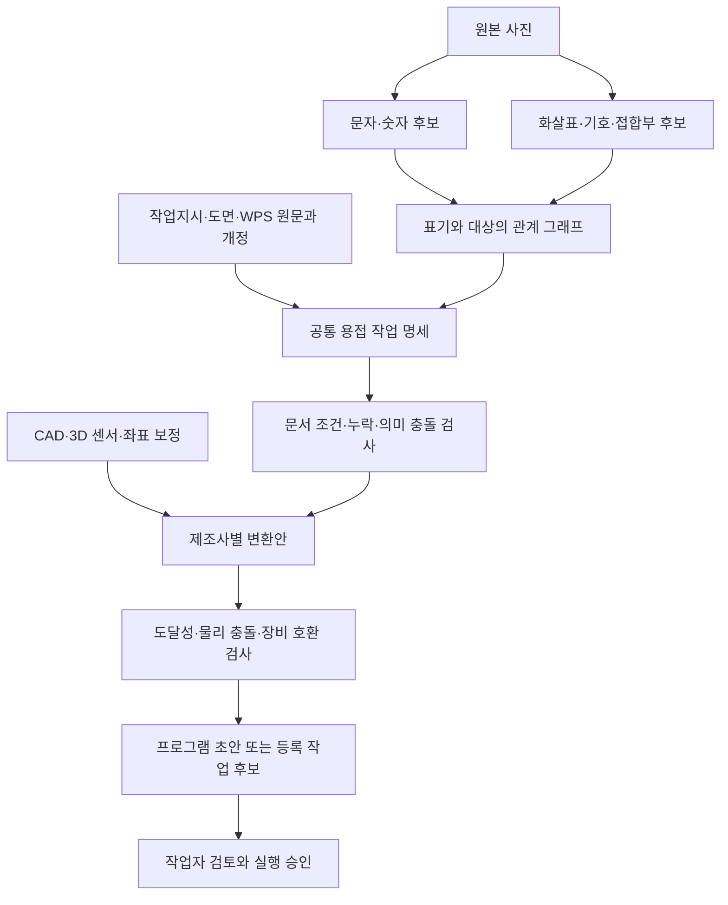

# ContextWeld 파이프라인 — 오픈 모델·공개 자료 조사 기록

작성·웹 확인일: **2026-10-09**. 문서 정합 갱신일: **2026-10-10**. 입력은 사용자가 제공한 `mermaid-diagram.png`의 파이프라인이다. 공개 자료 탐색과 당시 확장 설계를 보존한 문서이며 새 모델 추론·로봇 프로그램 실행 결과가 아니다. 아래 외부 자료의 조사일은 10월 9일이며, 정합 갱신이 외부 자료 전체의 재조회를 뜻하지 않는다.

**현재 구현은 [데모 스펙 v1.5](DEMO_SPEC.md), [OCR 구성 v1.2](../spec/OCR_PIPELINE_SPEC.md), [문서 적용 계획 v1.3](DOCUMENT_APPLICATION_PLAN.md)을 따른다.** 단일 반사·재촬영 시나리오를 실행·기록하고 로컬 관리자 화면에서 조회·재생한다. 아이디어 피칭이 목적이므로 실제 모델·문서 근거로 데모 흐름을 연결하는 것을 우선한다. 추가 사진·정량 비교·독립 평가는 선택 사항이다. 제조사 입력의 기준은 [현대·두산 입력 상세 명세](../spec/WELDING_ROBOT_INPUT_SPEC.md)다.

| 이 조사 문서의 내용 | 현재 기준에서의 역할 |
|---|---|
| §1 전체 흐름·§6 좌표/실기 확장 | 원래 아이디어의 확장 배경. 실제 용접 경로·프로그램 실행은 현재 데모 범위 밖 |
| §2 모델 목록 | 10월 9일 조사 후보. 현재 초기 구성은 PP-OCRv6 medium + Qwen3-VL-8B이며, revision·성능·자원은 검증 전 |
| §4 공개 문서·§5 PCC 사례 | 적재 후보와 별도 문서·관계·충돌 검증 사례. 현재 시뮬레이션의 확정 주 시나리오가 아님 |
| §7 검증 순서 | 당시 조사에서 제안한 작은 시험 단위. 현재 실행 순서는 데모 스펙·OCR 구성·문서 적용 계획·마일스톤을 따름 |

문서 적재·RAG 구현, 인식 품질 확보, 최종 모델 채택이 이 조사만으로 완료된 것은 아니다.

## 1. 최초 파이프라인의 확장 설계 — 현재 데모보다 넓은 범위

**[추론] OCR, 기호 검출, 관계 해석, 문서 추출, 규칙 검증, 로봇 변환을 나누는 구성이 적합하다.** 공개 모델 각각의 출력이 문자·영역·마스크·문서 구조에 한정되므로, 하나의 모델이 사진부터 실행 가능한 용접 프로그램까지 책임지도록 구성하지 않는다.

| 제공된 단계 | 입력 → 보존할 출력 | 적용 방법 | 다음 단계에 넘기기 전 확인 |
|---|---|---|---|
| 원본 사진 | 원본 → 이미지 ID·해시·해상도·촬영 맥락 | 원본 보존, crop·회전본은 파생물로 관리 | 회전·crop 좌표를 원본으로 역변환 |
| 문자·숫자 인식 | 사진 → 문자열 후보·polygon·인식기·점수 | OCR, 필요 시 VLM 보조 판독 | `O/0`, `I/1`, 소수점, 단위, 부재번호 전체 일치 |
| 화살표·기호·접합부 검출 | 사진/도면 → 객체·선분·화살촉·접합부 후보 | 검출기·분할기·기하 처리 | 화살표 box만으로 방향·대상을 확정하지 않음 |
| 표기와 대상의 관계 해석 | 객체 → `표기→leader→접합부→부재` 그래프 | 기하 규칙, 도면 메타데이터, VLM 후보 설명 | 근접한 것과 연결된 것 구별, 복수 후보 보존 |
| 작업지시·도면·WPS | 원문 → 문서 ID·개정·유효기간·표 행·출처 위치 | PDF 구조 추출, 정확 ID 조회, 필요한 근거 검색 | 최신 취소/보류와 개정 충돌, 표의 행·열 대응 |
| 공통 용접 작업 명세 | 관측+문서 → 제조사 독립 작업 객체 | 정해진 스키마로 결합 | 실제 관측·문서 값·합성 값·미확인 값 구분 |
| 조건·누락·충돌 검증 | 작업 객체 → 오류·보류 사유 | 단위·범위·공정·재질·두께·자세·개정 규칙 | 서로 다른 WPS의 숫자를 섞지 않음 |
| CAD·3D 센서·좌표 보정 | CAD/점군/보정 → 좌표계·경로·자세·오차 | CAD 엔티티, 캘리브레이션, 정합 | 사진 픽셀 좌표를 로봇 mm 좌표로 간주하지 않음 |
| 제조사별 변환 | 검증된 명세+장비 프로파일 → 변환안 | 두산 DRL / 현대 Hi6 템플릿·등록 조건 매핑 | 제어기·버전·용접기·지원 옵션·단위 |
| 로봇 프로그램 또는 등록 작업 선택 | 변환안 → 검토용 프로그램/등록 작업 후보 | 장비별 검증, 작업자 확인 이력 | 후보 선택과 실행 승인을 별도 상태로 관리 |

첨부도에서 `조건·누락·충돌 검증`은 **문서·의미 충돌**을 먼저 검사하는 단계로 해석한다. **[추론] 로봇의 물리적 충돌·도달성 검사는 CAD/좌표 보정과 제조사 변환 뒤에 한 번 더 필요하다.** 로봇 형상, 토치, 지그, 주변 물체, 경로가 있어야 검사할 수 있기 때문이다. [MoveIt Planning Scene](https://moveit.picknik.ai/main/doc/examples/planning_scene/planning_scene_tutorial.html)



위 도식은 10월 9일 첨부 파이프라인에 검증 지점을 보충한 확장 설계안이다. 현재 제품에 모두 구현됐다는 뜻이 아니며, 현재 데모의 재촬영·작업자 수정/명시적 재검토·모의 전달 흐름을 대신하지 않는다. CAD·3D 보정과 실제 용접 경로의 충돌 검사는 현재 데모 밖의 후속 범위다. 시뮬레이터 카메라 팔의 이동은 데모 스펙에 따라 별도로 구현한다.

## 2. 모델과 오픈소스를 고르는 기준

`오픈 코드`, `다운로드 가능한 가중치`, `공개 열람 문서`, `재배포 가능한 데이터`는 서로 다르다. 아래 라이선스는 조사 시점의 저장소·모델 카드 표기이며, 실제 도입 시에는 선택한 버전과 가중치의 라이선스도 함께 고정한다.

### 2.1 단계별 후보

아래 목록은 **10월 9일 조사 후보**이며 이 프로젝트에서 측정한 우열이 아니다. 당시 적용 우선순위는 [추론] 설계 제안이다. 현재 채택할 초기 구성과 비교 기준은 OCR 구성 문서가 우선하며, 같은 역할의 후보를 모두 동시에 넣을 필요는 없다.

| 후보·정확한 모델 ID | 역할·입출력 | 코드 / 가중치 라이선스 | 적용 범위와 한계 |
|---|---|---|---|
| **PP-OCRv6** — `PaddlePaddle/PP-OCRv6_medium_det` + `PP-OCRv6_medium_rec` | 사진 → 문자 영역·문자열·점수 | [PaddleOCR 코드](https://github.com/PaddlePaddle/PaddleOCR) Apache-2.0 / [검출](https://huggingface.co/PaddlePaddle/PP-OCRv6_medium_det)·[인식](https://huggingface.co/PaddlePaddle/PP-OCRv6_medium_rec) Apache-2.0 | 영문·숫자 부재번호의 첫 비교 후보. 공식 언어 목록은 한국어 포함으로 해석하지 않음. 현장 수기·반사·녹 성능은 [확인 필요] |
| **한국어 PP-OCRv5** — `PaddlePaddle/korean_PP-OCRv5_mobile_rec` | 검출한 crop → 한국어·영어 문자열 | PaddleOCR Apache-2.0 / [모델](https://huggingface.co/PaddlePaddle/korean_PP-OCRv5_mobile_rec) Apache-2.0 | 한국어 인식용 별도 후보. 인식기이므로 사진의 영역 검출은 따로 필요. 수기 정확도는 [확인 필요] |
| **PaddleOCR-VL-1.6** — `PaddlePaddle/PaddleOCR-VL-1.6` | 문서 페이지 → 텍스트·표·레이아웃 | PaddleOCR Apache-2.0 / [모델·사용법](https://huggingface.co/PaddlePaddle/PaddleOCR-VL-1.6) Apache-2.0 | 스캔 WPS·작업지시 후보. 전체 페이지 pipeline과 요소 인식 예제를 구분. 표 변환 후 숫자·단위·행 대응 검사 필요 |
| **Docling + Granite Docling** — `ibm-granite/granite-docling-258M` | PDF/DOCX 등 → 구조화 문서·표·JSON/Markdown | [Docling](https://github.com/docling-project/docling) MIT / [Granite](https://huggingface.co/ibm-granite/granite-docling-258M) Apache-2.0 | Docling은 문서 처리 도구, Granite는 선택 모델. 카드의 언어 표기는 English이므로 한국어는 별도 OCR 또는 위 모델과 비교. 다른 내부 모델 라이선스는 각각 확인 |
| **Qwen3-VL-4B-Instruct** — `Qwen/Qwen3-VL-4B-Instruct` | 사진+영역 ID+OCR 후보 → 관계·필드 후보 | [코드](https://github.com/QwenLM/Qwen3-VL) / [4B 모델](https://huggingface.co/Qwen/Qwen3-VL-4B-Instruct), 모두 Apache-2.0 | 이미지 의미·관계의 보조 판독 후보. 존재하는 객체 ID 사이에서 후보를 내도록 제한. 용접기호 전문 모델은 아님. 현재 초기 구성은 [8B](https://huggingface.co/Qwen/Qwen3-VL-8B-Instruct)이며, 이 4B는 당시 조사 후보로 유지 |
| **Grounding DINO** — `IDEA-Research/grounding-dino-tiny` | 사진+영어 대상 설명 → bbox·점수 | [코드](https://github.com/IDEA-Research/GroundingDINO) / [모델](https://huggingface.co/IDEA-Research/grounding-dino-tiny), Apache-2.0 | 부재·표기 영역 탐색과 라벨 초안. 작은 화살표·가는 선은 별도 평가. head/tail·대상 연결을 출력하는 완성 모델이 아님 |
| **SAM 2.1** — `facebook/sam2.1-hiera-tiny` | 사진+점/box → mask | [코드·체크포인트 정책](https://github.com/facebookresearch/sam2#license) / [모델](https://huggingface.co/facebook/sam2.1-hiera-tiny), Apache-2.0 | 부재 영역 분할·수동 보정 도구. 문자·기호 클래스나 용접 의미를 판독하지 않음 |
| **RT-DETRv2** — `PekingU/rtdetr_v2_r18vd` | 사진/도면 → 학습한 클래스의 bbox | [코드](https://github.com/lyuwenyu/RT-DETR) / [모델](https://huggingface.co/PekingU/rtdetr_v2_r18vd), Apache-2.0 | 지원할 기호가 고정된 뒤 자체 학습 후보. **COCO 가중치 그대로는 용접기호 검출기가 아니다.** 화살촉·기호·접합부 라벨과 학습 필요 |
| **BGE-M3** — `BAAI/bge-m3` | 질문·문서 → 검색용 표현 | [FlagEmbedding](https://github.com/FlagOpen/FlagEmbedding) / [모델](https://huggingface.co/BAAI/bge-m3), MIT | 문서가 많아진 후 다국어 검색 후보. WPS ID·개정·작업범위는 exact filter를 병행. 유사도만으로 적용 문서를 결정하지 않음 |

PP-OCRv6와 PaddleOCR-VL-1.6은 조사 시점 공식 배포 페이지를 확인한 후보다. 위 모델의 macOS MPS/MLX 지원, 처리시간·메모리·한국어 수기 성능은 **[확인 필요]**다. 모델 파라미터 수나 공개 벤치마크만으로 현재 장비의 실행성을 단정하지 않는다. Docling은 공식적으로 macOS/arm64 설치 경로를 안내한다. [Docling 설치 안내](https://github.com/docling-project/docling#quickstart)

YOLO 계열을 쓸 수도 있다. 다만 [Ultralytics](https://github.com/ultralytics/ultralytics#-license)는 AGPL-3.0 및 별도 Enterprise 조건을 안내하므로 Apache/MIT 후보와 같은 이용조건으로 묶지 않는다. 실제 통합·배포 방식과 선택 가중치 조건은 별도 확인한다.

### 2.2 모델 사이를 연결할 공개 코드

| 도구 | 구현에 사용할 부분 | 직접 작성할 부분 |
|---|---|---|
| [OpenCV](https://github.com/opencv/opencv), Apache-2.0 | edge·contour·선분·기하 보정 | [HoughLinesP](https://docs.opencv.org/4.x/d9/db0/tutorial_hough_lines.html)가 주는 선분 양 끝점에서 화살촉 방향·leader 연결을 별도 판정 |
| [NetworkX](https://github.com/networkx/networkx), BSD-3-Clause | 관계 그래프 저장·탐색 | 문자→leader→접합부 관계와 대안·근거. 내장 용접 해석 기능은 없음 |
| [ezdxf](https://github.com/mozman/ezdxf), MIT | DXF TEXT/MTEXT·[LEADER](https://ezdxf.readthedocs.io/en/stable/dxfentities/leader.html)·[MLEADER](https://ezdxf.readthedocs.io/en/stable/dxfentities/mleader.html) | 블록·사용자 기호·분해된 선의 의미 대응. DXF가 있으면 원래 문자와 엔티티를 먼저 읽음 |
| [Pydantic](https://github.com/pydantic/pydantic), MIT | 타입·필수 필드·구조 검증 | 단위 정규화, 문서 적용성·개정·상충 값 검사. JSON 형식 통과는 용접조건 승인과 다름 |

**현재 초기 구성:** 사진 문자에는 PP-OCRv6 medium, 비문자 관측·관계 해석에는 Qwen3-VL-8B를 검증한다. OpenCV 등의 보조 처리와 전용 검출기 추가는 실제 오류를 보고 판단한다. 정확한 역할·관측/해석 분리·모델 고정·검증 기준은 [OCR 구성](../spec/OCR_PIPELINE_SPEC.md)에서 관리한다. 화살표·접합부 영역을 사람이 지정한 경우 그 사실을 표시한다. DINO/SAM과 RT-DETRv2는 조사 후보이며 현재 필수 구현으로 간주하지 않는다.

문서 처리에는 텍스트 PDF 직접 추출, 스캔 문서 OCR, 표의 구조화·검수를 구분한다. **현재 문서 구성은 RAG와 정확 조회를 함께 구현하는 방향**이며, 작은 자료집의 전문 제공은 비교 기준선으로만 사용한다. 현재 작업·개정·WPS 연결은 정확 조회로 제한하고, 관련 설명·조항은 근거 검색으로 찾는다. BM25·다국어 임베딩의 후보·적재 계약·검증 기준은 [문서 적용 계획](DOCUMENT_APPLICATION_PLAN.md)을 따른다. 원문 페이지·표 셀·개정이 생성 답변까지 따라오도록 구성한다.

## 3. 화살표·기호·접합부 관계는 별도 기능이다

**[추론] 아래는 10월 9일의 기하·관계 처리 제안이다.** 현재 OCR 구성의 VLM 관측·관계 후보를 검사하는 데 참고하며, 규칙 기반 그래프나 선분 추적기 전체를 별도 필수 구현으로 추가하지 않는다. 검출기의 사각형만으로는 어떤 선이 화살표의 몸통인지, 어느 접합부를 가리키는지 알 수 없다.

1. 문자 영역, 화살촉, leader 선, 기준선, 용접기호, 부재, 접합부를 서로 다른 객체로 보존한다.
2. 선분의 연결성과 화살촉의 끝점을 사용해 leader를 추적한다. 선이 교차하면 교차점에서 임의로 다른 선으로 갈아타지 않는다.
3. 화살촉 끝과 접합부 사이의 거리·접촉·가림 상태로 대상 후보를 만든다. 단순히 가장 가까운 글자를 연결하지 않는다.
4. 기호의 종류·기준선의 어느 쪽인지·치수·길이·피치·꼬리 문구를 각각 추출한다.
5. 문서에 명시된 표준·표기 체계와 기업 사전을 적용한다. 표준이 없으면 해석을 보류한다.
6. 관계마다 원본 좌표와 근거 객체 ID를 남기고, 사람이 수정한 관계는 모델 관측과 분리한다.

용접기호의 화살표는 대상 이음을 지시한다. 그 방향을 곧바로 로봇의 용접 진행 방향으로 사용하지 않는다. 또한 ISO 2553에는 단일/이중 기준선 체계가 있으므로 “ISO면 항상 점선”으로 구현하지 않는다. [TWI 용접기호 해설](https://www.twi-global.com/technical-knowledge/job-knowledge/weld-symbols), [ISO 2553:2019 공식 개요](https://www.iso.org/standard/72740.html)

관계 객체의 최소 설계 예시는 다음과 같다. 아래 ID와 값은 **직접 작성한 설명용 예시**다.

```json
{
  "relation_id": "REL-DEMO-01",
  "text_id": "TXT-DEMO-01",
  "leader_id": "LEADER-DEMO-01",
  "arrow_tip_id": "TIP-DEMO-01",
  "target_joint_candidates": ["J-DEMO-01", "J-DEMO-02"],
  "selected_joint_id": null,
  "symbol_standard": null,
  "travel_direction": null,
  "status": "needs_review",
  "reason": "화살촉 주변에 접합부 후보가 두 개 있음"
}
```

## 4. 작업지시·도면·WPS 참고 소스

### 4.1 문서별 역할

| 문서 | 파이프라인에서 답해야 할 질문 |
|---|---|
| 작업지시/작업순서 | 어떤 부재·이음의 작업을 언제, 어떤 개정으로 수행할 것인가? |
| 도면 | 어느 위치·형상·치수·용접기호가 적용되는가? |
| WPS | 어떤 공정·재질·두께·자세·소모재·조건 범위가 적용되는가? |
| WPDS | CWB 등의 체계에서 구체 이음·패스별 절차 데이터를 어떻게 기록하는가? |
| PQR | 해당 절차를 인정하기 위해 어떤 시험·결과를 기록했는가? |
| WTS/Tracking/Checklist | 작업별 상세기법·추적·검사·확인을 어떻게 연결하는가? |

WPS, WPDS, PQR, 빈 양식을 동일한 “용접조건 정답 문서”로 취급하지 않는다. [TWI WPS 설명](https://www.twi-global.com/technical-knowledge/job-knowledge/welding-procedure-039), [CWB 작성 안내](https://www.cwbgroup.org/document/id/119E)

### 4.2 바로 참고할 소스

| 소스·직접 링크 | 얻을 수 있는 것 | 접근 확인·활용과 한계 |
|---|---|---|
| **[PCC WLD152 교육자료](https://spot.pcc.edu/welding/PDFs/152%20TP%2013.pdf)** | 사진·작업순서·WPS·상세 도면이 있는 32쪽 교육팩. §5의 별도 문서 검증 사례 | PDF 다운로드와 해당 페이지 시각 검수. 2013 교육자료이며 현행 기업 작업·로봇 승인 자료는 아님. 재배포 라이선스 [확인 필요] |
| **[CWB Form119E](https://www.cwbgroup.org/document/id/119E)** | 절차 작성 안내, 마지막 PDF 27쪽/인쇄 24쪽에 GMAW-2F WPDS·T형 이음 그림·조건표 | 27쪽 PDF와 표 시각 검수. 표지 2019-1, 예시 rev0/2008. SAMPLE·Semi-Auto·빈 승인란. 참조 GMAW-1 전문은 이 파일에서 확보하지 못함 |
| [CWB 빈 WPDS](https://www.cwbgroup.org/document/guide/sample-welding-procedure-data-sheet) | 이음 스케치·패스·전류·전압·속도 등 입력 구조 | 공개 PDF 열람. 값을 채우는 양식이며 승인조건 예시가 아님 |
| **[LANL WTS](https://engstandards.lanl.gov/esm/welding/vol4/4-01-Att-1-R1.pdf)** | Work Order, Drawing, WPS/PQR, 특별지시, 패스별 조건, 승인 필드 | 공개 PDF 확인. 작업지시를 직접 작성할 때 가장 가까운 구조 참고. 실제 완료된 생산 작업지시는 아님 |
| [LANL Weld Tracking Chart](https://engstandards.lanl.gov/esm/welding/vol1/GWS%201-02-Att.1R2.pdf) | 프로젝트·작업·도면·용접부·WPS·검사 추적 | 공개 PDF 확인. 문서 연결/이력 스키마 참고용 빈 양식 |
| [LANL Welding Checklist](https://engstandards.lanl.gov/esm/welding/vol1/GWS%201-03-Att-7-R3.pdf) | 작업ID·도면·WPS·검사·hold point | 공개 PDF 확인. 검증 단계의 누락 목록 설계 |
| **[LANL GMAW 3003-xxxx-1](https://engstandards.lanl.gov/esm/welding/welding_specs/3003-xxxx-1.pdf)** | 기입된 2쪽 WPS, 재료·가스·패스별 범위·PQR 참조 | 다운로드·양쪽 페이지 시각 검수. rev1/2006-10-03, Semi-automatic. 빈 셀/0을 자동 상속하지 않음 |
| **[LANL FCAW 3501-xxxx-1](https://engstandards.lanl.gov/esm/welding/welding_specs/3501-xxxx-1.pdf)** | 기입된 WPS, 패스별 범위와 열입력 상한 | 다운로드·양쪽 페이지 시각 검수. rev1/2005-01-21. 개별 변수 범위뿐 아니라 조합 제약 검사에 적합 |
| [LANL Joint Design 부록](https://engstandards.lanl.gov/esm/welding/vol1/GWS%201-06-Att.1-R1.pdf) | 이음 단면·형상 예제, 28쪽 | PDF 확인. 특정 부재의 제작도는 아님 |
| [LANL CAD Symbols](https://engstandards.lanl.gov/DM_symbols.shtml) | arrow-side/both-side fillet 등 DWG 기호 목록 | 목록·DWG 링크 확인. 개별 DWG 렌더·내용 추출은 [확인 필요] |
| [AWS 무료 양식](https://www.aws.org/standards-and-publications/free-resources/) | 규격별 WPS·PQR 등 양식 | 공식 목록 확인. 무료 양식과 무료 승인 조건집은 다름 |
| [TWI 용접기호](https://www.twi-global.com/technical-knowledge/job-knowledge/weld-symbols) | leader·기준선·보조기호·치수 이해 | 공식 해설 확인. 기업 수기 약어나 최신 표준 전문의 대체물은 아님 |
| [한국선급 2026 규칙](https://www.krs.co.kr/KRRules/KRRules2026/KRRulesK.html) | 제2편 재료 및 용접 등 국문 기준 | 기존 [출처 조사](../sources/SOURCES.md)의 후보. 적용 규칙·회보와 실제 승인 WPS는 별도. 이번 조사에서는 개별 조항을 검수하지 않음 |
| [KOBELCO 조선용 재료표](https://www.kobelco-welding.jp/products/recommended-materials/index.html) | 부위·이음·자세·공정·용접재료 대응 | 기존 출처 조사의 보조 후보. 제조사 권장표를 대상 현장의 승인조건으로 바꾸지 않음 |

CWB는 문서에 저작권 보유를 표시하고 LANL도 사이트에 권리 고지를 둔다. 따라서 **공개 열람 가능**과 **자유 재배포·학습 허용**을 구분한다. 이번 산출물은 링크와 필요한 사실 요약만 포함하며 원문 PDF·그림을 묶어 재배포하지 않는다. ISO/AWS 표준 전문을 무료 공개 데이터셋으로 간주하지 않는다.

### 4.3 사진·기호 인식 데이터와 코드

| 소스 | 적용할 부분 | 조건·한계 |
|---|---|---|
| **[Steel OCR 원본](https://huggingface.co/datasets/iput-tk230215/steel-ocr-dataset)** / [960px판](https://huggingface.co/datasets/iput-tk230215/steel-ocr-dataset-960) | 철골 손글씨 제품코드의 문자·영역 인식 | 카드 MIT 표기. 기존 로컬 manifest에는 별도 LICENSE 파일 미확인 기록. 용접기호·작업지시·WPS 연결 정답은 없음 |
| [MPSC / SynthMPSC](https://github.com/TongkunGuan/RFN/blob/main/IndustrialTextDataset.md) | 금속 표면의 산업 문자 검출·인식 | CC BY-NC 4.0 및 연구 이용 안내. 실제 파일 확보·행사 이용/재배포 조건 [확인 필요] |
| [weldCalloutIdentifier](https://github.com/RylanBosquez/weldCalloutIdentifier) | 도면 용접기호 검출 코드·예시 | 기존 조사에서 CC0 표기 확인. 학습 데이터·가중치·실행성 [확인 필요]. YOLO 의존성 조건도 별도로 확인 |
| 자체 관계 라벨 | 화살촉 head/tail, leader, arrow→joint, 기호→치수 | [추론] 이 파이프라인에 직접 필요한 자료. box만 있는 기호 데이터로 관계 정답을 대신할 수 없음 |

[추론] 현장 수기 부재번호는 Steel OCR, 문서·그림의 관계와 조건 추출은 PCC/CWB로 나눠 시험하는 것이 적합하다. 서로 다른 출처의 사진과 WPS를 실제 동일 부재의 기록처럼 연결하지 않는다. 공개 열람 교육 묶음은 찾았지만, 생산현장 사진부터 승인된 로봇 프로그램까지 추적되는 **오픈 라이선스 완결 데이터셋은 이번 조사에서 확보하지 못했다.**

## 5. 공개 자료 기반 별도 검증 사례 — 현재 시뮬레이션 주 시나리오 아님

### 5.1 검증 사례: 교육 시험편의 표기를 읽고 작업·도면·WPS 후보를 복원한다

**[추론] 10월 9일 제안한 PCC WLD152의 Project #5 사례는 문서·관계·충돌 검증용으로 보존한다.** 현재 반사·재촬영 장면의 마킹·정답·WPS를 이 사례로 확정한 것은 아니다. [원문 PDF](https://spot.pcc.edu/welding/PDFs/152%20TP%2013.pdf) 24–26쪽을 다운로드·렌더링하여 시각 확인했다. 자료의 연도·이용조건은 §4.2에 정리했다.

| 실제 공개 자료 | 원문 위치 | 파이프라인 입력 |
|---|---|---|
| `PCC GMAW-01`, Rev Original | PDF/인쇄 24쪽 | WPS 후보 |
| Project #5의 용접 순서와 분필 `2G` 시험편 사진 | 25쪽 | 작업순서·사진 |
| `WLD152-05` 도면 | 26쪽 | 치수·이음·용접기호·조건 |

**[추론]** 페이지 인접성·내용 일치가 연결 근거다. 도면의 명시적 WPS ID 참조는 **[확인 필요]**이므로 확정 연결로 처리하지 않는다. 사진에는 이미 비드가 있고, `2G`는 자세 표기다. 따라서 새 용접 경로나 고유 부재번호로 해석하지 않는다.

### 5.2 원문에서 가져올 최소 정보

| 항목 | WPS 24쪽 | 도면·작업순서 25–26쪽 |
|---|---|---|
| 공정·방식 | GMAW, Semi Automatic, Spray Transfer | Spray Arc, 2G 과제 |
| 모재·이음 | A36, 3/8 inch, 45° Single V, backing | Mild Steel, 같은 두께·개선 형상 |
| 용가재·직경 | 원문 `E70S-6`, 0.035 inch | 도면 `ER70S-6`, 0.035 inch |
| 전류·전압 | 220–320 A, 24–29 V | 24–30 V; 전류 직접값 없음 |
| 속도 | travel 4–6 IPM | WFS 380–440 IPM |
| 가스 | Ar/O₂ 98/2, 45 cfh | 같은 조성·유량 |
| 작업 단계 | multipass | root → fill → cover |

출처: 위 PCC 원문 24–26쪽. **전압 상한과 용가재 표기를 원문 그대로 남긴다.** 오탈자처럼 보여도 임의로 정정하거나 두 범위를 합집합/교집합으로 확정하지 않는다. 표의 사실 요약과 아래 시연 설계를 구분한다.

### 5.3 직접 작성할 작업지시

공개 자료에 없는 생산 작업 ID·부재 ID·유효기간·승인 이력은 만들었다고 표시해야 한다. 아래는 **직접 작성한 시연 입력 설계**이며 현재 CLI의 입력 규약과 같다는 뜻은 아니다. 시연 시작 시 사용자가 이 교육과제를 선택했다는 맥락을 제공한다.

```json
{
  "source_kind": "synthetic_demo",
  "work_order_id": "WO-DEMO-PCC-005",
  "revision": 1,
  "status": "active",
  "project_id": "DEMO-PCC-WLD152",
  "task_context": "Project #5",
  "task_context_origin": "manual_demo_selection",
  "part_instance_id": null,
  "joint_id": "J-DEMO-005",
  "document_bundle_ref": "PCC-PROJECT5-BUNDLE",
  "document_link_status": "inferred_needs_review",
  "target_process_mode": "robotic",
  "execution_authorized": false
}
```

`active`는 시연 내부 상태다. 사진의 `2G`를 읽었다는 이유로 `part_instance_id`에 임의의 번호를 채우지 않는다. 자료가 제공하지 않는 단일 부재 식별·현장 개정·실행 승인은 비워 둔다.

### 5.4 파이프라인을 통과할 때의 화면·출력

아래는 **기대 출력과 판정 설계**다. 이번 조사에서 모델을 실행해 얻은 출력은 아니다.

| 단계 | 보여줄 입력·출력 | 처리와 보류 지점 |
|---|---|---|
| ① 원본 | §5.1 사진 crop과 출처 페이지 | 원본 해시·crop 좌표 보존. 교육자료의 사진임을 표시 |
| ② 문자 인식 | 분필 문자 후보와 영역 overlay | 실제 추론 후 결과를 채움. 예상 문자열을 모델 입력에 주입하지 않음 |
| ③ 기호·접합부 검출 | 사진의 영역 후보, 도면의 leader·기호·치수선 | 사진과 도면을 별도 입력으로 처리. 사진에 없는 화살표를 검출한 것처럼 만들지 않음 |
| ④ 관계 해석 | 문자→자세 후보, 도면기호→V형 이음, 치수→대상 | 치수 화살표와 용접 leader를 구별. 사진-도면 간 픽셀 정합을 얻었다고 주장하지 않음 |
| ⑤ 문서 결합 | §5.1의 문서 묶음 | 후보 연결과 확정 연결의 상태를 구분 |
| ⑥ 공통 명세 | 공정·자세·모재·이음·범위·단위·문서별 근거 | 충돌하는 값은 후보 배열로 남기고 승인된 설정값은 `null` |
| ⑦ 조건 검증 | §5.2의 상충 항목, 작업방식·승인 검사 | 승인 서명·날짜가 빈칸이며 자동화 적용도 미확인. 실행 보류 |
| ⑧ CAD·좌표 | 도면 치수와 좌표계 상태 | 2D 치수가 있어도 실제 TCP·토치 자세·`T_base_part`가 없으므로 로봇 경로 미확정 |
| ⑨ 제조사 변환 | 두산·현대 입력 필드의 매핑 미리보기 | 단위 변환과 누락 항목을 보여줌. 보류 상태를 해제하지 않음 |
| ⑩ 최종 결과 | 문서/등록 작업 후보와 검토 사유 | `candidate_only`, `execution_authorized=false`. 원문까지 되짚어 확인 가능 |

이 별도 검증 사례는 **자료를 읽고 연결한 뒤, 확정을 막는 구체적인 이유를 보여주는 것**을 목적으로 한다. 현재 데모의 정상 성공 분기는 검증된 파라미터의 모의 수신까지이며 실제 셀 보정을 요구하지 않는다. 실제 로봇 실행으로 확장하는 경우에만 자동화용 승인 절차·등록 작업·셀 보정을 추가로 확보해야 한다.

### 5.5 공통 용접 작업 명세의 기대 형태

아래는 **충돌 검사용 공통 명세의 일부**다. 모델 출력 저장 파일이 아니다. `FIELD-*`는 §5.2의 추출 필드를 가리키는 시연용 참조다. 단위를 정규화해도 원문값·단위·출처는 보존한다.

```json
{
  "joint_id": "J-DEMO-005",
  "observed_part_id": null,
  "voltage_source_refs": ["FIELD-WPS-VOLTAGE", "FIELD-DRAWING-VOLTAGE"],
  "filler_source_refs": ["FIELD-WPS-FILLER", "FIELD-DRAWING-FILLER"],
  "travel_speed_source_ref": "FIELD-WPS-TRAVEL",
  "wire_feed_speed_source_ref": "FIELD-DRAWING-WFS",
  "approved_setpoints": null,
  "robot_base_transform": null,
  "status": "needs_review",
  "execution_authorized": false
}
```

단위 계산은 `inch × 25.4 = mm`, 이동속도 `mm/min ÷ 60 = mm/s`다. §5.2의 이동속도 환산 결과는 약 1.69333–2.54 mm/s, 송급속도는 9.652–11.176 m/min이다. 같은 `IPM` 표기여도 travel과 wire feed는 **서로 다른 물리량**으로 저장한다. 범위의 중간값을 자동으로 설정값으로 채우지 않는다.

| 공통 항목 | 두산 아날로그 미리보기 | 현대 Hi6 미리보기 |
|---|---|---|
| 이동속도 범위 | `vel_target`에 들어갈 후보의 단위는 mm/s | `arccond spd`를 쓴다면 cm/min로 변환; 이 예제 범위는 10.16–15.24 |
| 송급속도 | `f_target` 후보 단위 m/min | EWM의 송급 지령 등 해당 용접기 프로파일과 연결 |
| 전압 | `v_target` 후보. 문서 충돌 해결 전 설정 미확정 | 절대 V/VP/%/아크길이 보정 중 장비별 지령 종류 확인 |
| 전류 | WPS 범위를 보존하되 `f_target`에 전류를 넣지 않음 | A 지령을 받는 모드일 때만 해당 전류 필드로 연결 |
| 패스·위빙 | 패스별 경로와 위빙 수치 미확인 | 시작·종료·위빙/WDB 조건번호 미확인 |
| 출력 | 가상 등록 작업 `DOOSAN_DEMO_PCC005` 후보 | 가상 등록 작업 `HYUNDAI_DEMO_PCC005` 후보 |

두 등록명은 직접 만든 예시다. 실제 로봇에 존재하거나 실행 가능한 프로그램이 아니다. 자세한 매핑은 [제조사 입력 상세 명세](../spec/WELDING_ROBOT_INPUT_SPEC.md)에 있다.

### 5.6 같은 시나리오에서 확인할 분기

| 입력·상황 | 기대 판정 | 보여주는 기능 |
|---|---|---|
| 문서에 실제로 존재하는 두 전압 범위 | `source_conflict`와 양쪽 원문 표시 | 상충 근거 보존 |
| 도면만 보고 29.5 V를 선택한 가상 요청 | WPS 후보 범위 밖임을 표시 | 복수 문서 조건 대조 |
| 사진의 `2G`를 부재번호로 조회하려는 요청 | 자세 표기 후보이며 고유 부재 ID 부족 | 문자와 의미의 분리 |
| 작업지시 최신 개정을 cancelled로 바꾼 가상 입력 | 이전 active를 되살리지 않음 | 개정·상태 검증 |
| 같은 leader 주변의 대상 후보를 두 개로 만든 입력 | 임의 연결 대신 후보·보류 표시 | 관계 모호성 처리 |
| 교정된 문서만 주고 실제 좌표는 주지 않음 | 문서 충돌 해소와 별개로 좌표 누락 유지 | 검증 단계의 독립성 |

실제 공개 사진의 문자 인식 평가는 별도로 Steel OCR을 사용한다. PCC 교육사진 몇 장의 성공을 현장 인식 정확도로 일반화하지 않고, 서로 다른 자료를 같은 부재 기록처럼 연결하지 않는다.

## 6. 실제 좌표·용접 경로까지 확장할 때 — 현재 데모 범위 밖

| 도구 | 담당 역할 | 필요한 입력과 한계 | 공식 소스 |
|---|---|---|---|
| OpenCV ArUco / `solvePnP` | 알려진 크기의 기준물과 카메라 사이 pose 추정 | 카메라 내부 파라미터·왜곡계수·기준물 크기 필요. 이것만으로 robot base까지 보정되지 않음 | [공식 튜토리얼](https://docs.opencv.org/4.x/d5/dae/tutorial_aruco_detection.html) |
| Open3D | CAD에서 얻은 점군과 센서 점군 정합, ICP 등 | 초기 정렬·겹치는 형상·점군 품질 필요. 정합 결과의 오차와 실패 검사를 별도로 둠 | [코드, MIT](https://github.com/isl-org/Open3D), [ICP](https://www.open3d.org/docs/release/tutorial/pipelines/icp_registration.html) |
| Open CASCADE | STEP 등 CAD 형상과 면·모서리 처리 | CAD의 모서리가 실제 용접 대상이라는 의미는 별도 작업 명세에서 부여 | [OCCT](https://github.com/Open-Cascade-SAS/OCCT); LGPL-2.1 및 예외 조항은 저장소 확인 |
| MoveIt 2 | 로봇 기구학·도달성·자기/환경 충돌 검토 | URDF/SRDF, 실제 토치·지그·환경·관절 상태 필요. 용접조건 승인 기능은 아님 | [코드](https://github.com/moveit/moveit2), [Planning Scene](https://moveit.picknik.ai/main/doc/examples/planning_scene/planning_scene_tutorial.html) |
| 제조사 템플릿·장비 프로파일 | 공통 작업을 DRL·Hi6 조건/작업에 대응 | 제어기 버전과 용접기 인터페이스별 매핑 필요 | [제조사 입력 상세 명세](../spec/WELDING_ROBOT_INPUT_SPEC.md) |

**현재 시연의 마지막 출력은 데모 스펙에서 정한 파라미터 생성·모의 수신이다.** 위 도구는 향후 실제 용접 경로를 생성할 때의 조사 후보이며, 현재 데모를 완료하기 위한 설치 목록이 아니다. 실제 등록 작업을 선택·실행하는 경우에는 해당 셀·지그·개정, TCP·토치 자세·접근/이탈 경로를 별도로 확인해야 한다.

좌표 체계에는 최소한 `image_px`, `drawing_mm`, `part_frame`, `camera_frame`, `robot_base`, `tcp_frame`을 구별한다. `T_base_part` 같은 변환은 보정 ID·측정일·오차와 함께 관리한다. 사진의 화살촉은 대상 식별 근거이며 경로의 시작점 좌표와 같지 않다.

## 7. 당시 조사에서 제안한 검증 단위

아래 표는 조사 후보를 시험할 때의 참고 순서다. 현재 데모의 필수·선택 범위와 실행 순서는 [데모 스펙](DEMO_SPEC.md), [OCR 구성](../spec/OCR_PIPELINE_SPEC.md), [문서 적용 계획](DOCUMENT_APPLICATION_PLAN.md), [마일스톤](MILESTONES.md)을 따른다. 특히 6번의 실기 검토는 현재 데모 완료 조건에 포함하지 않는다.

| 순서 | 작은 검증 단위 | 기록할 결과 |
|---|---|---|
| 1 | §5 검증 사례의 공개 문서 한 묶음에서 문자·표·그림 추출 | 숫자·단위·행 대응, 원문 페이지, 누락 |
| 2 | 지원 기호를 한정한 도면 관계 해석 | 기호 분류와 `표기→접합부` 연결 정답을 따로 채점 |
| 3 | 같은 작업의 정상/모호/충돌/좌표누락 분기 | 임의 확정 여부, 보류 이유, 출처 유지 |
| 4 | 실제 Steel OCR 사진에서 OCR·VLM 비교 | 문자 CER와 식별자 완전 일치, 후보 누락, 처리시간 |
| 5 | 두산·현대 변환안 비교 | 필드/단위 대응, 지원하지 않는 값, 필요한 등록 조건 |
| 6 | 실제 장비 정보를 받은 뒤 좌표·경로 검토 | 보정 오차, 도달성, 충돌, 장비별 dry run 결과 |

현재 저장소의 [기존 인식 실험](../../experiments/REPORT-2026-10-09.md)은 공개 사진 10장 중 채점 대상 9장·28개 표기에서 전체 이미지 인식의 최고 완전 일치가 1/28이었다. 따라서 새 모델을 적용하면 해결된다고 가정하지 않는다. 기존 10장은 개발 표본으로 유지하고 새 촬영 묶음에서 검증한다.

이번 문서에서 제안한 모델·시나리오의 성능은 **미측정**이다. 문서에 나타난 예시 출력과 합성 작업지시는 실제 모델 출력·실제 현장 작업·실행 승인으로 사용하지 않는다.
