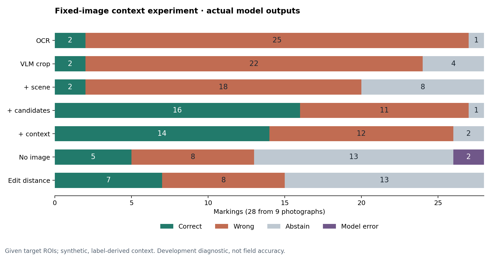

# CTX-001 실행 결과: 후보 목록은 도움이 됐고, 문서 추가는 개선되지 않았다

실행일: 2026-10-10. Runpod `9451321` 기반의 새 실험 코드로 기존 Steel OCR 사진을 다시 추론했다. 과거 서버 이전 실험 성적은 사용하지 않았다. [고정 프로토콜](PROTOCOL.md), [전체 표와 개별 판정](results/tables.md), [채점 JSON](results/summary.json)을 함께 보관한다.

**공개 사진 9장의 대상 표기 28개에서 OCR 단독 2개, 이미지·후보 목록 조건 16개, 여기에 합성 작업 문서를 추가한 조건 14개가 정답이었다.** OCR 오독을 부재 후보로 복구하는 사례는 확인했다. 그러나 문서 추가의 순효과는 -2개였고, 정답 없는 목록 4개 중 3개에서 오답을 확정했다. 현재 결과로 ‘문맥을 많이 주면 정확하고 안전해진다’고 말할 수 없다.

이 숫자는 **위치가 주어진 표기의 소규모 개발 진단**이다. 실제 현장 정확도, 자동 검출 성능, Isaac 장면 판독 성능, 전체 서비스 성공률이 아니다.

## 무엇을 비교했나

모든 VLM 호출은 같은 Qwen3-VL-8B와 같은 OCR 원문을 사용한 별도 대화다. 이전 조건의 VLM 답을 다음 조건에 넘기지 않았다. C 이후에는 동일 crop과 전체 이미지를 함께 제공했다. D/E의 후보 목록과 순서는 같다.

| 조건 | 추가한 정보 | 문자 완전 일치 | 올바른 확정 | 잘못된 확정 | 보류 | 형식 오류 | 사진별 평균 정답률 |
|---|---|---:|---:|---:|---:|---:|---:|
| A | 대상 crop의 Paddle OCR | 2/28 | 2/28 | 25 | 1 | 0 | 22.2% |
| B | A + crop의 VLM 재판독 | 2/28 | 2/28 | 22 | 4 | 0 | 22.2% |
| C | B + 주변 전체 장면·대상 위치 | 2/28 | 2/28 | 18 | 8 | 0 | 22.2% |
| D | C + 부재 후보 ID 6개 | 9/28 | 16/28 | 11 | 1 | 0 | 44.0% |
| E | D + 합성 작업·배치 문서 | 10/28 | 14/28 | 12 | 2 | 0 | 41.4% |
| F | E에서 이미지 제외 | 2/28 | 5/28 | 8 | 13 | 2 | 27.6% |
| 규칙 | A + D 목록의 문자 거리 | 2/28 | 7/28 | 8 | 13 | 0 | 39.7% |

A/B/C의 확정값은 판독 문자열, D/E/F/규칙은 선택한 후보 ID다. 문자 판독과 후보 연결은 다른 출력이므로 분리해 읽어야 한다. 양끝 공백과 대소문자만 정규화했으며 `1/I`, `0/O`, 하이픈, 내부 공백을 치환하지 않았다. 대소문자까지 보존한 완전 일치 수도 이번 실행에서는 위와 같았다. A의 ‘확정’은 비어 있지 않은 OCR 출력이라는 뜻이며 근거 검토를 통과했다는 뜻이 아니다.

F에도 OCR 원문·대상 ROI 좌표·전체 이미지 크기·후보·문서는 제공했다. 순수 문서만의 성능이 아니다. 규칙은 유일한 최소 편집거리 후보가 2 이내일 때만 선택하고 동률이면 보류한다. 보류·오류도 전체 28개 분모에 포함했다.

## 어떤 정보가 결과를 바꿨나

- **A→B→C:** 완전 일치 정답은 2개로 같았다. 문자 오류율은 36.4%→27.1%→20.7%로 낮아지고 보류는 1→4→8개가 됐다. 부분 판독이 좋아진 것과 완전한 식별 성공을 구분해야 한다.
- **C→D:** 오답 9개와 보류 6개를 정답으로 바꿨지만, 기존 정답 1개를 오답으로 바꿨다. 정답 수는 2→16개다. 정답이 포함된 후보 목록을 제공한 효과가 크다.
- **D→E:** 오답 2개를 복구했고 정답 3개를 오답, 정답 1개를 보류로 바꿨다. 정답 수는 16→14개로 감소했다. 문서 추가의 평균 개선은 확인되지 않았다.
- **F→E:** 이미지가 있는 E는 14개, 없는 F는 5개가 정답이다. 이 고정 조건에서 이미지가 유용했음을 보여주지만, 독립적인 공간 추론이나 실제 작업문서 이해가 검증된 것은 아니다.
- **A→E:** 기존 정답 2개를 유지하고 OCR 오답 12개를 복구했다. 다만 이것을 문서만의 효과로 설명하면 D의 후보 목록 효과를 섞게 된다.

같은 사진의 여러 표기를 독립 사진처럼 취급하지 않기 위해 사진별 정답률 평균도 제시했다. S06의 11개와 S08의 7개가 전체의 18/28을 차지한다. 유의성이나 일반화 성능을 주장하지 않는다.

## 잘못된 맥락과 실패 사례

| 별도 스트레스 조건 | 개수 | 올바른 ID 확정 | 오답 확정 | 보류 | 명시적 conflict |
|---|---:|---:|---:|---:|---:|
| 정답 ID를 목록·문서에서 제거 | 4 | 0 | 3 | 1 | 0 |
| 정답 후보의 배치를 틀리게 제공 | 4 | 2 | 1 | 1 | 0 |

정답 없는 목록에서는 비슷한 오답을 세 번 선택했다. 잘못된 배치를 넣은 경우 최종 정답/오답/보류 분류가 정상 E와 같았지만, 명시적 문서 충돌 검출은 없었다. 유일한 보류는 `unreadable`이므로 ‘문서가 잘못됐음을 알아냈다’고 해석하지 않는다. 각 조건의 분모는 4개이며 정상 28개에 합치지 않는다.

| 사례 | 저장된 결과 | 설명할 수 있는 것 |
|---|---|---|
| S03-R00, 정답 `B1Sb30N-34` | A `BI5 3N-34`, B/C `BI5b 30N-34` → D/E에서 올바른 ID 선택 | 오독 이후 후보 기반 연결 성공. D부터 성공했으므로 E 문서의 추가 효과는 아님 |
| S01-R00, 정답 `B1Sb30N-56` | A/B/C 정답 → D에서 `BISb30N-56` 오답 → E에서 정답 ID 선택 | 후보가 정답을 망칠 수도 있음. 이 사진의 문서 위치는 전부 중립이라 E 회복을 공간 이해로 설명할 수 없음 |
| S03-R01, 정답 `B1Sb30N-12` | D/E 판독 문자열은 정답인데 선택 ID는 `BISb30N-12` | 문자 인식과 최종 후보 선택의 불일치. F와 문자열 규칙은 정답 |
| S08-R04 | D 오답 → E 정답 | 문서 추가 개선 사례도 있으나 다른 표기에서 발생한 악화와 함께 보고해야 함 |

F의 S03-R02/S04-R00은 `ambiguous`인데 후보 ID도 선택해 출력 계약을 위반했다. JSON 파싱은 가능했고 토큰 상한으로 잘린 출력도 아니었다. 재시도나 수동 수정을 하지 않고 실패 2개로 포함했다. 일부 이미지 없는 F 응답이 시각적으로 일치한다고 설명하므로, 모델이 생성한 설명을 검증된 시각 근거로 표시해서는 안 된다. 판독 문자열과 선택 ID가 다른 것 자체는 맥락 기반 복구일 수 있으므로 일괄 오류 처리하지 않았다.

## 자료와 설계의 한계

대상 ROI는 공개 라벨의 polygon에서 만들었다. 검출 실패는 이 실험에서 측정하지 않는다. 공개 전사 정답을 고정했지만 독립 전문가의 재검수는 없으며, 이미 개발에 사용했던 사진이다. 10번째 사진의 difficult 표기 1개는 실행 전에 제외했다.

후보와 작업 문서는 실제 현장 문서가 아니라 공개 라벨로 만든 합성 입력이다. 정답 후보와 `1/I` 혼동 후보는 자신의 배치 행이 같지만, **18/28 문서에서는 다른 후보의 인접 표기 참조에 정답 ID가 등장한다.** 따라서 자신의 행을 같게 만들었다고 문서에서 답을 짐작할 가능성이 제거된 것은 아니다. [입력만 검사한 설계 감사](results/design-audit.json)에 대상과 방법을 기록했다. F와 단순 규칙은 이를 진단하기 위한 대조군이며 모든 누설 가능성을 없애는 장치는 아니다.

crop·전체 이미지의 기본 화소 예산은 이미지당 최대 802,816, 최소 65,536이다. C 이후에는 이미지와 시각 토큰이 추가된다. 같은 장면 정보를 다른 입력 예산으로 제공하므로 순수한 의미 추론 효과만 분리한 비교가 아니다. 원문·모델 revision·실제 이미지 grid와 토큰 수를 실행 묶음에 남겼다.

## 실행과 보존 검증

PP-OCRv6 medium det/rec와 Qwen3-VL-8B-Instruct를 기존 고정 모델 경로에서 오프라인 실행했다. Qwen은 BF16·SDPA·greedy decoding, 출력 상한 512토큰, 새 대화와 JSON 재시도 0회다. 전체 생성은 최대 183토큰으로 잘림이 없었다. 모델 revision은 각각 `8e0f56fb2ef86b461d99cfc7ac5c137738985f61`, `e5a92bcbc5cc1b494628e458d267778f0704fd7c`, `0c351dd01ed87e9c1b53cbc748cba10e6187ff3b`다.

OCR 28회 + VLM 148회 + 규칙 28개로 204개 기록을 저장했다. 소요 916.595초(약 15.3분)이며 기존 Isaac과 GPU를 공유했으므로 단독 추론 성능 벤치마크가 아니다. 표기당 평균 OCR 0.416초, B 4.258초, C 5.377초, D 7.006초, E 8.133초다. 모델 로딩 시간은 조건별 평균에 포함하지 않으며 규칙 시간은 측정하지 않았다.

- 서버·로컬에서 완료 묶음의 574개 해시와 계획 204개를 검증했다. 원문을 직접 센 독립 감사에서도 판정 건수가 일치했다. 양쪽 채점의 개별 판정·정답 수·전이·비율이 일치하며 시간 합산의 부동소수점 끝자리 차이만 있다. [검증 기록](results/verification.json).
- 첫 추론 전 고정한 입력·정답·합성 문서·프로토콜·준비기·실행기 SHA가 실행 뒤에도 같다. 채점기는 별도 검증했으며 테스트 16개가 통과했다. 기존 제품 테스트도 로컬 83개가 통과했다.
- 기존 서버 파일 1,363개·39,887,991바이트와 기존 프로세스 5개의 명령·시작시각이 그대로다. 실험 후 Foxglove 브리지 20초 실수신에서 PNG 117개와 상태 해시 117쌍이 일치했다. 장면·카메라·송출은 바꾸지 않았다.
- 원본 실행은 `output/context-ablation-20261010/run-01/`에 서버와 로컬로 보존한다. `records/`, `raw/`, `prompts/`, `frames/`, `config.json`, `completion.json`, `checksums.json`이 포함된다. 원본 사진은 공개 Git에 넣지 않는다.

## 다음 구현 권고

1. **판독과 후보 대조, 문서 검증을 분리한다.** 판독 원문·복수 후보를 보존하고 작업/블록/개정의 정확 조회로 후보를 좁힌 뒤 문서는 선택을 덮어쓰는 설명문보다 검증 가능한 제약으로 적용한다. 문자 거리 규칙도 보조 근거로 유지한다. 이번 데이터로 선택한 방향이므로 다음 검증에서는 새 사진·사전 고정한 조건을 사용해야 한다.
2. **목록 밖·충돌·모호함에서 보류하는 분기를 먼저 보강한다.** 구조화 출력의 계약 검증, 관측과 선택 후보의 불일치 이유 확인, 문서 근거 참조 검증을 연결한다. 단순 문자열 불일치만으로 모두 차단하지 말고 복구 근거가 실제로 있는지를 확인한다. 개선 효과는 아직 측정하지 않았다.
3. **고정된 Isaac A/B 두 장을 새 입력 계약으로 연결한다.** 현재 장면을 유지하며 원본 RGB·촬영 pose·해시를 받는 어댑터부터 만들고, 합성 `BISB30N-15`·`J01`을 시연용 작업문서와 연결한다. 실제 인식→보류 또는 B 이미지 재판독→문서 검토→모의 수신 흐름을 확인한다. 예약 A/B 재생을 모델 요청에 따른 실제 팔 이동으로 표시하지 않는다.

다음 소규모 판독 비교로는 **OCR 원문을 먼저 주지 않는 독립 VLM 판독**을 권한다. 현재 B/C가 OCR 오독을 반복하는 사례가 있어 OCR 입력에 끌리는 영향을 분리하려는 가설이다. 이번 실행에는 이 조건이 없으므로 성능 개선을 확인했다고 말할 수 없다.

발표에서는 “OCR 오독 일부를 이미지와 후보 대조로 복구했지만, 문서를 추가하면 악화되는 사례도 확인했다. 그래서 근거 대조와 보류·명시적 재검토를 분리한다”는 정도가 이 실행이 뒷받침하는 설명이다.
